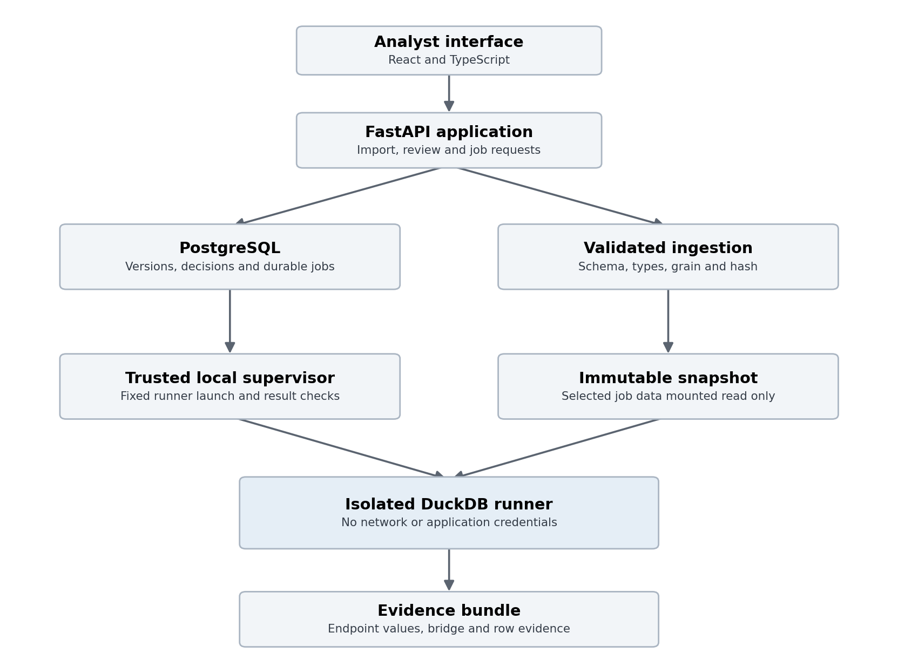

# 5 Architecture and deployment

## 5.1 Recommended stack

| Layer | Choice | Reason |
| --- | --- | --- |
| Web interface | React with TypeScript and Vite | Clear typed investigation screens without unnecessary server rendering |
| API | Python with FastAPI and Pydantic | Validation, typed contracts and a Python analytics ecosystem |
| SQL interpretation | SQLGlot with a versioned restricted IR | Structural parsing and comparison with an explicit support policy |
| Analytical execution | DuckDB in a restricted runner | Repeatable local queries against frozen analytical snapshots |
| Application records | PostgreSQL | Transactions for versions, runs, claims and decisions |
| Data and evidence files | Local managed directories initially | Cheap reproducible storage; abstraction permits object storage later |
| Data preparation | DuckDB plus PyArrow where needed | Typed CSV and Parquet ingestion without maintaining two dataframe stacks |
| Tests | pytest, property tests and Playwright | Numeric invariants, parser behavior and one complete user journey |
| Packaging | Locked Python and JavaScript dependencies with containers | Repeatability across development machines |
| AI | No required provider in the MVP | Baseline behavior is independently testable and available offline |

Pandas or Polars may be added for a specific measured need. Using both by default duplicates transformations and increases disagreement risk. PostgreSQL stores application metadata; DuckDB calculates analytical results. They have different responsibilities. Redis, Kafka, Kubernetes, a graph database and a vector database are unnecessary for the initial workload.

Select supported stable dependency versions at implementation time, verify compatibility and lock them. This plan specifies behavior rather than claiming a particular version number is the newest.

## 5.2 Component boundaries

The browser communicates only with the API. The API handles imports, context validation, pair review and job creation. PostgreSQL stores durable job and application state. A trusted local worker supervisor claims queued jobs and launches the analytical runner. The runner receives only a validated job description and the selected snapshot, calculates evidence, and returns a bounded result bundle.

Original SQL is parsed and rejected if unsupported. Only SQL regenerated from the validated IR is executed. This reduces the exposed query language but does not replace sandboxing. DuckDB's own guidance treats untrusted SQL as executable code and recommends isolation plus resource controls [S8].

The API never receives a container engine socket. The local supervisor, started by the developer, may use container privileges to launch a fixed runner image. This privilege is confined to the trusted local orchestration process; uploaded text cannot choose images, mounts, commands or flags. In a hosted pilot, replace that mechanism with a restricted job service before allowing arbitrary remote uploads.

## 5.3 Execution sequence

1. API validates version IDs, context and permissions for the local project, then inserts a queued run transactionally.
2. Supervisor claims one job with a lease and an attempt number. The initial deployment permits one analytical run at a time.
3. Supervisor prepares a job-specific directory containing an immutable snapshot copy or read-only reference and a validated JSON manifest.
4. A fixed runner container starts with no network, no application credentials, no container socket and no unrelated data mounts.
5. Runner verifies hashes and policy versions, validates the IR, opens the selected prebuilt database read-only and executes the permitted endpoints and bridge.
6. Runner writes bounded JSON and evidence files to a job-specific output directory.
7. Supervisor validates output sizes, hashes, schemas and reconciliation invariants, then commits the result pointers and terminal state.
8. API serves results and paginated evidence. The browser polls status; streaming is optional later.

Ingestion is a separate operation with its own limits. It turns an accepted flat file into an immutable analytical database before untrusted metric execution begins. Do not require external file scans from the SQL runner. A snapshot is published only after ingestion validation completes.

## 5.4 Modules and interfaces

| Module | Input | Output |
| --- | --- | --- |
| Import adapter | SQL text and source metadata | Definition draft and provenance |
| Snapshot ingester | CSV or Parquet with declared schema | Validated immutable snapshot manifest |
| Parser and binder | SQL, dialect and schema | Parsed tree or structured parse error |
| Support checker | Parsed tree and policy version | Typed IR or unsupported reasons |
| Match suggester | Names, metadata and IR features | Ranked candidates with reason fields |
| Context validator | Definition pair and run context | Comparable status and missing-context list |
| Diff engine | Two IR versions | Structured rule changes |
| Executor | Approved IR, context and snapshot | Typed endpoint values and execution diagnostics |
| Reconciler | Endpoint data and valid rule switches | Row contribution evidence and ordered bridge |
| Drift service | Definition versions and approved scope | Version event and optional fixed-data replay |
| Evidence exporter | Immutable completed or partial run | Human-readable report and machine-readable bundle |

Define these boundaries before creating UI pages. A single Python service package can own all modules initially; separating interfaces does not require separate microservices.

## 5.5 Job behavior

Lifecycle: queued, running, succeeded, partial, failed, canceled. A job stores started_at, completed_at, heartbeat_at, lease_expires_at, attempt and error_code. An expired worker lease can be reclaimed with a new attempt. Only the current lease owner can finalize that attempt. Results are written under attempt-specific temporary paths and committed atomically.

An idempotency key on run creation prevents a browser retry from creating duplicate jobs. A unique key belongs to a project and the normalized request. Reusing it with a different request returns a conflict. Cancellation sets a requested flag; the supervisor terminates the runner and records the final state. Never mark a job succeeded merely because its process exited with code zero.

A run can be partial when endpoint results exist but a bridge exceeds a limit or cannot be constructed. Endpoint execution failure makes the value comparison unavailable. Parsing and comparability errors should be resolved before queuing whenever possible.

## 5.6 Reproducibility and caching

The cache key includes both definition version hashes, the snapshot manifest hash, mapping version, context, IR policy version, engine version, decomposition method and configuration. A name or timestamp is insufficient. Changing any semantic input produces a new run identity.

Reproducibility means the same numeric results and evidence under fixed inputs. Timings, generated timestamps and unordered source record order need not be byte-identical; sort exported evidence by stable key and separate volatile metadata. Preserve decimal formatting and code-version references in the report.

Do not cache a failed or incomplete result as a full success. Cached results keep their original provenance. A new UI label or owner decision can reference an old run but cannot change the stored historical conclusion.

## 5.7 Local and hosted deployment

The recommended development environment is a laptop with approximately 16 GB RAM and Docker support, using WSL2 if building on Windows. This is a planning assumption, not a measured minimum. The web service, API and PostgreSQL can run in a local Compose setup; a documented local supervisor starts the restricted job containers. Bind development services to loopback by default.

The first shareable demonstration can be a recording or a web interface using precomputed synthetic evidence. It does not need a public SQL-execution endpoint. A private pilot with uploads requires authentication, project authorization, isolated jobs, managed secrets, retention controls and backups. Add those when moving beyond local use, without pretending the local owner labels already provide them.

Deployment is a separate decision from building the project. No deployment or external integration is required by this planning pack. A container-based backend needs an appropriate execution host; do not assume a static hosting platform can run the analytical worker.

## 5.8 Configuration and operation

Configuration includes database URL, artifact root, runner image digest, upload limit, query deadline, run deadline, worker concurrency, memory budget and log level. Keep secrets outside source control. Persist a redacted configuration fingerprint on each run.

Provide health checks for the API and database, a worker heartbeat, a run queue count and an artifact integrity check. Log structured error codes, durations and row counts without raw query text or row contents by default. Maintain a developer runbook for a stuck job, failed ingestion, invalid snapshot and replay failure.
