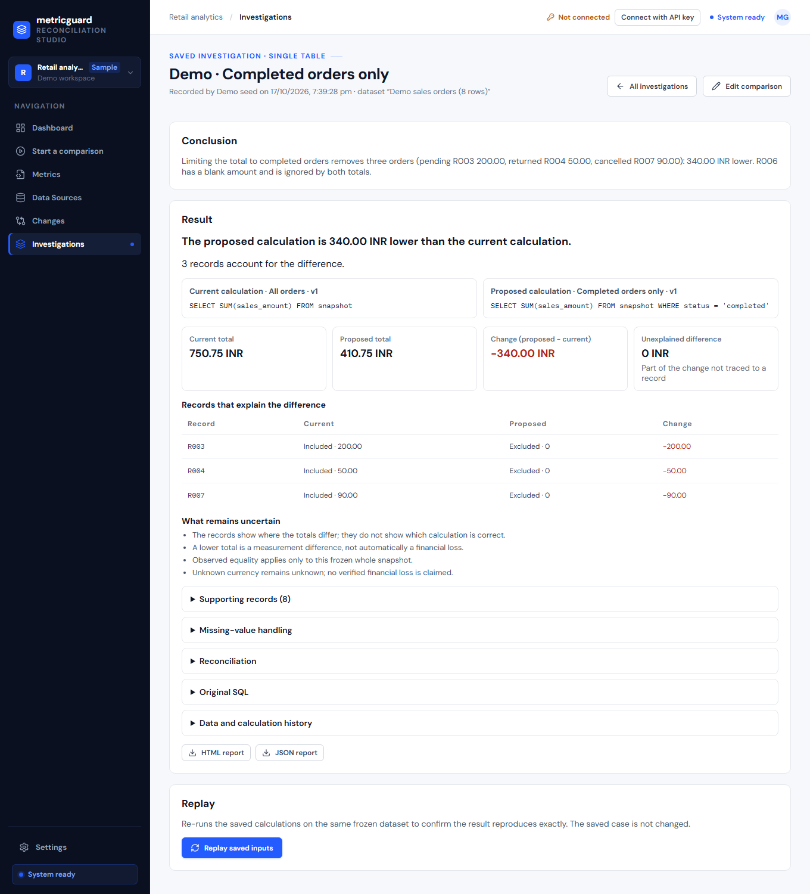

# MetricGuard

**When two versions of a metric disagree, MetricGuard shows exactly which records explain the difference.**

A finance dashboard says sales were 750.75; a proposed definition says 410.75. Which orders account for the 340.00 gap, and is anything left unexplained? MetricGuard runs both calculations on the same frozen dataset, in an isolated container, and reconciles the difference record by record. It refuses calculations it cannot evaluate exactly instead of guessing.



## Quick start (Windows)

Prerequisites: Python 3.12, Node.js 20+, and **Docker Desktop running** (it executes every calculation in a locked-down container).

```powershell
py -3.12 -m venv .venv
.\.venv\Scripts\python -m pip install -r requirements.txt
.\scripts\mg.ps1 start -Seed
```

Open <http://127.0.0.1:8000>. The first start builds the web interface and the runner image (a few minutes). `-Seed` loads two worked examples into a clean workspace stored in `data\demo-app`, separate from test data.

```powershell
.\scripts\mg.ps1 status    # what is running, health, Docker state
.\scripts\mg.ps1 stop      # stops API and engine; data is kept
```

The script refuses to start a second copy, and tells you when Docker is missing or stopped, or when port 8000 is taken (`-Port 8010` to use another).

## What to try

1. **Investigations → “Demo · Completed orders only.”** Current calculation: all orders, 750.75 INR. Proposed: completed orders only, 410.75 INR. Three records (pending, returned, cancelled) explain −340.00; nothing is unexplained. Press **Replay saved inputs** to reproduce it exactly.
2. **“Demo · North segment via join.”** Two tables joined: 65.00 → 10.00 points, and the join view shows which records were dropped because they have no matching group.
3. **Start a comparison** and build your own: choose a dataset, describe each calculation with the guided form (or the SQL editor), review the difference, save your explanation.
4. Type `SELECT AVG(sales_amount) FROM snapshot` in the SQL editor: it is **refused** with a reason, and your SQL is kept.

The [two-minute demo script](docs/demo-script.md) walks through these, plus the public Olist dataset and the GitHub pull-request check.

## How it works

```
Browser (React)  ──►  API (FastAPI)  ──►  job queue  ──►  supervisor  ──►  runner container (DuckDB, no network)
                         │                                                     │
                         └── frozen datasets, calculation versions,  ◄─────────┘  row-level evidence + hash
                             saved investigations (SQLite/PostgreSQL)
```

- **Datasets are frozen.** An upload is validated against a declared contract (row key, amount, unit, filter columns) and stored immutably with hashes.
- **Calculations are restricted SQL.** One `SUM` with bounded filters, over one table or one fact table joined to one dimension table. Anything else is refused.
- **Evidence is exact.** Every record's contribution to each total is stored; the record changes plus any unexplained difference always equal the total change. Decimals are never floating point.
- **Saved investigations replay.** A case pins the dataset, both calculations and the result; replay must reproduce it bit for bit.
- **Access** is per workspace with reader / analyst / owner roles. Sign in with an API key issued by an owner (`python -m scripts.issue_api_key`); keys are held in browser memory only.

## Limitations

- Supported: `SUM` over one table, or one fact table plus one unique dimension table, with `=`, `!=`, `IN`, comparisons, `IS [NOT] NULL` and (per dataset) `AND/OR/NOT`, one subtraction, or one `CASE WHEN`. No averages, ratios, `GROUP BY`, multiple joins or window functions.
- Up to 100,000 rows per table and 25 MiB per upload. Data preparation (cleaning, wider joins) happens before upload.
- No currency or unit conversion: a declared unit is a label the analyst confirms.
- “Explained” means every unit of the difference is traced to records; it does not mean either calculation is correct. A lower total is not automatically a loss.
- Local, single-machine deployment. Sign-in is API-key based; there is no single sign-on.
- External validation with real analyst teams has not been completed (see the release evidence).

## More detail

- [V8 closeout record](docs/v8-closeout-record.md): what this usability release verified, and what it did not
- [Demo script](docs/demo-script.md) · [Olist public-data case](docs/pilot/olist-public-case.md) · [CLI and CI usage](docs/cli-usage.md)
- [Project map](docs/project-graph.md) · [Technical README (setup details, supported grammar)](docs/technical-readme.md) · [API and input contracts](docs/contracts.md)
- Release evidence: [v1](docs/v1-release-evidence.md) · [v2](docs/v2-release-evidence.md) · [v3](docs/v3-release-evidence.md) · [v4](docs/v4-release-evidence.md) · [v5](docs/v5-release-evidence.md) · [v7](docs/v7-release-evidence.md) · [v8](docs/v8-release-evidence.md)
- [Original planning pack](MetricGuard_Planning_Pack/README.md) · [Repository working instructions](AGENTS.md)

## Tests

```powershell
.\.venv\Scripts\python -m pytest -q --basetemp .test-tmp/full
npm test --prefix apps/web
npm run build --prefix apps/web
```
