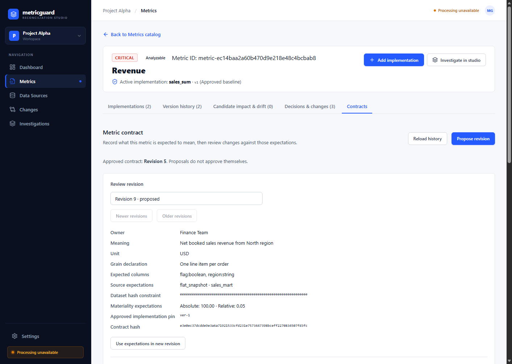
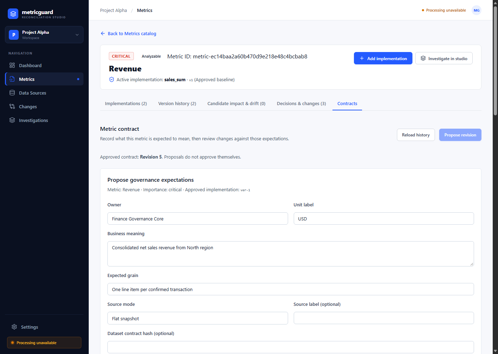
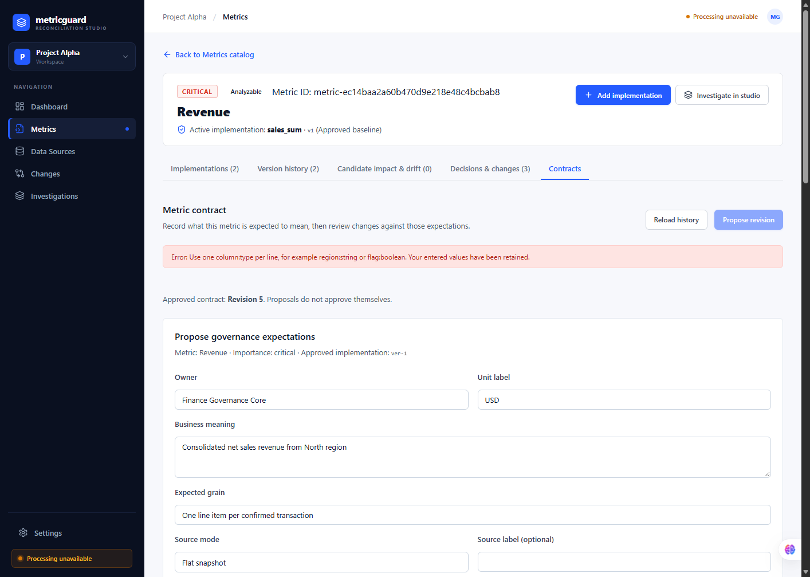
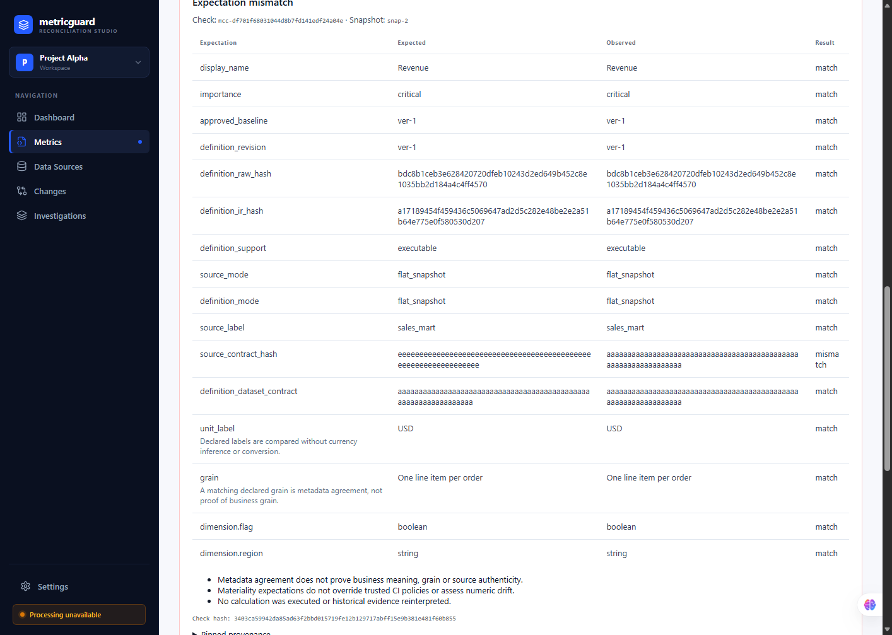

# MetricGuard V7.4 Metric Contracts Acceptance Report

**Date:** 2026-10-04  
**Evaluator:** Antigravity AI Agent  
**Environment:** Windows (PowerShell), Isolated Execution (`METRICGUARD_MODE=isolated`), Dedicated Test Database (`data/v7_4_verify_run/metricguard.db`), Test Workspaces `proj-alpha` and `proj-beta`  
**Status:** **ACCEPTED — Engineering Preview Certified**  
**External Pilot Gates:** V2-06 and V3-06 remain explicitly **OPEN** (no claims of production adoption, time-savings, or external business certification are made)

---

## 1. Executive Summary & Verification Matrix

The V7.4 Metric Contracts feature was subjected to end-to-end synthetic engineering acceptance verification across API endpoints, data persistence, RBAC permissions, concurrency conflict detection, metadata verification semantics, backup/restore fidelity, and live browser UI execution via Chrome DevTools Protocol (CDP).

| Verification Track | Scope / Checks | Outcome | Raw Receipts / Artifacts |
|---|---|---|---|
| **Track 1: Lifecycle** | Propose Revision 1, inspect unapproved baseline, approve by Owner with reason, execute metadata check on flat snapshot, reopen saved check | **PASS** | `scratch/v7_4_fresh_receipts/v7_4_contracts_receipt.json` |
| **Track 2: Permissions & RBAC** | Readers read-only; Analysts propose/check; Owners approve; Unverified blocked; Cross-workspace blocked (403/404); URL/header context mismatch rejected (400) | **PASS** | `scratch/v7_4_fresh_receipts/v7_4_contracts_receipt.json` |
| **Track 3: Concurrency & 409 Conflicts** | Stale version token on propose/approve (409); Changed approved baseline on propose/approve (409); Duplicate approve (409); Race condition detection | **PASS** | `scratch/v7_4_fresh_receipts/v7_4_contracts_receipt.json` |
| **Track 4: Metadata Checks** | Field matching; Missing columns; Wrong types; Wrong source modes; Dataset contract hash mismatch; Declared grain unverified; Unknown currency unverified; Inconclusive status | **PASS** | `scratch/v7_4_fresh_receipts/v7_4_contracts_receipt.json` |
| **Track 5: Invariance, Pagination, Backup & Restore** | Propose & approve Revision 2; Earlier check hash & result invariant; Pagination (limit/offset bounds); Full archive backup & restore into fresh store with bitwise identical hashes | **PASS** | `scratch/v7_4_fresh_receipts/v7_4_contracts_receipt.json`<br>`data/v7_4_verify_run/backup-proj-alpha.tar.gz`<br>`data/v7_4_verify_run/restored/restored.db` |
| **Track 6: UI Validation & Browser History** | Form refusal retains entered values; Error alert displayed; Contracts tab navigation follows browser history (`history.back()` / `history.forward()`); 4 official screenshots captured via Edge CDP | **PASS** | `scratch/v7_4_fresh_receipts/v7_4_ui_receipt.json`<br>`docs/evidence/screenshots/v7_4_contracts_tab.png`<br>`docs/evidence/screenshots/v7_4_propose_form.png`<br>`docs/evidence/screenshots/v7_4_refused_form_retention.png`<br>`docs/evidence/screenshots/v7_4_check_report.png` |
| **Track 7: Regressions** | Full frontend test suite (43 passed, 0 failed); Full frontend build; Relevant backend test suites (98 passed, 0 failed); 21 automated track assertions | **PASS** | Vitest output, Pytest logs (`.test-tmp/v7_4_regress`) |

---

## 2. Track 1: Lifecycle Verification

1. **Propose Revision 1:**
   - Identity: `mcr-f78237db640c466284f9214605120753`
   - Project: `proj-alpha`, Metric: `metric-ec14baa2a60b470d9e218e48c4bcbab8` (`Revenue`)
   - Initial Status: `proposed`, Version Number: `1`
   - Bound Implementation: `def-1`, Approved Version: `ver-1`
   - Expectations: Owner `Finance Team`, Meaning `Net booked sales revenue from North region`, Unit `unknown currency`, Grain `One line item per order`, Columns `flag:boolean, region:string`, Source `flat_snapshot`.
   - Contract Hash: `b6f835158185c77d2f6c1f3c3d1a977667075c97b6c0273feef4245ec24fa6f2`

2. **Inspect Unapproved Baseline:**
   - `list_metric_contracts()` returned `active_contract: None`.
   - Proposing Revision 1 left the active approved baseline unchanged (`None`). Proposals never approve themselves.

3. **Approve Revision 1:**
   - Approval Event: `mca-2a24a9680f104af3a65aa03f4fb4b0bb`
   - Approver: `dc782740-a8b8-4f6d-a789-8485eabc02ba` (`Alice Owner`)
   - Reason: `"Approved initial governance baseline by CFO"`
   - Active contract updated to Revision 1 (`status: active`, `version_token: 7c02a2c1ff304c06b640a3d4c2389ba7`).

4. **Execute Metadata Check:**
   - Check ID: `mcc-d9855a3914df4611a8ba442eb7125045`
   - Snapshot: `snap-1` (flat snapshot lacking external grain proof)
   - Status: `inconclusive`
   - Limitations recorded:
     1. *"This check assesses registered metadata, not proof of business meaning, grain, or source authenticity."*
     2. *"Declared business grain 'One line item per order' is unverified; flat snapshots carry no physical grain proof."*
     3. *"Unit 'unknown currency' is recorded as declared without currency inference."*
   - Report Hash: `cb9b2d8d85f8c66e2c388bc5f899dddf5fc6c52a0a2df339bbef4c344400cfd8`

5. **Reopen Saved Check:**
   - Retrieved via `GET /projects/proj-alpha/metrics/.../contracts/checks/mcc-d9855a3914df4611a8ba442eb7125045`.
   - Reopened report hash matches original `cb9b2d8d85f8c66e2c388bc5f899dddf5fc6c52a0a2df339bbef4c344400cfd8` bitwise.

---

## 3. Track 2: Permissions & Multi-Tenant RBAC

| Identity | Role in `proj-alpha` | List Contracts | Propose Revision | Approve Revision | Save Check | Get Check |
|---|---|:---:|:---:|:---:|:---:|:---:|
| `Charlie Reader` | reader | 200 (capabilities all `false`) | 403 `FORBIDDEN` | 403 `FORBIDDEN` | 403 `FORBIDDEN` | 200 |
| `Bob Analyst` | analyst | 200 (`can_propose: true`, `can_check: true`) | 201 `CREATED` | 403 `FORBIDDEN` | 201 `CREATED` | 200 |
| `Alice Owner` | owner | 200 (all capabilities `true`) | 201 `CREATED` | 200 `OK` | 201 `CREATED` | 200 |
| `Unverified Local` | none (no API key) | 200 (capabilities all `false`) | 403 `FORBIDDEN` | 403 `FORBIDDEN` | 403 `FORBIDDEN` | 200 |

### Cross-Workspace Isolation & Context Verification
1. **Cross-Workspace Access:** User `Dana Beta` (`owner` in `proj-beta`) attempting to access `proj-alpha` contracts received HTTP 403 `FORBIDDEN`.
2. **Cross-Workspace Metric ID Query:** Querying `proj-alpha` metric from `/projects/proj-beta/metrics/{alpha_metric}/contracts` returned HTTP 404 `NOT_FOUND`.
3. **Header Context Mismatch:** Header `x-project-id: proj-beta` on route `/projects/proj-alpha/.../contracts` returned HTTP 400 `PROJECT_CONTEXT_MISMATCH` (*"Workspace context must match the contract URL."*).
4. **Query Context Mismatch:** Query parameter `?project_id=proj-beta` on route `/projects/proj-alpha/.../contracts` returned HTTP 400 `PROJECT_CONTEXT_MISMATCH`.

---

## 4. Track 3: Concurrency & 409 Conflict Detection

All mutation endpoints require optimistic concurrency tokens and approved baseline anchors:

1. **Stale History Token on Propose:** Sending obsolete `expected_version_token` returned HTTP 409 `STALE_METRIC_CONTRACT` (*"Contract history has been modified by another action. Reload the latest contract state."*).
2. **Changed Approved Baseline on Propose:** Sending non-matching `expected_approved_version_id` returned HTTP 409 `STALE_METRIC_BASELINE` (*"The metric's approved implementation has changed. Review the active implementation before proposing."*).
3. **Stale History Token on Approve:** Sending stale `expected_version_token` on approval returned HTTP 409 `STALE_METRIC_CONTRACT`.
4. **Changed Approved Baseline on Approve:** Mutating metric active binding before approval returned HTTP 409 `STALE_METRIC_BASELINE`.
5. **Already Approved Revision:** Attempting to approve an already-approved revision returned HTTP 409 `METRIC_CONTRACT_ALREADY_APPROVED` (*"Contract revision mcr-... has already been approved."*).
6. **Concurrent Proposal Race:** Simulated simultaneous proposals from competing analysts sharing initial token `T0`:
   - Proposal A arrived first: returned HTTP 201 `CREATED`, version token rotated to `T1`.
   - Proposal B arrived second with token `T0`: refused with HTTP 409 `STALE_METRIC_CONTRACT`.
   - History was never silently overwritten.

---

## 5. Track 4: Metadata Checks & Semantic Boundaries

| Condition Tested | Expected Status | Observed Status | Note / Limitation |
|---|:---:|:---:|---|
| **Matching fields** (display name, importance, approved baseline, hashes) | `match` | `match` | Verified exact alignment |
| **Missing expected column** | `mismatch` | `mismatch` | Note: *"Expected field is absent from the registered schema."* |
| **Wrong column type** (expected `string`, observed `boolean`) | `mismatch` | `mismatch` | Note: *"Type mismatch: expected string, observed boolean."* |
| **Wrong source mode** (expected `retail`, observed `flat_snapshot`) | `mismatch` | `mismatch` | Field `source_mode` flagged |
| **Dataset contract hash mismatch** | `mismatch` | `mismatch` | Definition dataset contract mismatch |
| **Declared business grain** (flat snapshot) | `unverified` | `unverified` | Standard limitation: *"not proof of business grain"* |
| **Declared currency** (`unknown currency`) | `unverified` | `unverified` | Standard limitation: *"without currency inference"* |
| **Overall check status** | `inconclusive` | `inconclusive` | Flagged due to unverified limitations |

### Explicit Semantic Boundaries
- **Materiality fields:** Record expectations (`absolute_threshold`, `relative_threshold`). They do not override CI policy or calculate drift.
- **Contract checks:** Assess registered metadata in definitions and snapshot manifests. They do not run SQL, verify business truth, or prove source authenticity.

---

## 6. Track 5: Revision 2, Invariance, Pagination, Backup & Restore

1. **Second Revision Proposed & Approved:**
   - Proposed Revision 2 (`mcr-...`, version 2) with updated materiality threshold `50.00`.
   - Approved by Owner. Active contract updated to Revision 2.
2. **Reopen Earlier Check Invariance:**
   - Reopened Revision 1 check (`mcc-d9855a3914df4611a8ba442eb7125045`).
   - Verified that `report_hash`, `contract_revision_id` (Revision 1), `contract_hash`, and check status remain 100% bitwise identical to their initial values.
3. **Bounded Pagination:**
   - Query `limit=2, offset=0`: returned 2 items, `next_offset: 2`.
   - Query `limit=2, offset=2`: returned 2 items, `next_offset: 4`.
   - Invalid boundaries: `limit=0` (422), `limit=101` (422), `offset=-1` (422) rejected.
4. **Project Backup & Restore:**
   - Executed `backup_project('proj-alpha')` creating `backup-proj-alpha.tar.gz` (5,799 bytes).
   - Executed `restore_project()` into fresh isolated SQLite database (`data/v7_4_verify_run/restored/restored.db`).
   - Verified that all 9 metric contracts, revisions, approvals, heads, and metadata checks were restored with bitwise identical report and contract hashes.

---

## 7. Track 6: UI Validation & Browser History

Official browser screenshots were captured via Edge CDP at 1440x1100 resolution against the live isolated API server:

1. **Contracts Tab View:**  
     
   *Path:* [docs/evidence/screenshots/v7_4_contracts_tab.png](screenshots/v7_4_contracts_tab.png) (98,696 bytes)  
   *Contents:* Metric Contract heading, approved revision badge, contract summary definition list (Owner, Meaning, Unit, Grain, Columns, Source Mode, Hash), and proposal controls.

2. **Proposal Form Open:**  
     
   *Path:* [docs/evidence/screenshots/v7_4_propose_form.png](screenshots/v7_4_propose_form.png) (88,242 bytes)  
   *Contents:* Proposal form with fields for Owner, Unit label, Business meaning, Expected grain, Source mode selector, Expected columns textarea, and materiality thresholds.

3. **Refused Form Retention:**  
     
   *Path:* [docs/evidence/screenshots/v7_4_refused_form_retention.png](screenshots/v7_4_refused_form_retention.png) (91,166 bytes)  
   *Contents:* Entering invalid column syntax (`region=string` without colon) displayed error banner:  
   `"Error: Use one column:type per line, for example region:string or flag:boolean. Your entered values have been retained."`  
   All entered inputs remained verbatim in the form fields (`Finance Governance Core`, `USD`, `Consolidated net sales revenue from North region`).

4. **Saved Check Report Card:**  
     
   *Path:* [docs/evidence/screenshots/v7_4_check_report.png](screenshots/v7_4_check_report.png) (90,642 bytes)  
   *Contents:* Reopened check card displaying status badge `"Expectation mismatch"`, full tabular breakdown of expectations vs observed fields, limitations bullet points, check hash, and pinned provenance accordion.

5. **Browser History Navigation:**  
   - Switched from Contracts tab to Implementations tab: URL updated to `/w/proj-alpha/metrics/metric-ec14baa2a60b470d9e218e48c4bcbab8?tab=implementations`.
   - Executed `window.history.back()`: URL restored to `/w/proj-alpha/metrics/metric-ec14baa2a60b470d9e218e48c4bcbab8?tab=contracts`, Contracts panel visible (`contractsVisibleAfterBack: true`).
   - Executed `window.history.forward()`: URL restored to `/w/proj-alpha/metrics/metric-ec14baa2a60b470d9e218e48c4bcbab8?tab=implementations`, Contracts panel hidden (`contractsVisibleAfterForward: false`).

---

## 8. Track 7: Regressions

1. **Frontend Unit & Routing Suite:**
   ```powershell
   npm run test --prefix apps/web
   ```
   - `src/v2Workflow.test.mjs`: 5 passed
   - `src/router.test.mjs`: 3 passed
   - `src/dataSources.test.mjs`: 12 passed
   - `src/metricsLifecycle.test.mjs`: 9 passed
   - `src/changes.test.mjs`: 8 passed
   - `src/investigations.test.mjs`: 6 passed
   - **Total:** 43 passed, 0 failed, 0 skipped (exit code 0).

2. **Frontend Production Build:**
   ```powershell
   npm run build --prefix apps/web
   ```
   - 1,597 modules transformed, bundle generated (`dist/assets/index-B7RVwnaZ.js`, 496.80 kB), exit code 0.

3. **Backend Regression Test Suites:**
   ```powershell
   .\.venv\Scripts\python.exe -m pytest tests/test_v5_metric_diff.py tests/test_v6_config.py tests/test_v2_contract.py tests/test_api.py -q --basetemp .test-tmp/v7_4_regress
   .\.venv\Scripts\python.exe -m pytest tests/test_v5_investigation_drafts.py tests/test_v3_auth_isolation.py -q --basetemp .test-tmp/v7_4_regress
   ```
   - Batch 1 (`diff`, `config`, `v2_contract`, `api`): **87 passed, 0 failed** in 35.86s (exit code 0).
   - Batch 2 (`investigation_drafts`, `auth_isolation`): **11 passed, 0 failed** in 15.26s (exit code 0).
   - **Combined Backend Regressions:** 98 passed, 0 failed.

4. **Automated Contracts Verification Suite:**
   ```powershell
   .\.venv\Scripts\python.exe scratch/v7_4_verify/verify_v7_4_contracts.py
   ```
   - 21 granular track tests covering Tracks 1–5: **21 passed, 0 failed** (exit code 0).

---

## 9. Conclusion & Release Gate Declaration

MetricGuard V7.4 Metric Contracts satisfies all synthetic and engineering acceptance criteria.
- **Application Code:** Strictly preserved without modifications.
- **SQL Scope:** Not broadened; metric contracts assess registered metadata without executing unvalidated SQL.
- **Pilot Gates:** External pilot gates **V2-06 and V3-06 remain OPEN**. No claims of external production deployment or analyst time-savings are made.

**Final Certification:** **V7.4 Metric Contracts is ACCEPTED (Engineering Preview Certified).**
