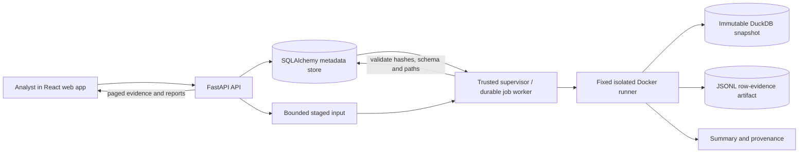

# MetricGuard: project and technical report

**Status: 24 September 2026.** MetricGuard is a local workbench for investigating why two reported KPI values disagree. Its original planning pack is **one v1** with milestones M0–M5 and work items MG01–MG26. The later v2 workflow is implemented locally and tested with synthetic cases, but its required two independently sourced real-case pilot is still open. V3 and v4 are roadmap proposals, not shipped releases.

## What the product is trying to achieve

An analyst often sees two dashboards report different values for a metric with the same name. The difference may come from refund treatment, payment eligibility, date attribution, scope, or a genuine definition change. Matching the displayed numbers does not prove the definitions mean the same thing, and different numbers do not by themselves identify which definition is correct.

MetricGuard makes that disagreement inspectable. It records the exact SQL definitions and the declared business context, evaluates supported definitions on the **same frozen dataset**, calculates an exact gap, and shows the rows and rule changes that account for it. An analyst can save the case, a metric owner can inspect the evidence, and another analyst can reopen and replay it. The product does **not** decide accounting policy or certify a metric as correct; a human must interpret and approve the business meaning.

The intended first users are analysts, metric owners, and reviewers working with flat retail-style extracts. The present app is a local workbench, not a public upload service or an authenticated multi-user product.

### A concrete example

The seeded v1 demo has an August 2026 orders snapshot. “Dashboard A” totals INR 104,000,000.00 and “Finance” totals INR 98,000,000.00. MetricGuard reports **target minus baseline = INR −6,000,000.00**. Its declared ordered bridge attributes INR −4,320,000.00 to refund treatment, INR −420,000.00 to payment eligibility, and INR −1,260,000.00 to payment-date attribution. The steps sum exactly to the reported gap, with zero residual. Those numbers are from a synthetic fixture and illustrate the method; they are not a customer result.

## Product workflow

1. **Declare the data meaning.** For v2, the analyst creates a versioned dataset contract: the row key, eligible entity key, field types, decimal scale, reporting currency, business timezone, grain, scope, cutoff, date roles, and NULL policy. Unsupported contracts fail before execution.
2. **Preview and approve an extract.** A CSV or Parquet file is previewed inside the fixed Docker runner. The analyst maps source columns explicitly to the nine supported analytical roles. Extra source columns are permitted but are not executable fields. The app does not guess currency, timezone, timestamp, or grain conversions.
3. **Publish a frozen snapshot.** The validated file is ingested into an immutable DuckDB analytical snapshot. Source, contract, mapping, and snapshot hashes allow the run to be traced back to the approved input. A mapping or policy change creates a new identity; it does not reinterpret prior v1 evidence.
4. **Add the definitions.** The analyst provides each supported SQL definition. V2 binds approved source column names to the canonical schema using a restricted SQL parser. It stores both the original SQL and the bound SQL.
5. **Set comparison context.** The analyst selects the same snapshot, compatible aggregate family and unit, and a half-open reporting period for both definitions. Contract and business-context mismatches are explicit errors, not successful-looking comparisons.
6. **Run and investigate.** The restricted runner calculates exact decimal totals, the signed gap, row contributions, and an ordered rule bridge where supported. Summary results and row evidence are stored separately. The UI pages evidence and offers a bounded export.
7. **Save and replay.** A saved investigation pins its snapshot, definition versions, context, run, evidence, and a self-declared decision. A second analyst can reopen the record and replay a supported comparison. If required evidence is unavailable, replay must explain why.

Candidate ranking helps find possibly related definitions, but it is a deterministic suggestion mechanism requiring human review. A recorded local decision is not an authenticated organizational approval.

## Architecture and data flow

The browser is React 19 and TypeScript, built with Vite 6. The API is Python 3.12, FastAPI 0.141, Pydantic 2, and SQLAlchemy 2. The analytical core uses SQLGlot 30.19 for parsing/binding and DuckDB 1.5.5 for snapshots and execution. SQLite is the default local metadata store; the supplied Compose demo uses PostgreSQL 16. The Python dependency versions are pinned in `requirements.txt`; the frontend versions are specified in `apps/web/package.json` and its lockfile.

The API stages bounded uploads and stores metadata. It does not execute uploaded SQL or file content in its own process. A separate trusted supervisor claims durable jobs and launches a **fixed image**. The runner validates or evaluates the approved, restricted request and returns results. Before publication, the supervisor checks the result and evidence artifact paths, schemas, sizes, hashes, and provenance. Immutable definition versions, source/mapping identities, snapshots, and runs keep historical reports meaningful.

The v1 **demo mode** serves precomputed synthetic evidence for its seeded cases; arbitrary uploaded definitions or files do not execute there. **Isolated mode** is the local live workflow for a user's supported CSV/Parquet extract and SQL. Docker Desktop and a running supervisor are required for new analytical jobs. The API path remains `/api/v1` for compatibility while v2 workflow resources are added under it.

## Input and SQL contract

V2 deliberately retains one flat analytical table with exactly nine executable roles:

| Role | Type | Purpose |
| --- | --- | --- |
| `order_id` | `VARCHAR` | Row identity |
| `customer_id` | `VARCHAR` | Eligible entity for distinct counts |
| `order_date` | `DATE` | Order-date attribution |
| `payment_date` | `DATE` | Payment-date attribution |
| `status` | `VARCHAR` | Order status rule |
| `payment_status` | `VARCHAR` | Payment eligibility rule |
| `currency` | `VARCHAR` | Declared unit check |
| `order_amount` | `DECIMAL(18,2)` | Amount calculation |
| `refund_amount` | `DECIMAL(18,2)` | Refund calculation |

Every role must map to a distinct source column. V2 supports CSV with a declared blank or literal `NULL` token policy for nullable fields, or mapped Parquet with native NULLs and matching mapped types. The source limit is **25 MiB** and ingestion limit is **1,000,000 rows**. Preview returns a bounded sample, not an implicit approval. Dates are business `DATE` values; timestamp conversion is not inferred. There is no currency conversion.

Supported SQL is a restricted DuckDB subset: one `SELECT` with a single scalar `SUM` numeric expression, `COUNT(*)`, or `COUNT(DISTINCT customer_id)`; allowed arithmetic is `+`, `-`, `*`, decimal literals, and numeric `COALESCE`, with bounded boolean predicates, comparisons, `IN`, and `IS NULL`. The selected date role and half-open interval must agree with comparison context. Joins, CTEs, grouped or windowed queries, division, `CASE`, arbitrary distinct expressions, UDFs, multiple statements, file scans, and DDL/DML are rejected. Importing dbt or TMDL metadata does not make its compiled SQL, Jinja, or DAX executable.

An empty `SUM` is undefined rather than a fabricated zero. Definition differences and observed value equality are separately reported. For additive comparisons, row deltas and bridge steps reconcile to the target-minus-baseline total; the bridge's order is a declared convention, not proof of causality. `COUNT(DISTINCT ...)` uses entity membership evidence rather than pretending every row has an additive distinct-count contribution. An optional bounded Shapley allocation can show how an order-dependent bridge changes across six rule orders; it is still not a policy decision.

## Evidence, APIs, and reproducibility

The application stores definitions and immutable versions, dataset contracts and mapping versions, source and snapshot manifests, queued jobs and runs, comparison contexts, saved investigations, local reviews/baselines, report dependencies, and evaluation reports. V2 keeps a small summary separate from a JSONL row-evidence artifact. Evidence has a manifest containing its hash, row count, byte count, and delta sum. The API pages evidence at up to **100 rows per page** and explicitly limits exports to **25 MiB**, reporting included and omitted rows rather than implying completeness.

The API exposes grouped resources for health and inventory, contracts/mappings/preview/import, definition versions and SQL binding, comparisons and reports, evidence pages/exports, saved cases and replay, reviews/baselines/dependencies, metadata adapters, and evaluation. The exact request fields, error codes, and route names are in [the API contract](contracts.md). Amounts in JSON are decimal strings to preserve precision; errors use a typed `{error:{code,message}}` shape.

The source extract hash and approved mapping/contract hashes appear in run provenance. The original SQL remains available beside its bound SQL. This makes a stored result reproducible on its pinned policy and snapshot, or visibly unavailable if a required artifact is gone. It does not imply that a newly collected live source would contain the same data.

## Security and deployment boundary

The current deployment is intended for a trusted **local** machine. The supplied API commands bind to `127.0.0.1`; Compose also publishes its ports only on loopback. The API has no Docker socket or container launch privilege. The trusted supervisor alone launches a fixed Python runner image. Its tested restrictions include non-root UID 10001, read-only root filesystem, no outbound network, dropped capabilities, no-new-privileges, **1 GiB memory**, **one CPU**, **64 PIDs**, bounded temporary storage, and a **60-second execution deadline**. The worker validates typed inputs, output boundaries, hashes, and evidence before publishing results.

These controls reduce the risk of local analysis, but the current app has **no authenticated user ownership, server-side project authorization, or hosted multi-tenant isolation**. It must not be exposed as a public upload/execution service. Identity, access checks on every object and download, remote job isolation, retention, restore, and operational recovery belong to the proposed v3 work. Current actor labels and owner decisions are self-declared.

## What has been verified

- The v1 evidence matrix records **102 local tests** at its earlier checkpoint, plus a production frontend build, Compose configuration, exact synthetic oracles, candidate-ranking evaluation, and live Docker golden CSV/Parquet import and comparison. The golden Dashboard A→Finance run produced INR −6,000,000.00 with zero residual. Malformed Parquet was rejected without publishing a snapshot.
- The later v2 full local suite recorded **140 passing Python tests**; the frontend build, five frontend workflow tests, and Compose configuration passed. Subsequent targeted binding checks also passed. These are code and synthetic-workflow checks, not a real analyst pilot.
- The live Docker verification exercised mapped CSV and Parquet preview/import, mapped comparison, saved case reopen/replay, paged evidence, and bounded JSON export, in addition to the fixed-schema golden path and container restriction probes.
- A single-machine, 100,000-row mapped Docker check matched independently calculated totals: baseline **81,712,636.58**, target **72,217,099.74**, delta **−9,495,536.84**, residual **0.00**. Upload plus isolated ingestion took about **6.43 s** and comparison plus publication about **9.61 s**. The stored summary was **6,863 bytes** and row artifact about **22.77 MB**; a bounded export included 100 rows and identified 99,900 omitted rows. These timings are measurements on one synthetic workload, not throughput or concurrency guarantees.

The detailed checks and limitations are recorded in [v1 release evidence](v1-release-evidence.md), [v2 release evidence](v2-release-evidence.md), and the machine-local reports under `data/evaluation/`.

## Open work and roadmap

The decisive v2 acceptance item, **V2-06**, has not been completed. It requires at least two independently sourced, sanitized real investigation cases, expected totals calculated outside MetricGuard, measured completion time, support/refusal coverage, wrong conclusions, and a second analyst reopening and reproducing a saved case. Synthetic examples prove the workflow is executable, but cannot establish that real analysts interpret it correctly or that its supported grammar covers their cases.

Some v1 release gates also remain visible: a real analyst exercise, a shareable recorded walkthrough if needed, and live cancellation/timeout/worker-recovery checks before any deployment that depends on those failure modes. Unit/state-machine tests and live happy-path checks do not establish those operational paths end to end.

The proposed **v3** would add authenticated shared reviews and recurring checks, including project access, remote job isolation, monitoring policies, and recovery. The proposed **v4** would deepen the connected SQL workflow, starting with dbt provenance, a repository check, and one read-only snapshot collector chosen from pilot demand. Neither is implemented as a release. Adding broad joins, arbitrary schemas, ratios, native DAX, AI explanations, or a hosted public service is outside current support and requires separate correctness work.

## How to use it locally

For a guided live investigation, build the frontend and fixed runner image, then start the API in `isolated` mode and the supervisor with the same database and data directory. The commands and prerequisites are in the [README](../README.md). On the current machine, the clean isolated workbench was started at [http://127.0.0.1:8001/](http://127.0.0.1:8001/); the older seeded demo is at [http://127.0.0.1:8000/](http://127.0.0.1:8000/). These URLs are local processes, not permanent hosted addresses. If a process has stopped, restart it using the README commands (choosing the desired port).

The main code locations are `apps/web/src` for the UI, `services/api` for HTTP and persistence, `services/supervisor` for jobs and the Docker boundary, `packages/metricguard_core` for contracts, parsing, snapshots and reconciliation, `infra` for container/Compose definitions, and `tests` plus `scripts` for verification. Use [the project graph](project-graph.md) for a short navigation map and [the roadmap](next-versions-roadmap.md) for proposed future work.
