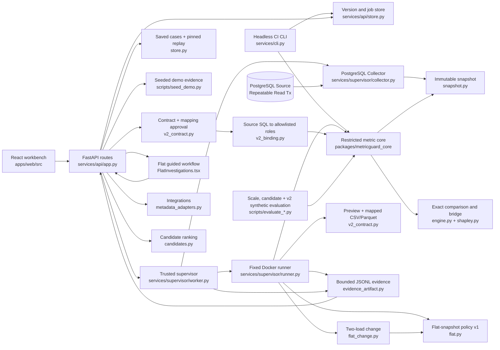

# MetricGuard project graph

This is the compact entry point for future work. The [generated Graphify graph](../graphify-out/graph.json) indexes symbols and cross-file relationships; [the interactive tree](../graphify-out/GRAPH_TREE.html) offers a visual view. Ask `graphify query "<question>" --budget 800` before opening many files. The source of truth remains the code, tests, [v1 release matrix](v1-release-evidence.md), and [v2 release matrix](v2-release-evidence.md).

## Scope and source map

- **Live-user onboarding corrections (2026-10-20):** `apps/web/src/onboardingPolicy.ts` feeds deployed `/api/v1/usage` limits into `DataSourcesView`, blocks over-limit previews, defaults plain imports to compound-filter contract v5, and keeps load labels/units distinct from file names. Completed server previews expose exact `row_count`; streaming refusals explicitly say when only a lower bound is known. `Store.finish_import` persists the manifest unit; older summaries recover it without changing pinned artifacts. Inspect counts saved calculations separately from governed metrics. `authFlow.connectionControls` hides key actions for cookie sessions and supplies distinct auth-page titles. `views/evidence/breakdownSelection.ts` shares saved filter preferences between CaseReport and Breakdown and selects a strongest exact group share only when no preferred column is available. No generated graph refresh requested.

- **Public website (2026-10-20):** `apps/web/src/PublicPages.tsx` and `public.css` render homepage, beta privacy/terms and 404 pages outside workspace loaders. `router.sitePage` classifies public routes and rejects extra path segments; `homeRedirect` consumes the existing identity endpoint's authorised `home_workspace_id`. `App` mounts workspace code only for known workspace routes. Actual synthetic demo captures are in `apps/web/public/images/`; `apps/web/vercel.json` keeps the documented backend placeholder and server-side origin-secret transform. Local page fallback and setup/verification limits: [deployment plan, step 5](deployment-plan.md). No Graphify refresh requested.

  Homepage redesign adds sticky anchors, IntersectionObserver reveals, reduced-motion final states, an animated verified demo reconciliation and viewport/theme-aware evidence captures. `data/evaluation/homepage-v2/` contains browser/replay receipts. The Docker runner image now includes `services/durable.py`, required by its worker import; the actual eight-row demo replay matched after rebuilding. No parser or execution-policy change.

- **Hosted account sign-in (2026-10-20):** `services/api/oauth.py` installs Google/GitHub code-flow routes, signed ten-minute Lax state cookies, one-use state records, verified-email invite gating and the existing Strict browser session. `Store.oauth_sign_in` atomically links identities and creates one personal workspace. `services/api/account_deletion.py` erases sole-member owned workspaces through durable storage while preserving shared records; active jobs refuse deletion. `SignInScreen.tsx`, `authFlow.ts` and `views/AccountSettings.tsx` provide social sign-in, API-key fallback, sign-out and typed deletion confirmation. Setup and verification scope: [deployment plan, step 4](deployment-plan.md). No generated graph refresh was requested.

- **One product v1:** [planning pack](../MetricGuard_Planning_Pack/README.md). M0–M5 are its six milestones; MG01–MG26 are backlog items. There is no planned v2 in this pack.
- **Versions after v1:** the separate [roadmap](next-versions-roadmap.md) proposes v2–v5. V2 engineering/product requirements complete; V2-06 external real-world validation remains open. V3 engineering/product requirements (multi-role RBAC, shared review & superseding decisions, recurring checks & materiality policies, backup/restore, storage quotas) are complete and locally verified; V3-06 external observed team trial remains open. V4 engineering/product requirements (Connected SQL Workflow: V4-01 dbt artifact import, V4-02 PostgreSQL collection, V4-03 headless CLI / CI automation, and V4-04 integration, exit gates & decoupled benchmarks) are complete, frozen, and verified. V5 engineering/product requirements (Metric Diff): V5-01 (Stable Metric Identity + dbt Revision Change Set Core), V5-02 (Affected Metric Resolution + Controlled Metric Impact Execution), and V5-03 (Revision-Level Metric Diff Orchestration + Coverage Report) complete, frozen, and verified. V5.1 (Restricted Level-1 SQL Normalization: single-use, non-recursive CTE filter/projection wrappers over single table into canonical IR) complete, verified, and frozen. V5.2-01 (Production Product Shell + Routing + Workspace UX + Dashboard) complete, verified, and frozen. V5.2-02 (Unified Data Sources UX: single data landing, 3-step file onboarding, safe meaning inference, humanized errors, schema inspection) complete, verified, and frozen. V5.2-03 (Metrics + V5 Lifecycle UX: declared metric inventory, importance tiers, active/candidate/retired implementations, approved baseline timelines, candidate impact drift, lifecycle transition audit trail) complete, verified, and frozen. V5.2-04 (Changes / Metric Diff Production UX: landing list with search/filters, modal run diff with snapshot selector, action-relevance prioritization, cumulative approved-baseline drift vs incremental revision impact, version path step visualization, amber refusal diagnostics, 4-view coverage analysis, expandable changed dbt resources, PR markdown summary, direct handoff to investigation) complete, verified, and frozen. V5.2-05 (Unified Investigation Workspace + Durable Drafts + Contextual Decisions: landing list with search/filter/status, unified investigation studio with debounced autosave, existing-definition and ad-hoc SQL modes, 3-card KPI strip, 4 analytical tabs [What changed, Value bridge, Evidence, Provenance], contextual decision rail with candidate approval & intentional variant handling, Track as Metric flow, server-backed durable drafts with optimistic concurrency 409 conflict detection, workspace isolation, Changes & Metric Detail handoff with evidence reuse, and 15-row deterministic verification) complete, verified, and frozen. V6.1 (Safe SQL Expansion: P0 operators !=, <>, IS NULL, IS NOT NULL, >, <, >=, <=, BETWEEN, boolean predicates, 3-valued NULL logic, separable half-open period interval enforcement, and zero-residual Shapley Value Bridge across analytical scenarios) complete and verified. V6.2 (Declarative Repository Configuration: metricguard.yml specification, Model B store governance boundary, schema-only & store-backed validation CLI, and safe provenance tracking) complete and verified. V6.3 (Turnkey CI / PR Metric Change Gate: provider-neutral diff-ci workflow, deterministic metricguard_ci_report_v1 JSON schema, Zero-Green GitHub PR markdown generator, credential redaction, exit codes 0/1/2/3, and standalone GitHub Actions adapter) complete and verified. V6.4 (CI -> Investigation Handoff + Pilot Hardening: zero-recomputation handoff via deterministic draft resolution reusing existing comparison runs, evidence artifact hash invariance, idempotent draft preservation preventing duplicate creation or human investigation overwrite, analytical refusal handoff with zero fake numbers, graceful stale artifact safety, cross-workspace isolation, trusted app URL vs headless deep links, and pilot ergonomics via metricguard.py) complete and verified (historical handoff: 557 Python/36 web; later typed-contract regression: 586 Python/43 web). V7 (V7.1 Bounded Boolean Filters, V7.2 Safe Additive Expressions, V7.3 Restricted CASE WHEN & Investigation Persistence, and V7.4 Metric Contracts) complete and verified. V8 engineering/product requirements (V8.1 Relational Execution over one fact and one unique dimension, V8.2 Governed Relational Contracts under metric-governance-v2 with Schema-2 expectations and check reopen invariance, and V8.3 Relational Join Evidence under relational-join-evidence-v1 with side-by-side outcome explanation, SQL 3-valued logic, and immutable summary hash) complete, verified, and frozen. See [docs/v8-release-evidence.md](v8-release-evidence.md).
- **Product and workflows:** chapters `01_product_and_prd.md` and `02_user_journeys_and_ux.md`.
- **Metric semantics and reconciliation:** `03_metric_contract_and_sql.md` and `04_reconciliation_method.md`; the hand-checkable August fixture is in `examples/` and chapter `08_demo_and_evaluation.md`.
- **Architecture and boundaries:** `05_architecture.md`, `06_data_model_and_api.md`, and `07_security_and_operations.md`.
- **Delivery criteria and decisions:** `09_delivery_plan.md` and `10_decisions_risks_and_handoff.md`. The current implementation status is in [v1-release-evidence.md](v1-release-evidence.md), [v2-release-evidence.md](v2-release-evidence.md), [v3-release-evidence.md](v3-release-evidence.md), [v4-release-evidence.md](v4-release-evidence.md), and [v5-release-evidence.md](v5-release-evidence.md), including unmet external gates.
- **V2 design and status:** [local design](superpowers/specs/2026-09-23-v2-real-data-design.md), [execution plan](superpowers/plans/2026-09-23-v2-real-data.md), [V2-01–06 evidence](v2-release-evidence.md).
- **V3 design and status:** [roadmap](next-versions-roadmap.md), [V3 design](superpowers/specs/2026-09-25-v3-shared-review-design.md), [V3 plan](superpowers/plans/2026-09-25-v3-shared-review.md), [V3-01–06 evidence](v3-release-evidence.md). Server-side authorization, review lifecycle, recurring checks, and atomic project backup/restore.
- **V4 design and status:** [roadmap](next-versions-roadmap.md), [V4 design](superpowers/specs/2026-09-25-v4-connected-sql-design.md), [V4 plan](superpowers/plans/2026-09-25-v4-connected-sql.md), [V4 release evidence](v4-release-evidence.md). Complete connected SQL workflow: dbt Core artifact import, stable unique_id anchors, separate import and resource revisions, DefinitionVersion reuse, revision-aware lineage, and metadata-only degradation; trusted PostgreSQL source collector with repeatable-read snapshot isolation, cutoff invariance, in-stream contract validation, and atomic staging publication; headless CLI / CI automation workflow with deterministic comparison execution, versioned metricguard_ci_report_v1 JSON schema, project-scoped environment auth, strict exit codes (0/1/2/3), exact decimal serialization, and pinned snapshot replay determinism; and end-to-end provenance verification (Gates 4.1–4.5) with decoupled stage micro-benchmarks.
- **V5 design and status:** [V5 release evidence](v5-release-evidence.md). Stable business Metric identity, provider-neutral external references, Definition lifecycle binding, atomic promotion and version approval, immutable state-transition audit events, deterministic dbt revision change sets, affected metric resolution, approved-baseline drift prevention, controlled same-snapshot metric impact execution, revision-level diff orchestration, 4-view coverage reporting, aggregated diagnostics refusal reporting, CI exit-code precedence, and headless CLI (`metricguard diff`).
- **Analyst pilot preparation:** [current-state assessment and runbook](pilot/README.md), with observation, case intake, measurement, and decision templates. No real-case result has been recorded.
- **External public-data coverage check:** [Olist payment-status evaluation](pilot/olist-public-case.md), sourced and calculated with `scripts/acquire_olist_public_case.py`, `scripts/evaluate_olist_public_case.py`, and `scripts/olist_public_case.sql`; it is not a V2-06 analyst pilot.
- **Separate flat-snapshot policy:** `packages/metricguard_core/flat.py` validates pinned contract v3 and typed contract v4, imports a prepared table, parses bounded same-measure SUM definitions and computes exact eligibility-change evidence. `scripts/prepare_olist_flat_snapshot.py` performs external source preparation; `scripts/verify_flat_olist_live.py` checks the isolated API, Docker runner, evidence and replay path. The [Olist record](pilot/olist-public-case.md) retains the earlier retail-policy unsupported finding and appends the later flat-policy execution.

## Current V6 manual acceptance gate (2026-09-28)

FlatContract **v4** adds frozen `dimension_types` (string, boolean, date, timestamp) and optional `nullable_categories` without retrotyping v3. `flat.py` validates canonical values and typed SQL/IR; ingestion and supervisor share `flat_schema`. Data Sources scans all bounded CSV records (small display sample), accepts explicit type overrides, and pins the approved types. Parquet uses declared physical types. Timestamp support is timezone-free `YYYY-MM-DDTHH:mm:ss[.ffffff]`; offsets and nanoseconds require external preparation or remain text. Only the existing exact decimal measure is numeric.

The v4 inequality gate passed through the production UI and isolated Docker runner: 44300.00 to 42100.00 INR, gap -2200.00, zero residual; excluded rows O003 -500.00, O009 -800.00, O018 -900.00. The user subsequently approved the [AGY/Flash acceptance report](evidence/v6_acceptance_report.md), which reports **PASS for eight further case groups**: dates, NULL predicates, decimal predicates, booleans, NULL/empty aggregates, refusals, v4 replay and historical v3 compatibility. Defined comparisons report zero residual; undefined aggregates and refusals have no applicable residual. See [receipt incorporation and scope qualifications](v5-release-evidence.md#v6-manual-acceptance-receipts-incorporated-2026-09-28).

The approved [V6 release-gate audit](evidence/v6_release_gate_report.md) subsequently reports PASS for governed Metric lifecycle, configuration, dbt-to-CI, security, zero-recomputation handoff, live UI refusal retention and nullable boolean semantics. **V6 engineering freeze is supported within this tested synthetic/curated scope.** The two previously noted coverage gaps are closed by gates 6.1/6.2. This is receipt incorporation, not a new test execution. V2-06/V3-06 external analyst/team pilot gates remain open; real dbt project/dialect and live fork-permission validation remain limited as described in the report.

## V7.1 implementation preview (2026-09-28)

The user authorized continuing to V7 after release-gate review. First bounded slice: AND/OR/NOT over existing typed SUM-filter leaves. New **FlatContract v5** explicitly pins `predicate_policy=flat-boolean-v1`; legacy v3/v4 policy identities and flat-list IR remain unchanged. `packages/metricguard_core/flat_boolean.py` owns bounded tree lowering, canonicalization, validation and compilation; `flat.py` uses the same exact row-membership evidence and whole-filter bridge. API contract validation and the Data Sources opt-in expose new snapshots; Investigation Studio shows compound-filter support without splitting OR branches into misleading independent filter changes.

Limits: 16 leaf occurrences, 8 logical nesting levels, 63 tree nodes and the existing 200-node SQL AST cap. Associative AND/OR children are flattened and sorted; NOT retains three-valued NULL semantics. No distributive expansion, additional aggregates, arithmetic, CASE or joins. The execution family remains `flat_snapshot_v1`; contract v5 plus the independently checked predicate policy pin the new grammar and IR, preventing old artifacts from being interpreted as trees.

**Engineering preview verified and approved.** The approved [AGY/Flash V7.1 acceptance report](evidence/v7_1_acceptance_report.md) records **PASS across all seven acceptance groups**: contract v5 registration and typed ingestion, compound comparisons truth tables (2A–2J) with zero residual and SQL three-valued logic, canonicalization and hash invariance, boundary and 422 refusal testing with editor state retention, forged IR rejection, save/replay reproducibility with identical evidence SHA-256, and legacy v3/v4 backward compatibility verified through fresh post-V7.1 replays plus combined regression coverage of 586 backend tests across separate runs (541 earlier backend passes plus 45 subsequently executed PostgreSQL-dependent passes; 43 frontend tests; fresh post-V7.1 v3/v4 replays executed and verified; see [2026-09-29 Addendum](evidence/v7_1_acceptance_report.md#5-addendum-resolution-of-v71-evidence-gaps-2026-09-29)). See [V7 release evidence](v7-release-evidence.md). Major V7 expansion remains dependent on pilot prioritization; external pilot gates (V2-06, V3-06) remain open without adoption claims.

## V7.2 safe additive expressions preview (2026-09-29)

Speculative engineering preview for safe additive expressions: `SUM(colA - colB)`. New **FlatContract v6** explicitly pins `measure_policy=flat-subtraction-v1` alongside `predicate_policy=flat-boolean-v1`. Legacy `measure` and root `precision` fields are completely excluded from canonical v6 contracts and v6 IR; expression labels (`f"{minuend} - {subtrahend}"`) are generated dynamically for display. Conflicting legacy fields in v6 payloads are strictly rejected. Subtraction is strictly binary between two registered decimal columns with identical declared scale and compatible unit labels. DuckDB snapshot tables store both raw columns without fabricating physical computed columns (`flat_schema` maps both to `DECIMAL(p, s)`). Execution enforces exact DuckDB decimal subtraction with precision requirement $p_\text{req} = \max(p_A, p_B) + 1 \le 38$. Python exact `Decimal(prec=100)` arithmetic enforces aggregate endpoint capacity $|\text{endpoint} \times 10^s| \le 10^{38} - 1$ after complete accumulation (raising structured `ARITHMETIC_OVERFLOW` if exceeded), while preserving wider gap differences and exact cancellation.

Row evidence separates filter inclusion, NULL terms, and bookkeeping contributions (e.g. primary fixture R5/R6 are filter-included in both unfiltered baseline and `region='prod'`; their NULL expressions are ignored by SUM with 0.00 contribution, not filter-excluded). Bounded evidence artifacts preserve `baseline_operands`, `target_operands`, `baseline_expression_value`, and `target_expression_value`. Replay preserves frozen contracts and hashes.

Limits: exactly binary subtraction `A - B`, no addition, multiplication, division, constants, CASE, nesting, functions, joins, or formula-drift comparisons (`DIFFERENT_MEASURE_EXPRESSIONS` HTTP 422 refusal). Status: **ACCEPTED — Engineering Preview Certified (2026-09-29)** (see [v7_2_acceptance_report.md](evidence/v7_2_acceptance_report.md)). Groups A–H passed (586 backend pytest passes, 43 frontend passes, bitwise historical replays, exact 102-digit forgery defense, signed ordered subtraction, and live API tampering resistance). External pilot gates (V2-06, V3-06) remain explicitly OPEN.

## V7.3 restricted CASE WHEN & investigation persistence (2026-10-04)

Restricted conditional summation: `SUM(CASE WHEN <pred> THEN <col> ELSE 0 END) [WHERE <pred>]` over a single flat snapshot. New **FlatContract v7** pins `measure_policy=flat-case-v1` and `predicate_policy=flat-boolean-v1`. Exactly one WHEN branch, exactly one registered decimal THEN measure, mandatory ELSE numeric 0 (normalized to string `'0'` in canonical IR), and optional outer WHERE boolean tree (`predicate_tree`). Zero schema fabrication; native DuckDB CASE evaluation; distinction between outer filter inclusion, WHEN truth state (TRUE/FALSE/UNKNOWN), selected branch, measure value, resulting CASE term, and NULL-term status; whole-definition row-contribution bridge; and combined AST complexity bounding ($\le 24$ leaves, $\le 96$ nodes). Evidence validation in `flat_case_evidence.py` binds frozen definitions and verifies consistency with typed inputs while affirming that artifact inputs do not independently prove source authenticity. Server-backed durable investigation drafts under `/api/v1/projects/{pid}/investigation-drafts` enforce optimistic concurrency (`version_token` rotation, HTTP 409 `STALE_DRAFT`), verbatim invalid SQL persistence, draft deletion safety, and multi-tenant project isolation (HTTP 403). Status: **ACCEPTED — Engineering Preview Certified (2026-10-04)** (see [docs/evidence/v7_3_acceptance_report.md](evidence/v7_3_acceptance_report.md) and [docs/v7-release-evidence.md](v7-release-evidence.md)); external pilot gates V2-06/V3-06 remain explicitly OPEN.

## V7.4 Metric Contracts (2026-10-04)

Declared metric governance contracts under policy `metric-governance-v1`: records what a business metric is expected to mean (`owner_label`, `meaning`, `unit_label`, `grain`, `expected_dimensions`, `source_expectations`, and `materiality_policy`), then evaluates incoming snapshot manifests and bound implementation versions against those expectations without running SQL. Revisions follow an immutable audit history where proposing leaves approved baselines untouched, and only authenticated workspace owners can approve with human-recorded rationale. Enforces strict multi-role RBAC (reader/analyst/owner), optimistic concurrency via `version_token` and `expected_approved_version_id` (HTTP 409 on conflict), cross-workspace isolation, and 400 rejection on header/URL context mismatch. Flat snapshots without declared grain report `unverified` ("not proof of business grain"), unknown currency stays `unknown currency`, and checks with unverified fields yield `inconclusive`. Earlier checks remain bitwise invariant upon reopening across subsequent revision approvals. Full project backup and restore serialize and restore metric contracts, revisions, approvals, head pointers, and check reports. Status: **ACCEPTED — Engineering Preview Certified (2026-10-04)** (see [docs/evidence/v7_4_acceptance_report.md](evidence/v7_4_acceptance_report.md) and [docs/v7-release-evidence.md](v7-release-evidence.md)); external pilot gates V2-06/V3-06 remain explicitly OPEN.

## V8 Relational Execution, Governed Contracts, and Join Evidence (2026-10-05)

V8 expands MetricGuard from single-table flat snapshots to governed star-schema comparisons over one fact and one unique dimension table:
- **V8.1 Relational Execution (`relational-snapshot-v1` / `relational_snapshot_v1`):** Governed one-fact, one-dimension star-schema comparisons under contract policy `relational-snapshot-v1` and execution policy `relational_snapshot_v1` over qualified exact-decimal `SUM(f.measure)` with explicit `INNER JOIN` and `LEFT JOIN` on equality foreign keys (`f.foreign_key = d.dimension_key`). Strict grain verification at import guarantees key uniqueness, dimension uniqueness, match counts, and zero fanout before snapshot publication. Fully isolated Docker execution via fixed runner `metricguard-runner:1.0` (inspected active image `sha256:1ed2112c...`) producing fact-grain row evidence with exact signed delta reconciliation and zero residual for defined comparisons.
- **V8.2 Governed Relational Contracts (`metric-governance-v2`):** Schema-2 expectation contracts governing business metrics bound to relational implementations (`fact`, `dimension`, `relationship`, `expected_fields`, `source_expectations`, `materiality_policy`). Multi-role RBAC workflow with proposal by analyst, explicit approval by owner with rationale, and immutable audit trail. Optimistic concurrency detection (`STALE_METRIC_BASELINE`, `STALE_METRIC_CONTRACT`, HTTP 409) and bit-for-bit check reopen invariance across subsequent approved baseline promotions.
- **V8.3 Relational Join Evidence (`relational-join-evidence-v1`):** Dedicated join evidence endpoint (`GET /api/v1/comparisons/{run_id}/join-evidence`) returning side-by-side outcome explanations (`included_value`, `included_null_measure`, `excluded_join`, `excluded_filter_false`, `excluded_filter_unknown`) with full SQL 3-valued logic, immutable SHA-256 summary hashing, full-artifact integrity verification upfront before pagination, and snapshot missing safety (preserves stored evidence readability while refusing replay with HTTP 422 `SNAPSHOT_MISSING`).
Status: **ACCEPTED — Engineering Release Certified (2026-10-05)** (see [docs/evidence/v8_final_acceptance_report.md](evidence/v8_final_acceptance_report.md) and [docs/v8-release-evidence.md](v8-release-evidence.md)); external pilot gates V2-06/V3-06 remain explicitly OPEN.

## V8 usability and portfolio closeout (2026-10-17)

Presentation and reliability only; engine, contracts, evidence and authorization are unchanged. New web modules: access gate (`AuthScreens.tsx`, `authState.ts`), dataset summary from the flat or relational contract (`datasetSummary.ts`), guided **Start a comparison** (`views/StartComparison.tsx`, `comparisonBuilder.ts`: form → SQL → the same definition validation as the SQL editor), unified investigation list (`investigationLibrary.ts`, `views/InvestigationLibrary.tsx`), saved-case report and plain-language result (`views/CaseReport.tsx`, `views/ResultReport.tsx`, `resultSummary.ts`), dialog keyboard support (`useDialog.ts`). Routes: `/w/:ws/start`; `/w/:ws/investigations` is the list, `/investigations/:id` the report, `?edit=1` the previous editor. `GET /api/v1/projects` now lists only openable workspaces with the caller's role. Tooling: `scripts/mg.ps1` (start/status/stop), `scripts/seed_closeout_demo.py`, `scripts/issue_api_key.py`. Improvement pass: the guided flow (`StartComparison.tsx`, `TwoTableUpload.tsx`) now handles new, edited and continued comparisons; the old `InvestigationsView.tsx` and `RelationalInvestigations.tsx` editors were removed. Evidence pages, summaries, filters and CSV export go through `services/api/evidence_cache.py` (full verification on first read, per-row hash checks after). Browser sessions: `auth_sessions` table, `POST/DELETE /api/v1/auth/session`. Status and open checks: [V8 closeout record](v8-closeout-record.md) — **partially verified** (restored replay and 375px layout pass; remaining checks listed there).

## Analyst feedback pass (2026-10-18)

Breakdown and record columns: the runner writes an optional, separately hashed record-context file (`services/supervisor/row_context.py`) beside the evidence; the supervisor validates it line-by-line against the evidence keys and registers it (`evidence_context` records). Evidence hashes and replay identity are unchanged. API: `GET /comparisons/{id}/evidence-breakdown?column=` (exact Decimal split), `?with_context=true` on evidence pages. COUNT(*): separate `aggregate: 'count'` in single-table IR (SUM IRs and hashes unchanged; empty COUNT is 0). Warehouse: the PostgreSQL collector now writes the typed `flat_schema`, records the real contract version, validates typed/nullable columns and supports `sample_rows`; guided UI in `views/WarehouseSource.tsx`. Speed: one full evidence verification in the supervisor (copy checked by SHA-256), cached join summaries, precompiled runner image, `METRICGUARD_JOB_DIR` outside synced folders.

## Aggregate, scale and lookup continuation (2026-10-18)

Implementation (acceptance pending) extends `flat.py` through `flat_distinct.py` / `flat_ratio.py` and their evidence validators. Distinct values have entity evidence plus a hashed record membership sidecar; ratios and AVG retain exact fractions and exact numerator/denominator attribution. FlatContract v8 registers 2–8 amounts for margin and cross-amount ratios. The API, collector, guided builder, exports and saved replay use the frozen contracts. Exact materiality and metadata unit checks follow the calculation, not rounded display values or the dataset's first amount.

Bounded scale: streamed flat import up to 5 million records / 512 MiB; above 100,000 records only plain SUM/COUNT(*) with explicitly changed-only evidence (100,000 listed records / 256 MiB maximum), unchanged counts, and bounded exact accumulation. Other aggregate families refuse large snapshots. `relational_star.py` handles relational contract v2: one fact, up to four unique lookups, declared INNER/LEFT joins, 100,000 rows/table and 25 MiB combined. Schema-2 governance covers the selected lookup; further lookup coverage remains unverified/inconclusive. Historical flat/retail and relational-v1 artifacts keep their policies. `evidence_cache.py` bounds cached rows and binds indexed bytes to artifact hashes. `scripts/benchmark_flat_comparisons.py` writes reproducible synthetic timing receipts. See the [design and completion decisions](superpowers/specs/2026-10-18-distinct-and-ratio-design.md). Regression/browser acceptance remains delegated and unexecuted in this pass; no graph refresh was requested.

Speed (same pass): the runner writes evidence, context and membership files with 4 MiB buffers (each small write into a Docker Desktop bind mount is slow on Windows) and no longer re-checks rows the supervisor re-verifies anyway (`write_artifact(check_rows=False)`); ratio arithmetic uses integer coefficients at fixed scales; the supervisor notices container exit within 0.1 s; the API starts the full evidence verification in the background when a finished run is first fetched (`prefetch_evidence`, one verification per artifact via a per-key lock); the PostgreSQL collector stages validated rows in a CSV and loads them with one `COPY` instead of row-by-row `executemany`; `parse_fixed_point` has a regex fast path proven identical to the general path. `scripts/mg.ps1` labels the runner image with a hash of the engine sources and rebuilds it whenever they change. Measured through Docker on Windows (100,000 rows): SUM compare 24 → 7.8 s, AVG 75 → 14.7 s, import 17 → 2.9 s; 1,000,000 rows: import 13 s, SUM compare 9 s.

## Hosted deployment foundations (2026-10-20)

Backend steps 1–3 of [the deployment plan](deployment-plan.md). **Runner without Docker:** `LocalLauncher` (`METRICGUARD_RUNNER=local`) runs `services.supervisor.runner` as a child process, with its job folders in `METRICGUARD_JOB_INPUT`/`_OUTPUT`, a scrubbed environment (no database URL or storage keys) and Linux CPU and file-size limits. It shares the host network and file system, unlike the Docker runner. `services/serve.py` runs the API plus a self-restarting worker pool in one container (`infra/Dockerfile.server`). **Durable files:** `services/durable.py` copies frozen datasets (with manifest sidecars), prepared datasets and evidence/members/context files to an S3-compatible bucket (`METRICGUARD_STORAGE=s3`, R2) before an import or run is recorded, and fetches them back on first read (`durable.ensure`) after a redeploy. Hashes and replay identity are unchanged; local use (storage unset) is unchanged. **Hosting switches** in `create_app`: `METRICGUARD_ORIGIN_SECRET` (proxy-only access), `METRICGUARD_PUBLIC_ORIGINS` and `METRICGUARD_ALLOWED_HOSTS` (the old guards accepted localhost only), `Cache-Control: no-store` on `/api`, and `METRICGUARD_SECURE_COOKIES`. Tests: `tests/test_hosting.py`. Not yet verified against real R2, Neon or Northflank.

## Free-tier guardrails (2026-10-20)

Step 6 of the [deployment plan](deployment-plan.md). All limits are environment settings, off when unset and set by `infra/Dockerfile.server`. `packages/metricguard_core/free_tier.py` holds the row/upload caps (`FreeTierLimit`, HTTP 413), enforced in every ingestion path, preparation and two-load comparisons. `Store.queue` admits at most `METRICGUARD_MAX_ACTIVE_RUNS_PER_WORKSPACE` active runs (409) and `METRICGUARD_MAX_RUNS_PER_DAY` per 24 h (429). `services/durable.py` gzips `.jsonl` objects in storage (hashes stay over the original bytes), keeps an LRU cache index with pins for files used by running jobs, and `cleanup_cache()` trims local copies above `METRICGUARD_CACHE_MAX_MB`. `services/maintenance.py` (called from the worker loop, throttled) runs cache cleanup and evidence retention: unsaved runs' evidence is removed after `METRICGUARD_UNSAVED_EVIDENCE_DAYS`, the run keeps its summary and reports `evidence_state: expired`. `services/supervisor/row_context.py` builds record context with a disk-backed index; a dropped context file is logged and recorded as `status: unavailable`, and the breakdown reason distinguishes a dropped file, two-load runs (no breakdowns by design) and pre-breakdown runs. `services/api/usage.py` and `apps/web/src/views/UsagePanel.tsx`: Settings → Usage. Tests: `tests/test_free_tier*.py`.

## Reconciliation-file UI (2026-10-20)

[Spec](design/evidence-ui-spec.md). `services/api/evidence_cache.py` classifies every evidence row into a change category (`excluded`, `added`, `value_changed`; two-load labels; distinct counts reuse excluded/added) during the verified indexing pass, in memory or in `evidence_disk_index.py`, and the evidence summary returns exact per-category records and sums (ratio runs add exact effects). The sums plus the residual equal the total change. `GET /evidence?category=` filters records; the breakdown takes `top=` and returns `total_records`, `other_records` and `abs_change_total` for share bars. Investigation replays record `investigation_id`, so a case lists its replay history. Web: `views/evidence/` (Bridge, Ledger, CustodyLog, HashPrint, Stamp, copySummary) and `exactDecimal.ts` (exact sums in the browser); `ResultReport` shows the bridge and the exhibits; `CaseReport` adds Copy summary (shortcut C), Copy link and the custody log. Tests: `tests/test_evidence_categories.py`, `apps/web/src/evidenceUi.test.mjs`.

## Runtime graph

Demo mode serves only precomputed synthetic comparisons. For a new CSV, Parquet file or analytical definition, isolated mode queues work for the supervisor and fixed container. V2 preview and mapped ingestion follow that boundary; the API stages bytes and stores approved metadata, while the runner reads source data. Contract and mapping hashes travel with the immutable snapshot, bound definition version, context and run provenance. V2 runner results keep a compact summary; the supervisor validates and publishes a separate row-evidence artifact, and the API verifies it for paged reads or bounded exports. Golden v1 CSV/Parquet paths and core isolation limits passed a prior live Docker check; see [v1 evidence](v1-release-evidence.md) and [v2 evidence](v2-release-evidence.md) for distinct coverage.

An isolated workspace now opens on **Guided investigations**. A clean local data directory starts without seeded snapshots or definitions, and the page offers editable starter SQL once a source mapping is approved. The older seeded demo remains available as a separate local workflow; the supported v2 input is still a flat extract mapped to the nine approved roles.

The **Flat snapshots** workbench is a separate contract/execution mode. Its immutable contract and snapshot carry `flat_snapshot_v1` identity; new raw SQL uses the registered `snapshot` table, one SUM measure and bounded categorical predicates. API validation blocks retail/flat cross-policy runs, while saved cases replay their pinned mode and context. The fixed supervisor and evidence artifacts are shared. Flat preparation, including any source aggregation or joins, happens outside the application and is measured separately.
An optional, bounded external-preparation JSON manifest can accompany a flat upload. The API checks its declared prepared-file SHA-256 against uploaded bytes; the runner pins the manifest data and hash in the immutable snapshot, and saved cases pin that hash. Public snapshot and bounded export views expose the source/lineage/script/transform references, while older snapshots show preparation as unavailable. Referenced lineage and original source files remain external and are not independently verified by the application.
Flat inputs are capped at 100,000 rows, eight categories, 256-character key/category values, and decimal scale 18; the 25 MiB upload cap remains. These bounds keep accepted extracts inside the existing in-memory comparison and evidence limits.

## Two-data-load comparison (2026-10-18)

Implementation (acceptance pending) answers the analyst evaluation's most-asked question: how one metric changed between two loads of the same dataset (for example September vs October). `packages/metricguard_core/flat_change.py` (`flat-snapshot-change-v1`) runs **one** flat SUM or COUNT(*) definition (FlatContract v3/v4/v5/v8; at most 100,000 records per load) on a baseline and a target snapshot. Both snapshots must be pinned to the same `contract_hash`, or the run is refused with `snapshot_contract_mismatch`. Records are joined on the contract row key. Each evidence row keeps the flat row schema plus `baseline_present`, `target_present` and `change` (`added`, `removed`, `value_changed`, `entered_filter`, `left_filter`, `unchanged`). The rows sum exactly to the change, and the result carries `change_summary`. `services/supervisor/evidence_artifact.py` re-derives the change label for every row and rejects presence/value contradictions. The run stays `flat_snapshot_v1`: its context carries `comparison=snapshot_change` plus both manifest hashes, and the request stores `target_snapshot_id`. The worker copies a second, hash-checked `target_snapshot.duckdb`, and the runner verifies its hash and skips the record-context sidecar. API: `POST /api/v1/flat/snapshot-changes[/validate]` (`FlatSnapshotChangeInput`); saved investigations keep `target_snapshot_id` and replay through the same validation. Web: **Start a comparison → Compare two data loads** (`views/SnapshotChange.tsx`); `ResultReport` labels each record's change. Not yet covered: distinct counts, ratios, subtraction, CASE, relational data, loads over 100,000 records, breakdown columns for these runs, and HTML export wording specific to load changes.

## Find the right file

| Need | Start here |
| --- | --- |
| SQL acceptance, typed IR, negative cases | `packages/metricguard_core/parser.py`, `tests/test_core.py`, [contracts](contracts.md) |
| Snapshot validation and ingestion | `packages/metricguard_core/snapshot.py`, `parquet.py`, `tests/test_snapshot_consistency.py`, `tests/test_parquet_ingestion.py` |
| V2 contract, explicit mapping, bounded preview and mapped CSV/Parquet | `packages/metricguard_core/v2_contract.py`, `tests/test_v2_contract.py`, `tests/test_v2_preview_api.py`, `tests/test_v2_parquet_api.py` |
| Flat whole-snapshot SUM policy and actual Olist execution | `packages/metricguard_core/flat.py`, `tests/test_flat.py`, `tests/test_flat_workflow.py`, `services/api/app.py`, `services/supervisor/runner.py`, `scripts/verify_flat_olist_live.py` |
| Filter value look-ups before a run (read-only, outside the runner): column values and match counts for single-table snapshots | `packages/metricguard_core/flat_profile.py`, `services/api/app.py` (`/snapshots/{id}/column-values`, `/snapshots/{id}/match-count`), `apps/web/src/views/StartComparison.tsx`, `tests/test_flat_profile.py` |
| Same calculation across two data loads | `packages/metricguard_core/flat_change.py`, `services/supervisor/evidence_artifact.py`, `services/api/app.py` (`/flat/snapshot-changes`), `apps/web/src/views/SnapshotChange.tsx`, `tests/test_flat_snapshot_change.py` |
| V2 SQL binding and hash-pinned context | `packages/metricguard_core/v2_binding.py`, `services/api/store.py`, `tests/test_v2_binding.py`, `tests/test_v2_context.py` |
| Endpoint totals, row evidence, ordered bridge, Shapley | `packages/metricguard_core/engine.py`, `shapley.py`, `tests/test_core.py`, `tests/test_shapley.py` |
| API routes, persistence, replay, imports and v2 investigations | `services/api/app.py`, `store.py`, `models.py`, `tests/test_api.py`, `tests/test_workflows.py`, `tests/test_v2_investigations.py` |
| Free-tier limits, evidence compression, cache cleanup, retention | `packages/metricguard_core/free_tier.py`, `services/maintenance.py`, `services/durable.py`, `services/api/usage.py`, `services/supervisor/row_context.py`, `apps/web/src/views/UsagePanel.tsx`, `tests/test_free_tier*.py` |
| Hosted deployment: local runner, durable storage, proxy switches | `services/durable.py`, `services/serve.py`, `services/supervisor/worker.py` (`LocalLauncher`), `infra/Dockerfile.server`, `scripts/check_storage.py`, `tests/test_hosting.py`, `docs/deployment-plan.md` |
| Isolated jobs, evidence artifacts and container rules | `services/supervisor/`, `infra/Dockerfile.runner`, `tests/test_supervisor.py`, `tests/test_end_to_end_isolated.py`, `tests/test_v2_evidence.py`, `tests/test_v2_large_evidence.py` |
| Web flows | `apps/web/src/App.tsx`, `router.ts`, `api.ts`, `csvInference.ts`, `errorUtils.ts`, `views/DataSourcesView.tsx`, `views/MetricsView.tsx`, `views/ChangesView.tsx`, `views/StartComparison.tsx`, `views/CaseReport.tsx`, `views/SettingsView.tsx` |
| Candidate suggestions and held-out results | `services/api/candidates.py`, `evaluation/candidate_corpus.json`, `scripts/evaluate_candidates.py` |
| dbt and TMDL imports | `services/api/metadata_adapters.py`, `tests/test_metadata_adapters.py` |
| PostgreSQL source collection and cutoff consistency | `services/supervisor/collector.py`, `tests/test_v4_collector.py` |
| Headless CLI and CI automation | `services/cli.py`, `tests/test_v4_cli.py`, [docs/cli-usage.md](cli-usage.md) |
| Revision-level Metric Diff and coverage reports | `services/diff_report.py`, `services/cli.py`, `tests/test_v5_metric_diff.py`, [docs/cli-usage.md](cli-usage.md), [docs/v5-release-evidence.md](v5-release-evidence.md) |
| V4 integration, exit gates, and benchmarks | `tests/test_v4_integration_and_exit_gates.py`, `scripts/evaluate_v4_benchmarks.py`, `data/evaluation/v4_benchmarks_report.json` |
| Declarative repository configuration (`metricguard.yml`) | `services/config.py`, `services/cli.py`, `tests/test_v6_config.py` |
| Turnkey CI / PR metric change gate (`diff-ci`) | `services/ci_workflow.py`, `scripts/github_ci_adapter.py`, `.github/actions/metricguard-ci/action.yml`, `tests/test_v6_ci_workflow.py` |
| CI -> Investigation Handoff & Pilot Hardening | `services/ci_workflow.py`, `services/api/store.py`, `services/api/app.py`, `metricguard.py`, `apps/web/src/views/InvestigationsView.tsx`, `tests/test_v6_4_ci_investigation_handoff.py` |
| V7 CASE expressions, evidence validation, and persistence | `packages/metricguard_core/flat_case.py`, `flat_case_evidence.py`, `services/supervisor/evidence_artifact.py`, `apps/web/src/views/InvestigationsView.tsx`, `tests/test_flat_case.py` |
| Metric Contracts governance, check reports, and RBAC | `services/api/models.py`, `services/api/app.py`, `services/api/store.py`, `apps/web/src/views/MetricContractsPanel.tsx`, `apps/web/src/views/metricContracts.css`, `docs/evidence/v7_4_acceptance_report.md` |
| Reproducible demo and release evidence | `scripts/seed_demo.py`, [walkthrough](v1-demo-walkthrough.md), [v1 matrix](v1-release-evidence.md), [v2 matrix](v2-release-evidence.md), `scripts/evaluate_release.py`, `scripts/evaluate_v2.py`, `scripts/verify_live_runner.py`, `scripts/verify_v2_scale.py` |

## Keep it current

After a code edit, run `graphify update . --no-cluster` and retain the updated graph and manifest. If modules or flows change, update this map and regenerate the tree HTML with the command in [AGENTS.md](../AGENTS.md). For changed behavior, run relevant tests and update the v1 or v2 release matrix when its state changes. The Graphify graph is AST-only; it does not index the planning prose or prove runtime behavior.
