# MetricGuard V4: Connected SQL Workflow — Specification

**Date:** 2026-09-25  
**Version:** 4.0.0  
**Status:** In Progress (V4-01, V4-02, and V4-03 complete; V4-04 pending)

## 1. Scope and Outcome

Build toward the V4 outcome defined in [the roadmap](../../next-versions-roadmap.md):
> **The team spends less time manually collecting definitions and snapshots.**

V4 connects MetricGuard to dbt Core artifacts and a read-only PostgreSQL source data connector, adds headless CLI/CI verification with strict refusal semantics, preserves source Git/dbt revision traceability without mutating definition history, and ensures all unsupported constructs (CTEs, multi-table JOINs, uncompiled Jinja) degrade gracefully to metadata-only with clear diagnostics.

---

## 2. Architectural Corrections & Principles

### 2.1 Separate dbt Source/Import Revisions from MetricGuard DefinitionVersion
- **Core Principle:** A dbt manifest or Git revision can change without the compiled SQL of a specific metric changing. Conversely, DAG lineage can change even when compiled SQL is identical.
- **MetricGuard `DefinitionVersion`:** Remains strictly focused on the immutable, executable definition history (SQL, IR, aggregate family, bound contract/mapping hash). It is **never** mutated or duplicated merely because another manifest revision references it.
- **Separate Revision Models:**
  1. `DbtImportRevision` (table `dbt_import_revisions`):
     - `id`: unique identifier (`dbt-rev-<uuid>`)
     - `project_id`: foreign key to `projects.id`
     - `manifest_hash`: SHA-256 of raw `manifest.json` bytes
     - `source_revision`: Git commit SHA, branch name, dirty flag, or repository tag
     - `invocation_id`: dbt invocation UUID (if present in metadata)
     - `dbt_version`: dbt Core version string
     - `generated_at`: ISO timestamp from dbt metadata
     - `created_at`: ingestion timestamp
  2. `DbtResourceRevision` (table `dbt_resource_revisions`):
     - `id`: unique identifier (`dbt-res-<uuid>`)
     - `import_revision_id`: foreign key to `dbt_import_revisions.id`
     - `unique_id`: stable dbt resource identifier (e.g. `model.retail.stg_orders`)
     - `resource_type`: `model`, `metric`, or `semantic_model`
     - `name`: resource name
     - `definition_version_id`: reference to MetricGuard `definition_versions.id` when executable; `None` when uncompiled or unsupported
     - `compiled_sql_present`: boolean flag
     - `support_state`: `'executable'` or `'metadata_only'`
     - `diagnostics`: list of structured diagnostic strings / unsupported reasons
     - `observed_lineage`: revision-specific upstream (`depends_on.nodes`) and downstream nodes
     - `run_results_status`: execution status (`success`, `error`, `skipped`), compile timing, and error message if `run_results.json` was supplied

### 2.2 Exactly One Product Source Connector: Read-Only PostgreSQL
- V4 implements exactly **one** supported product source connector: **read-only PostgreSQL**.
- DuckDB/SQLite are strictly internal mechanisms for unit test fixtures, local file snapshots, and simulation. They are not advertised, documented, or exposed as external source connectors.

### 2.3 Hashed / Integrity-Verified Snapshot Manifests
- All references to "signed manifests" are replaced with **hashed / integrity-verified snapshot manifests**.
- Manifests contain SHA-256 `manifest_hash = digest(manifest)` and `database_hash = file_hash(database)`.
- No cryptographic digital signatures or asymmetric key infrastructure are claimed.

### 2.4 Strict CLI Refusal & Exit Semantics
- CLI comparisons enforce 4 mutually exclusive exit codes:
  - `0`: Completed supported analysis. (In advisory mode, drift still exits 0, but JSON and Markdown outputs report the drift verdict).
  - `1`: Supported analysis exceeds materiality threshold in `enforcing` mode.
  - `2`: **Refusal / unsupported analysis.** If an imported definition contains an unsupported CTE, multi-table JOIN, or uncompiled Jinja, it exits `2` in **all** modes (including `advisory`). Advisory mode must never convert an unsupported analysis into an apparent success.
  - `3`: Operational failure (missing snapshot file, network crash, invalid arguments).

### 2.5 Non-Interactive CLI/CI Project-Scoped Authentication
- CI callers authenticate using a project-scoped API key passed via environment variable:
  - `METRICGUARD_API_KEY`: User or machine account API key.
  - `METRICGUARD_PROJECT_ID`: Target project ID.
- No credentials in CLI command-line arguments (preventing exposure in `ps` and process logs).
- API keys are redacted from all command outputs, stdout, reports, and audit logs.
- Server-side RBAC enforces `analyst` or `owner` role on the requested project.
- Non-verified local compatibility mode (`METRICGUARD_ALLOW_UNVERIFIED_LOCAL`) is strictly disabled in CI / shared environments.

### 2.6 Collector Query Safety & Snapshot Isolation
- **Cutoff Safety:** Cutoff values are passed strictly as query parameters (`$1` / `%(cutoff)s`). No string interpolation.
- **Identifier Quoting:** Table and column names are validated against strict regex (`^[a-zA-Z_][a-zA-Z0-9_]{0,127}$`) and safely quoted.
- **Single Transaction Snapshot:**
  ```sql
  BEGIN TRANSACTION ISOLATION LEVEL REPEATABLE READ READ ONLY;
  ```
  A single coherent transaction snapshot is held for the duration of the cursor extraction.
- **No Multi-Session Export:** `pg_export_snapshot()` is avoided unless multiple database sessions explicitly require a shared snapshot.
- **Retry Invariant:** Any extraction failure triggers immediate atomic deletion of staging files. Retries start a completely fresh attempt with the exact same logical cutoff date (`cutoff_at`), never appending to partial data.

### 2.7 Configurable Initial Guardrails
- Initial constants defined in configuration:
  - `MAX_DBT_MANIFEST_BYTES = 10 * 1024 * 1024` (10 MiB)
  - `MAX_DBT_RESOURCES = 500`
- Explicitly documented as provisional safety limits, subject to adjustment after V4-04 benchmark measurements.

---

## 3. Engineering Gates & Architecture

```mermaid
flowchart TD
  subgraph dbt_Artifact_Ingestion["dbt Artifact Ingestion (Gate V4-01)"]
    Manifest["manifest.json (v7-12)"]
    RunResults["run_results.json (optional)"]
    Adapter["dbt Adapter (services/api/metadata_adapters.py)"]
    ImportRev["DbtImportRevision (store.py)"]
    ResourceRev["DbtResourceRevision (store.py)"]
    DefVersion["DefinitionVersion (reused if SQL identical)"]
  end

  subgraph Source_Collection["PostgreSQL Collector (Gate V4-02)"]
    PG[("PostgreSQL Source (Read-Only Tx)")]
    Collector["services/supervisor/collector.py"]
    DuckDBSnap[("Frozen DuckDB Snapshot")]
    SnapManifest["Integrity-Verified Manifest (.manifest.json)"]
  end

  subgraph CI_Execution["Headless CLI & Verification (Gate V4-03)"]
    CLI["services/cli.py"]
    Runner["Isolated Docker Runner (--network none)"]
    Report["CI JSON & Markdown Reports (Exit Codes 0, 1, 2, 3)"]
  end

  Manifest --> Adapter
  RunResults --> Adapter
  Adapter --> ImportRev
  ImportRev --> ResourceRev
  ResourceRev -.->|Links if executable| DefVersion

  PG -->|Parameterized Cutoff Query| Collector
  Collector --> DuckDBSnap
  Collector --> SnapManifest

  CLI --> Runner
  Runner --> Report
```



### Gate V4-01: dbt Artifact Import, Stable IDs & DAG Lineage
- Ingest dbt Core `manifest.json` versions 7–12 with optional `run_results.json`.
- Extract stable `unique_id` anchors and Git revision metadata into `DbtImportRevision`.
- Link to existing `DefinitionVersion` if compiled SQL is unchanged; create a new `DefinitionVersion` only when executable SQL changes.
- Record revision-aware DAG lineage (`depends_on.nodes`) in `DbtResourceRevision`.
- Gracefully classify uncompiled Jinja, CTEs, and JOINs as `support_state: 'metadata_only'` with structured diagnostic reasons.
- Re-importing identical manifest bytes is idempotent.

### Gate V4-02: Read-Only PostgreSQL Collector & Cutoff Consistency [COMPLETED & VERIFIED]
- Implemented `services/supervisor/collector.py` supporting single PostgreSQL connector with parameterized cutoff filters (`WHERE ... <= %s`), allowlisted identifier quoting (`^[a-zA-Z_][a-zA-Z0-9_]{0,127}$`), and `REPEATABLE READ READ ONLY` single transaction isolation via psycopg 3.
- Enforced streaming row limits, duplicate key detection, decimal scale/precision, and in-stream contract validation against Retail V2 and Flat V3 schemas.
- Guaranteed atomic staging cleanup on failure; fresh attempt with invariant logical cutoff on retry.
- Output frozen DuckDB snapshot with companion integrity-verified `.manifest.json` and Store registration.
- Proved frozen immutability against source mutation and verified complete credential redaction across all manifests, logs, API responses, and exceptions.

### Gate V4-03: Headless CLI & CI Automation Workflow [COMPLETED & VERIFIED]
- Implemented `services/cli.py` with deterministic comparison execution contract and `compare` command.
- Enforced environment-variable authentication (`METRICGUARD_API_KEY`) with full credential redaction across reports, exceptions, and logs.
- Enforced strict exit codes (`0` completed analysis / advisory drift, `1` drift in enforcing mode, `2` refusal / unsupported construct in all modes including advisory, `3` operational failure). Custom `MetricGuardArgumentParser` prevents default argparse exit code collisions.
- Emitted machine-readable JSON schema (`metricguard_ci_report_v1`) with exact decimal serialization, input provenance anchors, top bridge contributions, and evidence summary.
- Implemented clean 80-column ASCII terminal summary for CLI invocations (`generate_terminal_summary`).
- Implemented human-readable structured Markdown report generator for CI artifacts and PR comments (`generate_markdown_report`) with zero AI narrative.
- Enforced materiality boundary checks, ambiguous selector rejection, dbt unique_id resolution with `metadata_only` refusal, and pinned snapshot replay determinism.
- Verified across 96 passing tests in `tests/test_v4_cli.py`, including full CLI subprocess execution matrix and V4-01/V4-02 regression preservation.

### Gate V4-04: Integration, Exit-Gate Verification & Benchmarks [COMPLETED & VERIFIED]
- Implemented and verified end-to-end integration scenario connecting all V4 components in `tests/test_v4_integration_and_exit_gates.py`: dbt manifest ingestion → resource revision linkage → PostgreSQL collection under `REPEATABLE READ READ ONLY` → frozen DuckDB snapshot with manifest validation → headless CLI execution (`compare`) → JSON & Markdown report generation → pinned snapshot replay determinism → review request and owner approval decision.
- Verified Gate 4.1 (Provenance Chain): Unbroken audit trail from Git commit SHA to review decision.
- Verified Gate 4.2 (Visible Failure/Refusal): Unrendered Jinja, CTEs, JOINs, missing compiled SQL, and failed extraction produce explicit exit code 2 / errors across all modes and never silent passes.
- Verified Gate 4.3 (Cutoff/Retry Isolation): Zero partial snapshots on interrupted runs; retries strictly require identical logical cutoff (`CUTOFF_CHANGED` domain error).
- Verified Gate 4.4 (Snapshot Determinism): 5 consecutive replays on frozen DuckDB snapshot yield identical analytical results.
- Verified Gate 4.5 (No Live-Source Dependency): Post-snapshot database table mutations (inserts, updates, deletes) do not alter snapshot comparison outputs or snapshot file hashes.
- Built decoupled micro-benchmarks runner in `scripts/evaluate_v4_benchmarks.py` measuring 7 discrete stages (dbt ingestion, PG collection, snapshot publication, runner startup, comparison, evidence, report export) and failure boundaries (10 MiB manifest limit, 500 resource limit, SQL refusals), recorded in `data/evaluation/v4_benchmarks_report.json`.
- All 353 tests passing across the repository.
