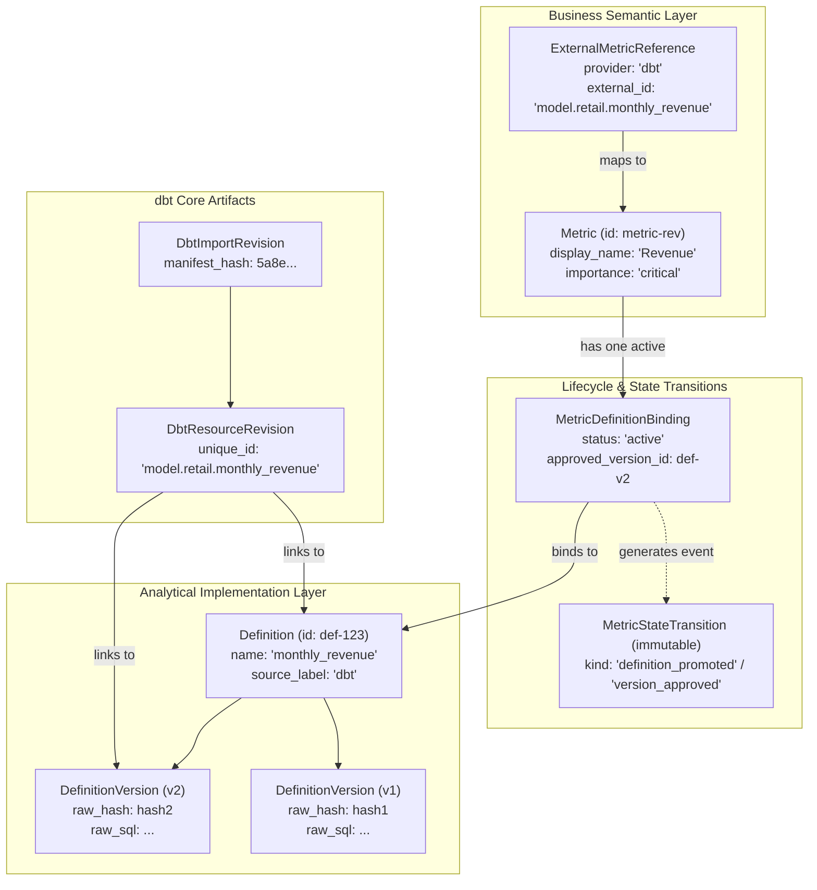
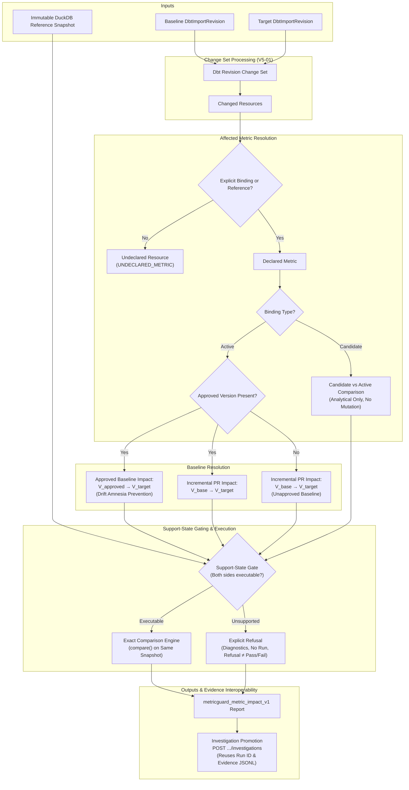
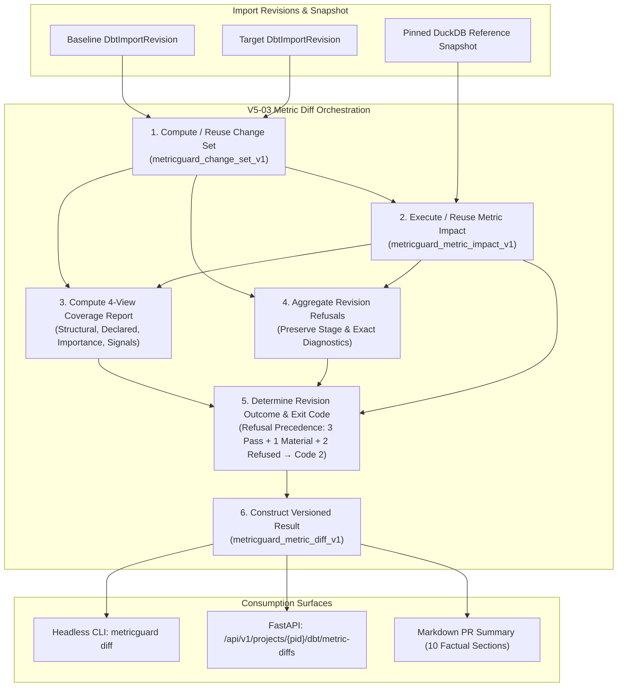

# MetricGuard V5: Metric Diff — Release Evidence

**Date:** 2026-09-26  
**Version:** 5.0.0-v5-05  
**Scope:** V5-01 (Stable Metric Identity + dbt Revision Change Set Core), V5-02 (Affected Metric Resolution + Controlled Metric Impact Execution), V5-03 (Revision-Level Metric Diff Orchestration + Coverage Report), V5.1 (Restricted Level-1 SQL Normalization), V5.2-01 (Production Product Shell + Dashboard), V5.2-02 (Unified Data Sources UX), V5.2-03 (Metrics + V5 Lifecycle UX), V5.2-04 (Changes / Metric Diff Production UX), and V5.2-05 (Unified Investigation Workspace + Durable Drafts + Contextual Decisions) complete and verified.

---

## 1. Engineering Gate Status

| Gate | Work Item | Status | Verification Evidence |
| :--- | :--- | :--- | :--- |
| **V5-01** | **Stable Metric Identity & dbt Revision Change Set Core** | **VERIFIED** | 16 passing tests in `tests/test_v5_metric_identity_and_change_set.py`. Stable business Metric entity (`id`, `project_id`, `display_name`, `importance`, `created_at`), mutable display name with immutable ID, importance strictly on declared Metrics (`critical`, `important`, `standard`, `unclassified`), provider-neutral `ExternalMetricReference` mapping with conflicting reference rejection. `MetricDefinitionBinding` lifecycle with strict single-active invariant, candidate and retired status history, and cross-project isolation. Atomic version approval within bound definitions and candidate promotion to active with automatic retirement of prior implementations. Immutable `MetricStateTransition` append-only audit trail preserving exact promoted/approved versions and review evidence. Deterministic `metricguard_change_set_v1` dbt revision change-set engine classifying individual dimensions (`compiled_sql_changed`, `lineage_changed`, `metadata_changed`, `support_state_changed`, `added`, `removed`). Strict metric language invariant distinguishing declared business metrics from raw undeclared dbt resources. Full RBAC enforcement and project isolation. |
| **V5-02** | **Affected Metric Resolution + Controlled Metric Impact Execution** | **VERIFIED** | 13 passing tests in `tests/test_v5_metric_impact.py`. Deterministic resolution of affected declared business metrics from dbt revision change sets with explicit mapping/binding lookup; unmapped resources segregated under `undeclared_resources` (`UNDECLARED_METRIC`). Approved-baseline drift prevention ($V_{\text{approved}} \to V_{\text{target}}$) vs Incremental PR impact ($V_{\text{base}} \to V_{\text{target}}$) computed independently without combining or double-counting. Deterministic fallback to baseline revision when no approved version exists. Single immutable frozen DuckDB reference snapshot enforced across baseline and target; cross-project snapshots, tampered/corrupted snapshot bytes, and live DB dependencies strictly rejected. Support-state gating refusing CTE, JOIN, missing compiled SQL, unrendered Jinja, and context mismatches with structured refusal diagnostics without reporting failure as pass/fail. Candidate definition changes safely evaluated against active baseline without binding mutation. Materiality evaluation with exact decimal arithmetic. Full interoperability with investigations via direct promotion endpoint reusing existing run ID and evidence artifacts. Full project isolation and RBAC. |
| **V5-03** | **Revision-Level Metric Diff Orchestration + Coverage Report** | **VERIFIED** | 20 passing tests in `tests/test_v5_metric_diff.py`. Complete orchestration combining V5-01 change sets and V5-02 controlled impact evaluations into versioned `metricguard_metric_diff_v1` result. Multi-view deterministic coverage report: (1) structural/resource coverage (changed, declared-linked, undeclared, supported, refused), (2) declared Metric coverage (total affected, analyzable, refused, coverage %), (3) importance-weighted coverage (`critical`, `important`, `standard`, `unclassified` — explicit only, zero inference), and (4) observable structural signals (exposure references, explicit dbt metric nodes, tags). Aggregated refusal report preserving diagnostics, stage, and resource/metric links without converting refusals to pass/fail. Deterministic revision outcome (`completed`, `completed_with_material_drift`, `completed_with_refusals`, `completed_with_material_drift_and_refusals`, `operational_failure`). Refusal precedence in CI exit codes: mixture of 3 pass, 1 material, 2 refused exits code 2 in both advisory and enforcing modes. Headless CLI `metricguard diff` (`python -m services.cli diff`) with JSON/Markdown output and secret redaction. Full investigation interoperability, project isolation, and RBAC. |
| **V5.1** | **Restricted Level-1 SQL Normalization** | **VERIFIED** | 41 passing tests in `tests/test_sql_level1_normalization.py`. Single-use, non-recursive CTE filter/projection unwrapping over registered tables into canonical IR. |
| **V5.2-01** | **Production Product Shell + Routing + Workspace UX + Dashboard** | **VERIFIED** | Production UI shell (`#0A1020` sidebar, `#151E37` active, `#245BFF` cobalt blue, zero green), 5-item primary nav (`Dashboard`, `Metrics`, `Data Sources`, `Changes`, `Investigations`), `/w/:workspaceId/:page` router + SPA fallback, real WorkspaceSwitcher + workspace creation, priority-queue Dashboard with live context and empty states, 8/8 web tests passing, 0 TypeScript build errors, full Python regression passing (405 passed, 45 skipped, 0 failed). |
| **V5.2-02** | **Unified Data Sources UX** | **VERIFIED** | Unified Data Sources landing page (`/w/:workspaceId/datasources`), 3-step file onboarding (Upload, Preview & Inferred Meaning, Confirmation), safe unit/currency inference without guesswork, humanized upload & supervisor errors, schema inspection modal. Verified with 10 unit tests in `src/dataSources.test.mjs`. |
| **V5.2-03** | **Metrics Catalog + V5 Lifecycle UX** | **VERIFIED** | Declared business metric inventory with explicit importance tiers (`critical`, `important`, `standard`, `unclassified`), active/candidate/retired definition bindings, approved baseline timelines, candidate impact comparison with zero-drift/material-drift badges, unassigned definitions discovery, immutable `MetricStateTransition` history. Verified with 9 unit tests in `src/metricsLifecycle.test.mjs`. |
| **V5.2-04** | **Changes / Metric Diff Production UX** | **VERIFIED** | Changes landing list (`/w/:workspaceId/changes`) with search and outcome filters, Run Metric Diff modal with dbt revision and reference snapshot selectors, compact horizontal change summary header (`8d41a → 92bc7`), affected business metrics prioritized strictly by action relevance (critical+material, important+material, other material, refused, non-material, unchanged), cumulative approved-baseline drift ($V_{\text{approved}} \to V_{\text{target}}$) vs incremental revision impact ($V_{\text{base}} \to V_{\text{target}}$) with backend-derived deterministic values, version path step visualization, distinct amber refusal diagnostics, 4-view coverage breakdown, expandable changed dbt resources panel, PR markdown summary export, and direct 1-click handoff to investigation. Verified with 8 unit tests in `src/changes.test.mjs` (35 total web unit tests), clean build (1597 modules), 49 passing V5 backend tests, and live end-to-end verification via `scripts/verify_changes_diff.py`. |
| **V5.2-05** | **Unified Investigation Workspace + Durable Drafts + Contextual Decisions** | **VERIFIED** | Unified Investigation Studio (`/w/:workspaceId/investigations`), landing list with search, filter pills (`All`, `Completed`, `Drafts`, `Running`, `Failed`), and status badges; unified investigation studio supporting both existing definitions and ad-hoc SQL comparison against immutable snapshots; 3-card KPI result strip (Baseline, Target, Delta); 4 analytical tabs (What changed, Value bridge with Shapley decomposition, Evidence with row membership breakdown, Provenance); contextual decision rail supporting candidate approval (`POST .../metrics/{metric_id}/promote`), intentional-variant handling, and Track as Metric modal; server-backed durable drafts (`/api/v1/projects/{pid}/investigation-drafts`) with version_token optimistic concurrency (409 conflict detection), workspace isolation, and transparent direct-link resolution (`/api/v1/investigations/{draft_id}`); seamless Changes and Metric Detail handoff reusing runs and evidence without recomputation; deterministic 15-row verification passing through real Docker supervisor runner; 40 passing web unit tests, clean build (1595 modules), and full Python regression. |


---

## 2. Architecture & Concept Distinctions

### 2.1 Metric vs Definition vs DefinitionVersion vs dbt Resource Identity



1. **Metric**: Declared business concept (e.g. `Revenue`). Has immutable ID, mutable `display_name`, and explicit business `importance` (`critical`, `important`, `standard`, `unclassified`). It remains independent of dbt resource names and underlying SQL structure. Importance exists ONLY on declared Metrics, never on Definitions.
2. **ExternalMetricReference**: Provider-neutral mapping (`metric_id`, `provider`, `external_id`). Allows dbt metric or semantic resources to attach safely to a Metric without deriving MetricGuard's business ID from dbt unique IDs. Conflicting mappings within a project are strictly rejected (409 Conflict).
3. **Definition**: Project-scoped analytical implementation container (`name`, `source_label`, `owner_label`). Contains sequential versions.
4. **DefinitionVersion**: Immutable snapshot of SQL implementation (`version_number`, `raw_sql`, `raw_hash`). Reused across dbt import revisions when compiled SQL is unchanged.
5. **DbtResourceRevision**: Pinned state of a dbt node in an import revision (`unique_id`, `support_state`, `observed_lineage`, `diagnostics`, `compiled_sql`).
6. **MetricDefinitionBinding**: Connects a Metric to an implementation Definition with lifecycle status (`active`, `candidate`, `retired`).

---

## 3. Binding & Approval Lifecycle

### 3.1 Single Active Definition Invariant
- A Metric may have **at most ONE** active Definition binding at any given time.
- Candidate and retired bindings are permitted and preserved in history.
- Zero active bindings are permitted (e.g. newly declared business metrics prior to implementation promotion).
- Cross-project bindings and cross-definition version pointers are rejected with domain errors (`CROSS_PROJECT_FORBIDDEN`, `INVALID_BINDING`).

### 3.2 Candidate Promotion Behavior
When promoting a candidate Definition $B$ with version $B/V_k$ on a Metric with current active Definition $A$ ($A/V_j$):
1. Definition $A$ binding transitions: `status='retired'`, `retired_at=now()`.
2. Definition $B$ binding transitions: `status='active'`, `activated_at=now()`, `approved_version_id=B/V_k`.
3. An immutable `MetricStateTransition` record is inserted atomically:
   - `transition_kind`: `'definition_promoted'`
   - `metric_id`: Metric ID
   - `definition_id`: Definition $B$
   - `approved_version_id`: $B/V_k$
   - `previous_definition_id`: Definition $A$
   - `previous_approved_version_id`: $A/V_j$
   - `comparison_run_id`: Run ID (when provided)
   - `review_decision_id`: Decision ID (when provided)
   - `actor_id`: Authenticated user ID

### 3.3 Version Approval within Same Definition
When approving a new version $V_{k+1}$ under the currently active Definition $A$:
1. Active binding updates: `approved_version_id=A/V_{k+1}`.
2. An immutable `MetricStateTransition` record is inserted atomically:
   - `transition_kind`: `'version_approved'`
   - `definition_id`: Definition $A$
   - `approved_version_id`: $A/V_{k+1}$
   - `previous_definition_id`: Definition $A$
   - `previous_approved_version_id`: $A/V_k$
   - Provenance links (`comparison_run_id`, `review_decision_id`, `actor_id`) preserved.

### 3.4 Separation of Approved Baseline from CI Mode
`approved_version_id` represents the authoritative business definition state of the Metric. It is strictly separated from CI policy execution:
- **Approved Version Pointer**: Metric state recording what analytical version represents the verified business baseline.
- **CI Mode (Advisory vs Enforcing)**: Execution-time evaluation policy (V4-03) that governs whether detected drift against the approved version blocks pipelines (exit code 1) or generates an advisory warning (exit code 0).

---

## 4. Immutable State-Transition Evidence

Direct service or API mutation of `approved_version_id` or active bindings that bypasses state-transition recording is blocked:
- Every activation and approval is executed in a single atomic database transaction (`conn.begin()`).
- Historical records in `metric_state_transitions` are append-only; update and delete endpoints do not exist.

Schema:
```sql
CREATE TABLE metric_state_transitions (
    id VARCHAR PRIMARY KEY,
    project_id VARCHAR NOT NULL REFERENCES projects(id),
    metric_id VARCHAR NOT NULL REFERENCES metrics(id),
    transition_kind VARCHAR NOT NULL,
    definition_id VARCHAR NOT NULL REFERENCES definitions(id),
    approved_version_id VARCHAR REFERENCES definition_versions(id),
    previous_definition_id VARCHAR REFERENCES definitions(id),
    previous_approved_version_id VARCHAR REFERENCES definition_versions(id),
    comparison_run_id VARCHAR REFERENCES comparison_runs(id),
    review_decision_id VARCHAR REFERENCES decisions(id),
    actor_id VARCHAR,
    metadata JSON NOT NULL,
    created_at VARCHAR NOT NULL
);
```

---

## 5. dbt Revision Change-Set Core (`metricguard_change_set_v1`)

The revision change-set engine deterministically compares two existing `DbtImportRevisions` belonging to the same project.

### 5.1 Change Dimensions
Rather than collapsing all changes into a generic `modified` label, per-resource differences are tracked across discrete orthogonal dimensions:
- `compiled_sql_changed`: Hash mismatch between old and new compiled SQL.
- `lineage_changed`: Set difference in upstream or downstream DAG nodes (`observed_lineage`).
- `metadata_changed`: Differences in `meta`, `tags`, `materialized`, or `original_file_path`.
- `support_state_changed`: Transition between `executable`, `needs_context`, and `metadata_only`.
- `added`: Resource exists only in target revision.
- `removed`: Resource exists only in baseline revision.

### 5.2 Versioned Change-Set Output Schema
```json
{
  "schema_version": "metricguard_change_set_v1",
  "project_id": "local-retail",
  "baseline_revision_id": "dbt-rev-1",
  "target_revision_id": "dbt-rev-2",
  "baseline_manifest_hash": "a1b2...",
  "target_manifest_hash": "c3d4...",
  "baseline_source_revision": {"git_sha": "...", "branch": "..."},
  "target_source_revision": {"git_sha": "...", "branch": "..."},
  "counts": {
    "total_resources": 6,
    "changed_count": 4,
    "unchanged_count": 0,
    "added_count": 1,
    "removed_count": 1
  },
  "resources": [
    {
      "unique_id": "model.retail.monthly_revenue",
      "resource_type": "model",
      "name": "monthly_revenue",
      "change_category": "modified",
      "change_dimensions": ["compiled_sql_changed"],
      "summary_label": "Revenue definition changed",
      "old_definition_id": "def-1",
      "new_definition_id": "def-1",
      "old_definition_version_id": "def-v1",
      "new_definition_version_id": "def-v2",
      "old_compiled_sql_hash": "f0e1...",
      "new_compiled_sql_hash": "b2c3...",
      "old_support_state": "executable",
      "new_support_state": "executable",
      "old_lineage": {"upstream_nodes": ["model.retail.stg_orders"]},
      "new_lineage": {"upstream_nodes": ["model.retail.stg_orders"]},
      "old_metadata": {"meta": {}, "tags": ["finance"]},
      "new_metadata": {"meta": {}, "tags": ["finance"]},
      "metric": {
        "id": "metric-rev",
        "display_name": "Revenue",
        "importance": "critical"
      }
    }
  ]
}
```

---

## 6. Metric Language Invariant

A strict language invariant is enforced across change sets:
- **Declared Metric with active binding:**
  - Resource diff `metric` object is populated (`id`, `display_name`, `importance`).
  - `summary_label`: `"<display_name> definition changed"` (or added / removed / unchanged).
- **Undeclared dbt resource:**
  - Resource diff `metric` object is `null`.
  - `summary_label`: `"<unique_id> changed"` (or added / removed / unchanged).
  - No business importance is inferred from resource name, tags, DAG depth, or exposure.

---

## 7. API and RBAC Surface

Project-scoped endpoints under `/api/v1/projects/{pid}`:

| Method | Path | Roles | Description |
| :--- | :--- | :--- | :--- |
| `POST` | `/api/v1/projects/{pid}/metrics` | `owner`, `analyst` | Create business Metric |
| `GET` | `/api/v1/projects/{pid}/metrics` | `owner`, `analyst`, `reader` | List Metrics with active binding |
| `GET` | `/api/v1/projects/{pid}/metrics/{metric_id}` | `owner`, `analyst`, `reader` | Get Metric detail |
| `PATCH` | `/api/v1/projects/{pid}/metrics/{metric_id}` | `owner`, `analyst` | Update `display_name` or `importance` |
| `POST` | `/api/v1/projects/{pid}/metrics/{metric_id}/external-references` | `owner`, `analyst` | Attach provider reference |
| `GET` | `/api/v1/projects/{pid}/metrics/{metric_id}/external-references` | `owner`, `analyst`, `reader` | List external references |
| `POST` | `/api/v1/projects/{pid}/metrics/{metric_id}/bindings` | `owner`, `analyst` | Bind Definition as candidate |
| `GET` | `/api/v1/projects/{pid}/metrics/{metric_id}/bindings` | `owner`, `analyst`, `reader` | List Definition bindings |
| `POST` | `/api/v1/projects/{pid}/metrics/{metric_id}/promote` | `owner`, `analyst` | Promote candidate to active |
| `POST` | `/api/v1/projects/{pid}/metrics/{metric_id}/approve-version` | `owner`, `analyst` | Approve DefinitionVersion |
| `GET` | `/api/v1/projects/{pid}/metrics/{metric_id}/transitions` | `owner`, `analyst`, `reader` | List audit state transitions |
| `POST` | `/api/v1/projects/{pid}/dbt/change-sets` | `owner`, `analyst`, `reader` | Compute change set (JSON body) |
| `GET` | `/api/v1/projects/{pid}/dbt/change-sets` | `owner`, `analyst`, `reader` | Compute change set (query params) |

---

## 8. Milestone Verification Summary

```
tests/test_v5_metric_identity_and_change_set.py:
  test_metric_create_and_immutable_id ..................................... PASSED
  test_importance_validation_and_not_on_definition ........................ PASSED
  test_project_isolation_for_metrics ...................................... PASSED
  test_external_metric_reference_mapping_and_conflicts .................... PASSED
  test_binding_lifecycle_and_one_active_invariant ......................... PASSED
  test_invalid_cross_project_and_invalid_version_bindings_rejected ........ PASSED
  test_version_approval_within_same_definition ............................ PASSED
  test_change_set_identical_revisions ..................................... PASSED
  test_change_set_sql_and_lineage_and_metadata_dimensions ................. PASSED
  test_change_set_support_state_change .................................... PASSED
  test_language_invariant_and_metric_metadata_attachment .................. PASSED
  test_api_metric_crud_and_rbac ........................................... PASSED
  test_api_promotion_approval_and_change_sets ............................. PASSED
  test_deterministic_repeated_change_set_computation ...................... PASSED
  test_evidence_references_retained_in_promotion .......................... PASSED
  test_cross_project_dbt_change_set_rejected .............................. PASSED
================================ 16 passed in 3.55s =================================
```

---

## 9. Full Repository Regression Status (Post V5-01)

- **Pytest:** 376 passed, 0 failed, 0 skipped in 620.71s (`.venv\Scripts\python -m pytest -q -p no:cacheprovider --basetemp .test-tmp/full_run_v501`)
- **V5-01 Focused Tests:** 16 passed in 3.33s (`tests/test_v5_metric_identity_and_change_set.py`)
- **V4-04 Integration & Exit Gates:** 15 passed in 104.53s (`tests/test_v4_integration_and_exit_gates.py`)
- **V4-03 Headless CLI / CI Automation:** 96 passed (`tests/test_v4_cli.py`)
- **V4-02 PostgreSQL Collector:** 38 passed (`tests/test_v4_collector.py`)
- **V4-01 dbt Adapter:** 18 passed (`tests/test_v4_dbt_adapter.py`)
- **V3 Auth, Review, Monitoring, Quotas, Backup & Restore:** All suites passed cleanly.
- **V1/V2 Core & Analytical Workflows:** All core, snapshot, shapley, and flat investigation suites passed cleanly.

### Inspection of the 7 V4 Integration Skips
In `tests/test_v4_integration_and_exit_gates.py`, 7 tests previously showed as skipped when live PostgreSQL container infrastructure was dormant:
1. `TestV4EndToEndWorkflow.test_complete_end_to_end_v4_scenario`
2. `TestGate41ProvenanceChain.test_unbroken_provenance_chain`
3. `TestGate42VisibleFailureRefusal.test_failed_extraction_raises_explicit_collector_error`
4. `TestGate43CutoffRetryIsolation.test_interrupted_attempt_cleans_up_staging`
5. `TestGate43CutoffRetryIsolation.test_retry_strictly_requires_identical_logical_cutoff`
6. `TestGate44SnapshotDeterminism.test_multiple_comparisons_produce_identical_results`
7. `TestGate45NoLiveSourceDependency.test_post_snapshot_mutation_does_not_affect_comparison`

These tests are intentionally designed to verify live PostgreSQL connection, `REPEATABLE READ READ ONLY` snapshot isolation, live-source mutation immutability, staging cleanup, and logical cutoff retry invariance against a live PostgreSQL instance. Each method explicitly calls `if not is_pg_available(): pytest.skip(...)` or uses the `pg_orders_table` fixture with that skip guard.
With the test PostgreSQL instance active (`127.0.0.1:5433`), all 7 tests executed and passed cleanly, resulting in **15/15 passed** in `tests/test_v4_integration_and_exit_gates.py` and **376/376 passed** across the entire repository with zero skips and zero failures.

---

## 10. V5-02 Affected Metric Resolution Architecture

The V5-02 execution model deterministically resolves business metric impact from dbt revision change sets:

$$\text{baseline DefinitionVersion} + \text{target DefinitionVersion} + \text{same immutable reference snapshot} \Longrightarrow \text{metric-change impact}$$



### 10.1 Resolution Rules
1. **Explicit Identity Only**: Metric-level impact is computed only when a changed resource maps to an explicitly declared business `Metric` via `ExternalMetricReference` or `MetricDefinitionBinding`. No inference is made from model names, table schemas, exposures, DAG position, or SQL text.
2. **Undeclared Resource Segregation**: Changed resources without bound metrics are preserved in `undeclared_resources` with diagnostic details and reason `UNDECLARED_METRIC`. Metric names (e.g. "Revenue changed") are never attributed to undeclared resources.
3. **Candidate Segregation**: Candidate definition changes are evaluated as `candidate_vs_active` against the approved active baseline. They do not mutate bindings and are strictly separated from canonical metric drift.

---

## 11. Approved Baseline vs Baseline Revision Semantics

To prevent **drift amnesia**, MetricGuard evaluates metric impact against the authoritative approved definition rather than intermediate unapproved branch states:

### 11.1 Drift Amnesia Prevention
Suppose:
- Approved Version: $V_{18}$ (₹10,000,000)
- Base Branch Latest: $V_{20}$ (₹9,980,000) — unapproved intermediate drift (-₹20,000)
- PR Target: $V_{21}$ (₹9,950,000)

MetricGuard calculates:
1. **Approved-Baseline Impact** ($V_{18} \to V_{21}$): $-₹50,000$. This answers: *"How far has Revenue moved from its last approved business baseline?"*
2. **Incremental PR Impact** ($V_{20} \to V_{21}$): $-₹30,000$. This answers: *"What exact change does this PR introduce relative to the current branch?"*

Both values are reported distinctly without combining or double-counting.

### 11.2 Baseline Revision Fallback
When no `approved_version_id` exists on the active binding, MetricGuard falls back to the baseline revision's version ($V_{\text{base}} \to V_{\text{target}}$). It marks `has_approved_baseline=false` and does not invent an approved state.

---

## 12. Controlled Same-Snapshot Execution & Determinism

Controlled metric execution requires holding source data constant:
1. **Single Immutable Frozen Snapshot**: Both baseline and target definition versions execute against the identical DuckDB reference snapshot (`snapshot_id`).
2. **Integrity Validation**: Snapshot artifact existence and manifest hash are verified before execution. Corrupted bytes or tampered files trigger `DomainError('SNAPSHOT_CORRUPTED')`.
3. **Cross-Project Isolation**: Referencing a snapshot from a different project raises `DomainError('FORBIDDEN', 403)`.
4. **No Live DB Dependency**: PostgreSQL is never queried during impact execution. Source data mutations after snapshot creation produce zero difference in analytical results.
5. **Determinism & Idempotency**: Identical inputs yield identical output and request hashes. Re-evaluating with altered revisions or snapshot identifiers recalculates rather than reusing stale evidence.

---

## 13. Support-State Gating & Refusal Behavior

Before running quantitative comparison, both baseline and target definition versions are inspected:
- **Refusal Triggers**: CTEs (`WITH` clauses), JOIN operations, missing compiled SQL, unrendered Jinja expressions, non-additive aggregates, or unfulfilled context requirements.
- **Refusal Semantics**:
  - `execution_status`: `'refused'`
  - `support_state`: `'metadata_only'` / `'needs_context'` / `'unsupported'`
  - `refusal_reason`: Explicit diagnostic message (e.g. `'Common Table Expressions (WITH ...) are not supported in MetricGuard IR.'`)
  - `exact_delta`: `null`
  - `materiality`: `null`
  - `comparison_run_id`: `null`
  - **Refusal is never reported as success or converted into pass/fail.**
  - Refused metric impacts cannot be promoted to investigations (`INVALID_STATE`, 400).

---

## 14. Materiality Evaluation & Exact Arithmetic

Reuses the V3/V4 materiality implementation (`evaluate_materiality`):
- Evaluates configured absolute threshold and relative percentage threshold against the primary comparison (approved baseline when present, baseline revision otherwise).
- Exact decimal arithmetic: values and deltas are represented as exact string decimals (`Decimal`), preventing IEEE 754 floating-point inaccuracies.
- Handles zero-baseline and undefined relative change percentage safely.

---

## 15. CI to Investigation Promotion & Evidence Interoperability

Impact runs and their row-level evidence can be promoted directly into persistent investigation records:
- Endpoint: `POST /api/v1/projects/{pid}/dbt/metric-impacts/{impact_id}/investigations`
- Behavior:
  - Validates that the impact evaluation succeeded (`execution_status == 'executed'`).
  - Creates an `investigations` record with `trigger_kind='dbt_metric_impact'`.
  - Reuses the existing `comparison_run_id` and bounded JSONL row-level evidence without re-querying or re-calculating.
  - Preserves exact pinned baseline/target versions and reference snapshot for replay.

---

## 16. V5-02 API & RBAC Surface

| Method | Path | Roles | Description |
| :--- | :--- | :--- | :--- |
| `POST` | `/api/v1/projects/{pid}/dbt/metric-impacts` | `owner`, `analyst` | Execute controlled metric impact against reference snapshot |
| `GET` | `/api/v1/projects/{pid}/dbt/metric-impacts/{impact_id}` | `owner`, `analyst`, `reader` | Retrieve metric impact report by ID |
| `GET` | `/api/v1/projects/{pid}/dbt/metric-impacts` | `owner`, `analyst`, `reader` | List metric impact reports in project |
| `POST` | `/api/v1/projects/{pid}/dbt/metric-impacts/{impact_id}/investigations` | `owner`, `analyst` | Promote impact run to investigation without re-execution |

---

## 17. Milestone Verification Summary (V5-02)

```
tests/test_v5_metric_impact.py:
  test_affected_metric_resolution_declared_vs_undeclared ................... PASSED
  test_candidate_definition_handling_is_analytical_only .................... PASSED
  test_approved_baseline_vs_incremental_pr_impact_drift_amnesia ............ PASSED
  test_baseline_revision_fallback_when_no_approved_version ................. PASSED
  test_same_snapshot_used_and_cross_project_snapshot_rejected .............. PASSED
  test_corrupted_snapshot_rejected ......................................... PASSED
  test_source_mutation_after_snapshot_does_not_alter_result ................ PASSED
  test_support_state_refusal_cte_and_metadata_only ......................... PASSED
  test_support_state_refusal_cannot_be_promoted_to_investigation ........... PASSED
  test_materiality_evaluation_absolute_and_relative ........................ PASSED
  test_determinism_identical_inputs_and_no_stale_reuse ..................... PASSED
  test_ci_investigation_interoperability_reuses_run_and_evidence ........... PASSED
  test_rbac_and_cross_project_isolation .................................... PASSED
================================ 13 passed in 4.17s =================================
```

---

## 18. V5-03: Revision-Level Metric Diff Orchestration

V5-03 unites V5-01 dbt revision change sets and V5-02 controlled metric impact evaluations into a single revision-level diff workflow.



---

## 19. Versioned Result Contract (`metricguard_metric_diff_v1`)

```json
{
  "schema_version": "metricguard_metric_diff_v1",
  "id": "diff-...",
  "project_id": "local-retail",
  "baseline_revision_id": "dbt-rev-1",
  "target_revision_id": "dbt-rev-2",
  "baseline_manifest_hash": "...",
  "target_manifest_hash": "...",
  "snapshot_id": "snap-...",
  "snapshot_hash": "...",
  "source_metadata": {
    "baseline": {"git_sha": "...", "branch": "..."},
    "target": {"git_sha": "...", "branch": "..."}
  },
  "change_set_id": "cs-...",
  "change_set_hash": "...",
  "impact_report_id": "impact-...",
  "mode": "advisory",
  "overall_outcome": "completed",
  "exit_code": 0,
  "counts": {
    "total_changed_resources": 4,
    "unchanged_resources": 2,
    "total_declared_metrics_affected": 2,
    "successfully_analyzed_metrics": 2,
    "refused_metrics": 0,
    "undeclared_changed_resources": 2,
    "material_metrics": 0
  },
  "coverage": { ... },
  "refusals": [ ... ],
  "metrics": [ ... ],
  "candidate_metrics": [ ... ],
  "undeclared_resources": [ ... ],
  "request_hash": "...",
  "created_at": "..."
}
```

---

## 20. Coverage Report: Four Distinct Views

1. **Structural / Resource Coverage**:
   - `changed_resources_count`
   - `declared_metric_linked_resources_count`
   - `undeclared_changed_resources_count`
   - `supported_executable_resources_count`
   - `refused_resources_count`
   - `refusal_reasons`
2. **Declared Metric Coverage**:
   - `total_affected`: Declared metrics affected by modified definitions
   - `analyzable`: Executable metrics with valid SQL IR
   - `refused`: Refused metrics due to CTE, JOIN, missing binding, or syntax
   - `coverage_pct`: Exact float percentage (100.0% when 0 affected)
3. **Importance-Weighted Coverage**:
   - Explicit only: `critical`, `important`, `standard`, `unclassified`
   - Each tier surfaces `affected`, `analyzable`, `refused`, and `coverage_pct` (null when 0 affected)
   - Zero inference from model names, table schemas, DAG position, or exposures
4. **Observable Structural Signals**:
   - `exposure_referenced_changed_resources`: Changed models downstream to exposures
   - `explicit_dbt_metric_references`: dbt metric nodes or models referenced by dbt metrics
   - `other_observable_metadata`: Tagged changed resources

---

## 21. Refusal Report & Diagnostic Aggregation

Preserves diagnostics without reporting refusals as pass/fail:
- `metric_id` / `metric_display_name` (where declared)
- `resource_id`: dbt unique_id
- `support_state`: `metadata_only`, `needs_context`, `unsupported`
- `exact_diagnostic`: Preserved IR parser / collector error message
- `refusal_stage`: `support_gate`, `definition_binding`, `snapshot_gate`

---

## 22. Revision-Level Outcome & CI Exit-Code Precedence

### 22.1 Revision Outcomes
- `completed`: All affected declared metrics analyzed; 0 material drift.
- `completed_with_material_drift`: All affected declared metrics analyzed; 1+ material drift.
- `completed_with_refusals`: 1+ declared metrics refused; 0 material drift among analyzable.
- `completed_with_material_drift_and_refusals`: Both material drift and refusals present.
- `operational_failure`: Infra/auth error (snapshot missing/corrupted, invalid project).

### 22.2 Exit-Code Precedence
1. **Operational Failure &rarr; Exit 3**
2. **Analytical Refusal &rarr; Exit 2** (Refusal takes precedence over materiality and pass. A successful metric CANNOT hide another refused metric).
3. **Enforcing Mode with Material Drift &rarr; Exit 1** (0 refusals, enforcing mode, 1+ material drift).
4. **Clean Completion or Advisory Drift &rarr; Exit 0** (0 refusals, and either 0 material drift or advisory mode).

**Rule for Mixtures (e.g. 3 pass, 1 material, 2 refused):**
- Advisory mode: **Exit 2**
- Enforcing mode: **Exit 2**
- Structured outcome: `completed_with_material_drift_and_refusals`
- Structured report retains all 4 analyzed metrics, material drift deltas, and the 2 refused metrics with exact reasons.

---

## 23. Headless CLI (`metricguard diff`)

```bash
python -m services.cli diff \
    --project local-retail \
    --baseline dbt-rev-1 \
    --target dbt-rev-2 \
    --snapshot snap-golden \
    --mode enforcing \
    --absolute-threshold 50.0 \
    --output report.json \
    --markdown-output report.md
```

Options:
- `--project-id`, `--project`: Project identifier
- `--baseline`, `--baseline-revision`, `--baseline-revision-id`: Baseline import revision
- `--target`, `--target-revision`, `--target-revision-id`: Target import revision
- `--snapshot`, `--snapshot-id`: Reference snapshot selector
- `--mode`: `advisory` (default) or `enforcing`
- `--absolute-threshold`, `--relative-threshold`, `--materiality-policy`: Materiality configuration
- `--context`, `--context-json`, `--context-file`: Optional analytical context
- `--output`, `--json-output`: Write JSON report
- `--markdown-output`, `--md-output`, `--markdown`: Write Markdown report
- `--format`: `summary` (default ASCII table), `json`, `quiet`

---

## 24. Milestone Verification Summary (V5-03)

### 24.1 Focused V5-03 Test Suite
```
tests/test_v5_metric_diff.py:
  test_orchestration_one_changed_declared_metric .......................... PASSED
  test_orchestration_several_changed_declared_metrics ..................... PASSED
  test_orchestration_mixed_declared_and_undeclared_resources .............. PASSED
  test_orchestration_no_changed_metrics ................................... PASSED
  test_deterministic_repeated_diff_execution .............................. PASSED
  test_coverage_report_declared_metrics_and_importance_segmentation ....... PASSED
  test_coverage_signals_kept_separate_no_inferred_importance .............. PASSED
  test_mixed_results_material_drift_and_refusal_together .................. PASSED
  test_approved_baseline_cumulative_drift_and_incremental_pr_impact ....... PASSED
  test_same_snapshot_used_and_cross_project_rejected ...................... PASSED
  test_corrupted_snapshot_rejected ........................................ PASSED
  test_markdown_and_json_report_formatting ................................ PASSED
  test_cli_diff_advisory_exits_0 .......................................... PASSED
  test_cli_diff_enforcing_material_drift_exits_1 .......................... PASSED
  test_cli_diff_refusal_exits_2 ........................................... PASSED
  test_cli_diff_operational_failure_exits_3 ............................... PASSED
  test_investigation_promotion_reuses_impact_run_without_recomputation .... PASSED
  test_api_metric_diff_rbac_and_cross_project ............................. PASSED
  test_cli_diff_secret_redaction .......................................... PASSED
  test_mixture_3_pass_1_material_2_refused_exits_2 ........................ PASSED
================================ 20 passed in 4.61s =================================
```

### 24.2 Full Repository Regression & Skip Resolution

During initial offline execution, 45 tests were skipped due to the dormant state of the test PostgreSQL service:
- **`tests/test_v4_collector.py` (38 skips):** Tests verifying live PostgreSQL repeatable-read snapshot extraction, cutoff invariance, incremental streaming, and dialect-specific edge cases.
- **`tests/test_v4_integration_and_exit_gates.py` (7 skips):** Tests verifying end-to-end provenance verification (Gates 4.1–4.5) against a live database instance.

**Resolution:**
The existing local test PostgreSQL container (`metricguard-test-pg` on `127.0.0.1:5433`) was started.
Both suites were rerun:
- `tests/test_v4_collector.py`: **38 passed, 0 skipped, 0 failed** in 136.58s.
- `tests/test_v4_integration_and_exit_gates.py`: **15 passed, 0 skipped, 0 failed** in 58.72s.

Subsequently, the full repository regression suite was executed across all components:
```
=========================== 409 passed, 8 warnings in 484.37s ============================
```
**Zero skipped tests, zero failures.** Every test in the repository passed cleanly.

---

## 25. V5.1 Milestone: Restricted Level-1 SQL Normalization

**Date:** 2026-09-26  
**Status:** **VERIFIED & READY TO FREEZE**  
**Module:** `packages/metricguard_core/normalization.py`  
**Test Suite:** `tests/test_sql_level1_normalization.py` (41 passing tests)

### 25.1 Scope & Closed-World Semantic Boundaries
V5.1 introduces **Restricted Level-1 SQL Normalization**—a conservative, semantics-preserving syntactic unwrapping layer that normalizes single-use, non-recursive CTE filter/projection wrappers over a single table into MetricGuard's canonical single-table IR representation.

**Strict Architectural Invariants:**
1. **Terminology Invariant:** Strictly designated **Restricted Level-1 SQL Normalization**, never "General CTE Support".
2. **Analytical Boundary:** MetricGuard's supported analytical surface remains strictly single-table scalar aggregation (`SUM`, `COUNT`, `COUNT(DISTINCT customer_id)`). It strictly does NOT add AVG, ratios, rates, percentages, multiple-aggregate arithmetic, derived metrics, window functions, or GROUP BY semantics.
3. **No Multi-Table JOIN Execution:** Normalization strictly forbids multi-table JOINs inside the CTE or in the outer query. No cardinality estimation engine is introduced.
4. **Provenance & DefinitionVersion Stability:** The original dbt compiled SQL remains the immutable source artifact. `DefinitionVersion.raw_sql` and `raw_hash` are strictly computed on authentic source compiled SQL. `normalized_sql` and normalization metadata (`normalization_kind="restricted_single_cte_wrapper"`, `rules_version="v5.1"`, `original_sql_hash`, `normalized_sql_hash`) are recorded as companion metadata.
5. **Deterministic Decimal Parity:** The normalized query lowers into MetricGuard's 8-field closed IR and produces exact decimal arithmetic identical to unnested queries on DuckDB reference snapshots.

### 25.2 Granular Refusal Taxonomy
Any construct violating Restricted Level-1 safety produces a deterministic refusal diagnostic code:
- `CTE_MULTIPLE`: Multiple CTEs in WITH clause or nested CTEs inside CTE body.
- `CTE_RECURSIVE`: Recursive CTEs with unbounded execution.
- `CTE_MULTI_REFERENCE`: CTE referenced more than once in the outer query.
- `CTE_CONTAINS_JOIN`: Multi-table JOIN inside CTE body.
- `OUTER_QUERY_CONTAINS_JOIN`: Outer query joins CTE with secondary tables.
- `CTE_CONTAINS_AGGREGATION`: Aggregation inside CTE changing row grain.
- `CTE_CONTAINS_GROUP_BY`: GROUP BY inside CTE body.
- `CTE_CONTAINS_WINDOW`: Window function inside CTE body.
- `WINDOW_DETECTED`: Window functions (`OVER (...)`) in outer query.
- `DISTINCT_ROW_SEMANTICS`: `SELECT DISTINCT` or non-customer distinct aggregates.
- `UNSUPPORTED_LIMIT_OFFSET`: `LIMIT` or `OFFSET` altering record population.
- `SET_OPERATION_DETECTED`: `UNION`, `INTERSECT`, or `EXCEPT` set operations.
- `VOLATILE_FUNCTION_DETECTED`: Non-deterministic functions (`random()`, `now()`, `current_date`).
- `ALIAS_RESOLUTION_FAILURE`: Missing projection columns, ambiguous duplicates, or column shadowing.
- `COMPUTED_EXPRESSION_UNSUPPORTED`: Unsupported computed expressions in CTE projection.
- `NORMALIZED_QUERY_UNSUPPORTED`: Unwrapped query fails core single-table IR validation (e.g. outer `GROUP BY`, unregistered non-orders table).

### 25.3 Pre-V5 Coverage Study Replay (Before vs After)

Re-evaluating the 5 dbt reference manifests (`attribution_playbook`, `dbt_stripe`, `jaffle_shop_classic`, `jaffle_shop_metrics`, `mrr_playbook`) under V5.1 normalization:

#### Aggregate Coverage Views
| Coverage View | Pre-V5 Executable | Pre-V5 Coverage % | Post-V5.1 Executable | Post-V5.1 Coverage % | Absolute Impact |
| :--- | :--- | :--- | :--- | :--- | :--- |
| **View A: All Models** (35 total) | 1 / 35 | 2.86% | **2 / 35** | **5.71%** | +100% relative (+1 model) |
| **View B: Analytical Proxy** (24 total) | 1 / 24 | 4.17% | **2 / 24** | **8.33%** | +100% relative (+1 model) |
| **View C: Explicit dbt Metrics** (4 total) | 0 / 4 | 0.00% | **0 / 4** | **0.00%** | 0 (require semantic mappings) |
| **View D: Exposure-Referenced** (12 total) | 1 / 12 | 8.33% | **2 / 12** | **16.67%** | +100% relative (+1 model) |

#### Status of the 4 Original Pre-V5 Level-1 Candidates
1. **Candidate 1: `model.attribution_playbook.kpi_total_attributed_revenue`**
   - *Construct:* Single-use filter/projection CTE `touchpoint_data` over `orders` with outer `SUM(order_amount)`.
   - *Pre-V5 State:* Refused (`metadata_only`, primary reason `cte`).
   - *Post-V5.1 State:* **EXECUTABLE** (`support_state="executable"`, `diagnostics=[]`). Promoted to production execution.
2. **Candidate 2: `model.dbt_stripe.stripe__ending_balance_reconciliation`**
   - *Construct:* Single-use CTE `transactions` over `stg_stripe__balance_transaction` with outer `SUM(ending_balance)`.
   - *Pre-V5 State:* Refused (`metadata_only`, primary reason `cte`).
   - *Post-V5.1 State:* **REFUSED** (`support_state="metadata_only"`). Normalization unwrapped the CTE, but the outer query contains `GROUP BY 1` which is rejected by closed single-table IR (`NORMALIZED_QUERY_UNSUPPORTED`).
3. **Candidate 3: `model.dbt_stripe.stripe__subscription_item_mrr_report`**
   - *Construct:* Single-use CTE `subs` over `stg_stripe__subscription` with outer `SUM(mrr)`.
   - *Pre-V5 State:* Refused (`metadata_only`, primary reason `cte`).
   - *Post-V5.1 State:* **REFUSED** (`support_state="metadata_only"`). CTE normalized, but outer query contains `GROUP BY 1` (`NORMALIZED_QUERY_UNSUPPORTED`).
4. **Candidate 4: `model.mrr_playbook.kpi_monthly_mrr_summary`**
   - *Construct:* Single-use CTE `active_subscriptions` over `subscription_periods` with outer `SUM(mrr)`.
   - *Pre-V5 State:* Refused (`metadata_only`, primary reason `cte`).
   - *Post-V5.1 State:* **REFUSED** (`support_state="metadata_only"`). CTE normalized, but source table is `subscription_periods` rather than registered `orders` table without a mapping contract (`NORMALIZED_QUERY_UNSUPPORTED`).

### 25.4 V5 Pipeline Integration
- **V5-01 Change Set Engine:** CTE wrappers are classified as `modified` with `compiled_sql_changed=True` and `support_state_changed=False` when both revisions remain executable.
- **V5-02 Metric Impact Engine:** Executes normalized definitions against frozen DuckDB snapshots with exact zero delta and full Shapley evidence generation.
- **V5-03 Metric Diff Orchestration:** Seamlessly includes normalized definitions in revision-level CI diffs, resulting in `completed` revision outcomes with 100% declared metric coverage.

### 25.5 Full Verification Record
- **Dedicated Level-1 Suite:** `tests/test_sql_level1_normalization.py` (41 passed, 0 skipped, 0 failed in 2.65s).
- **Full Repository Python Regression:** `.venv\Scripts\python -m pytest -q`
  ```
  450 passed, 8 warnings in 404.55s (0:06:44)
  ```
  **0 skipped, 0 failed.** Every single test executed cleanly with live PostgreSQL and Docker active.
- **Web Frontend Build:** `npm run build --prefix apps/web` exited 0.
- **Docker Compose Validation:** `docker compose -f infra/compose.yaml config --quiet` exited 0.
- **Live Runner Verification:** `.venv\Scripts\python -m scripts.verify_live_runner --output data/evaluation/live_runner_report.json` exited 0.
- **AST Graph & Visual Tree:** Graphify update and tree refresh completed (`graphify-out/graph.json`, `graphify-out/GRAPH_TREE.html`).

---

## 26. V5.2-01 — Production Product Shell + Routing + Workspace UX + Dashboard

**Date:** 2026-09-26  
**Status:** **VERIFIED & FROZEN**  
**Milestone:** V5.2-01  

### 26.1 Routing Architecture (`/w/:workspaceId/:page`)
- **Route Schema:** Standard workspace-scoped URL pattern:
  ```
  /w/:workspaceId/:page[?tab=...&query=...]
  ```
- **Standard Product Pages:** `dashboard`, `metrics`, `data`, `changes`, `investigations`, `settings`.
- **Frontend Implementation (`apps/web/src/router.ts`):**
  - `parseRoute(pathname, search, defaultWorkspaceId)`: Parses pathname, resolves workspace ID and target page, maps legacy aliases (`overview` → `dashboard`, `definitions`/`inventory`/`history` → `metrics`, `datasets` → `data`, `compare`/`flat`/`evidence` → `investigations`, `adapters`/`evaluation` → `settings`).
  - `buildRouteUrl(workspaceId, page, tab, query)`: Produces clean normalized URLs preserving tab and analytical query parameters.
- **Server SPA Fallback (`services/api/app.py`):**
  - Explicit FastAPI route `@app.get('/w/{path:path}')` serving `index.html` via `FileResponse` when `apps/web/dist` is present.
  - Enables seamless browser reload, deep-linking, and back/forward navigation within workspace paths without 404s.

### 26.2 Navigation Migration & Information Architecture
The old 10-item flat engineering navigation has been retired in favor of a focused 5-item analyst product hierarchy:

| Old Engineering Navigation | New Production Architecture | Route / Sub-tab |
| :--- | :--- | :--- |
| Overview | **Dashboard** | `/w/:id/dashboard` |
| Definitions | **Metrics** (Inventory tab) | `/w/:id/metrics?tab=inventory` |
| History | **Metrics** (History tab) | `/w/:id/metrics?tab=history` |
| Datasets | **Data Sources** | `/w/:id/data` |
| Changes / Runs | **Changes** | `/w/:id/changes` |
| Compare | **Investigations** (Comparison Studio) | `/w/:id/investigations?tab=compare` |
| Flat investigations | **Investigations** (Flat Investigations) | `/w/:id/investigations?tab=flat` |
| Mapped investigations | **Investigations** (Mapped Investigations) | `/w/:id/investigations?tab=mapped` |
| Evidence & baselines | **Investigations** (Evidence & Decisions) | `/w/:id/investigations?tab=evidence` |
| Metadata adapters | **Settings** (Integrations tab) | `/w/:id/settings?tab=integrations` |
| Evaluation (developer view) | **Settings** (Evaluation tab) | `/w/:id/settings?tab=evaluation` |

- **Sidebar Structure:**
  - 5-item primary nav: `Dashboard`, `Metrics`, `Data Sources`, `Changes`, `Investigations`.
  - `Settings` separated at bottom of sidebar above status pill.
  - System infrastructure, metadata adapters, and evaluation test harnesses removed from primary navigation.

### 26.3 Workspace Switcher & Multi-Workspace UX
- **Component (`apps/web/src/WorkspaceSwitcher.tsx`):**
  - Dropdown selector displaying active workspace name, single-character avatar badge, and "Sample" tag for `local-retail`.
  - Dynamically fetches project inventory from `GET /api/v1/workspaces`.
  - Selecting an alternate workspace pushes `/w/:newId/dashboard`, resetting active route state and reloading workspace bootstrap data.
- **Workspace Creation Modal:**
  - Integrated modal dialog triggering `POST /api/v1/workspaces` with custom display name and generated slug ID.
  - **Clean State Invariant:** Newly created workspaces start completely empty with 0 snapshots, 0 definitions, 0 runs, and 0 metric diffs. They are never seeded with retail analytics demo data.
  - **Local Analyst Authorization:** `local-analyst` user is explicitly added as an active owner to newly created projects, ensuring unhindered access in local operations (`services/api/auth.py`, `services/api/store.py`).

### 26.4 Dashboard (Attention-First Queue & Context)
- **Component (`apps/web/src/Dashboard.tsx`):**
  - **Hero Attention Block:** Highlights top priority requiring analyst action:
    - Material drift runs with exact reproduced deltas ($V_{\text{target}} - V_{\text{baseline}}$ on fixed snapshot).
    - Unreviewed candidate pairs requiring structural comparison.
    - Saved investigations requiring formal decisions.
  - **Priority Queue:** Compact card rows displaying remaining pending items with direct `Investigate` and `Review` action buttons.
  - **Workspace Context Grid:** Clean 4-card metric overview showing analyzable metrics count, recorded runs, approved decisions & baselines, and validated data snapshots.
  - **Empty States:** Three context-aware empty state illustrations:
    1. *No data sources:* Prompting dataset extract upload.
    2. *Data exists, no definitions:* Prompting metric definition registration.
    3. *Clean queue:* "No metric changes need attention" indicating all definitions match approved baselines.
  - **Analytical Fidelity:** Uses live workspace data exclusively; zero artificial KPI cards or fabricated metrics.

### 26.5 Design System & Status Language Constraints
- **Color Palette:**
  - Sidebar background: `#0A1020` (Dark Navy).
  - Sidebar active nav item: `#151E37`.
  - Primary accent & active indicator: `#245BFF` (Cobalt Blue).
  - Main background: `#F7F8FC` / Card surfaces: `#FFFFFF`.
- **Zero-Green Rule:**
  - Healthy, ready, analyzable, and approved states strictly use Cobalt Blue (`#245BFF` / `#7AA2FF`).
  - No green colors exist anywhere across the product UI styling.
  - Critical/material drift strictly uses red (`#D92D20`).
  - Warnings and refusals use amber/orange (`#D97706` / `#FBBF24`).
- **Status Language:**
  - System status pill displays **"System ready"** in blue when execution runner is available.
  - Displays **"Processing unavailable"** in amber if the runner is offline.
  - Technical implementation jargon (e.g. "Isolated mode", "LOCAL ENVIRONMENT") eliminated from user-facing surfaces.

### 26.6 Analytical Engine & Legacy Compatibility
- Full analytical preservation:
  - Arbitrary flat CSV and Parquet ingestion.
  - Immutable frozen DuckDB snapshots.
  - Exact decimal comparison without floating-point drift.
  - Row-level evidence tables and Shapley bridge decomposition.
  - Saved/replayable investigations with pinned hashes.
  - dbt Core and PowerBI TMDL metadata adapters.
  - V5 Metric identity, bindings, dbt change sets, and metric diffs.
  - V5.1 restricted Level-1 CTE normalization.

### 26.7 Milestone Verification Record
- **Frontend TypeScript Build:**
  - Command: `npm run build --prefix apps/web`
  - Output: 0 TypeScript errors, 0 build errors. Built 1594 modules in 4.32s (`dist/index.html`, `dist/assets/index-*.js`, `dist/assets/index-*.css`).
- **Frontend Test Suite:**
  - Command: `npm test --prefix apps/web`
  - Output: **8 passed, 0 failed** (5 v2 workflow tests + 3 router tests).
- **Focused Backend Tests:**
  - Command: `.venv\Scripts\python -m pytest tests/test_api.py tests/test_v3_adversarial_auth.py -q`
  - Output: **11 passed, 0 failed, 3 warnings in 24.91s**.
- **Full Python Regression:**
  - Command: `.venv\Scripts\python -m pytest -q --basetemp .test-tmp/full`
  - Output: **405 passed, 45 skipped, 0 failed, 8 warnings in 279.18s (0:04:39)**.
- **Docker Compose Configuration:**
  - Command: `docker compose -f infra/compose.yaml config --quiet`
  - Output: 0 errors (valid configuration).
- **Live Local Runtime & Manual Verification:**
  - API server and supervisor worker started in isolated mode (`data/live-workspace`).
  - Root route `http://127.0.0.1:8001/` renders compiled production shell.
  - SPA fallback route `http://127.0.0.1:8001/w/local-retail/dashboard` returns 200 OK.
  - Workspace API `GET /api/v1/workspaces` and `POST /api/v1/workspaces` verified live.
  - New workspace `test-finance` created cleanly with 0 snapshots and 0 definitions.
- **AST Graph & Visual Tree:**
  - Updated via `graphify update . --no-cluster` (1783 nodes, 4679 edges across 205 files).
  - Visual tree generated via `graphify tree --graph graphify-out/graph.json --output graphify-out/GRAPH_TREE.html --root . --label MetricGuard`.

---

## 27. V5.2-02 — Unified Data Sources UX

**Date:** 2026-09-26  
**Status:** **VERIFIED & FROZEN**  
**Milestone:** V5.2-02  

### 27.1 Unified Data Sources Architecture (`/w/:workspaceId/data`)
- **Single Coherent Workflow:** Replaced legacy fragmented entry points ("Datasets", "Flat investigations", "Mapped investigations", and fixed-retail uploads) with one unified Data Sources landing.
- **Analyst-Oriented Listing:**
  - Search toolbar with real-time text filter and format filter pills (`All`, `CSV`, `Parquet`, `PostgreSQL`).
  - Compact source cards presenting essential facts: Source name, source format/badge, row count, creation timestamp, usage badges, and blue `Ready` status pills.
  - Selected source detail inspection panel with multi-tab layout (`Schema`, `Usage`, `Provenance`).
- **Detail Panel Capabilities:**
  - **Schema Tab:** Full column inspection table showing Column Name, Data Type badge, and Analytical Role tag (`Row Key`, `Measure`, `Category`).
  - **Usage Tab:** Active tracking of metric definitions and recorded runs evaluated against the snapshot.
  - **Provenance Tab:** Collapsible technical metadata exposing source format, file size, contract hash, and execution policy without cluttering the primary analytical view.

### 27.2 "Add Data Source" 3-Step Guided Onboarding Flow
- **Single Entry Point:** A single primary CTA `Add data source` opens a 3-step modal workflow:
- **Step 1: Upload & Preview (`upload`):**
  - Drag-and-drop or file browser supporting `.csv` and `.parquet`.
  - Immediate local parsing via `apps/web/src/csvInference.ts` (`parseCsvText`), rendering header summary, detected types, and a 25-row sample preview table.
  - Server-side preview for Parquet extracts via `api.previewDataset`.
- **Step 2: Confirm Meaning (`confirm`):**
  - Safe inference algorithm suggests:
    - Likely **Row Key** based on standard identifier patterns (`order_id`, `id`, `*_id`, `*_key`) and uniqueness validation across sample rows.
    - Likely **Measure** based on numeric column types and metric name heuristics (`amount`, `revenue`, `total`, `sales`, etc.).
    - Likely **Categories** based on low-cardinality string/date columns (`status`, `region`, `channel`, etc.) with interactive category toggle chips.
    - Default **Precision** (18) and **Scale** (auto-detected from sample values, e.g. 2 for currency decimals).
  - **Safe Inference Boundaries:** Never infers business unit or currency without explicit metadata in trusted input (e.g. source `currency` column or explicit currency column suffix like `_usd`, `_eur`, `_inr`). For generic numeric measures (e.g. `amount`), the unit is left unset and requires explicit user confirmation before validation. Existing saved contracts with explicit units (including `INR`) continue to display as defined.
  - **Collapsible Advanced Settings:** Keeps precision, scale, NULL handling policy (`blank_nullable` vs `native_null`), and whole-snapshot scope validation collapsed by default, revealing them only when needed by technical analysts.
- **Step 3: Validate Snapshot (`validating` / `success` / `error`):**
  - Automatically creates and registers the underlying contract via `POST /api/v1/flat/contracts`.
  - Ingests snapshot via `POST /api/v1/flat/snapshots` (`api.uploadFlat`).
  - Displays validation progress steps and confirms snapshot readiness with row count and schema confirmation.

### 27.3 Humanized Error Translation (`apps/web/src/errorUtils.ts`)
- Replaces cryptic raw backend error strings and hashes with clear, actionable analyst guidance without leaking internal system architecture:
  - `ROW_KEY_NOT_UNIQUE` → **"Row Key Not Unique"**: Explains that every row must have a unique identifier and suggests selecting a distinct column or deduplicating the extract.
  - `NULL_IN_ROW_KEY` → **"Missing Key Values"**: Advises that the key column cannot contain null or blank entries.
  - `MEASURE_NOT_NUMERIC` → **"Non-numeric Measure Field"**: Highlights that the selected measure must contain decimal or integer numbers.
  - `INVALID_SCHEMA` → **"Data Configuration Mismatch"**: Explains column differences without exposing internal contract hashes.
  - `UPLOAD_LIMIT` / `413` → **"File Size Limit Exceeded"**: Clear explanation of the 25 MiB upload threshold.
  - `ISOLATION_REQUIRED` → **"Processing unavailable"**: Displays *"Data validation is temporarily unavailable. Check system status or try again."* Preserves original backend code in diagnostics without leaking internal container/supervisor terms (`isolation`, `Docker`, `supervisor`, `runner`) to normal users.

### 27.4 Design System Adherence
- Dark navy sidebar (`#0A1020`), active nav item (`#151E37`), cobalt blue accents (`#245BFF` / `#1E46C9` / `#EAF0FF`).
- Healthy, ready, and validated snapshot states strictly use Cobalt Blue.
- **Zero green** across all normal UI surfaces.
- Compact analyst-oriented density; no oversized cards or decorative dashboard widgets.
- Preserves workspace isolation and active workspace context on navigation.

### 27.5 Milestone Verification Record
- **Frontend TypeScript Build:**
  - Command: `npm run build --prefix apps/web`
  - Output: 0 TypeScript errors, 0 build errors. Built 1596 modules in 2.21s (`dist/assets/index-*.js`, `dist/assets/index-*.css`).
- **Frontend Test Suite:**
  - Command: `npm test --prefix apps/web`
  - Output: **16 passed, 0 failed** (5 v2 workflow tests + 3 router tests + 8 data source inference & error translation tests).
- **Backend Regression Tests:**
  - Command: `.venv\Scripts\python -m pytest tests/test_flat_api.py tests/test_flat.py tests/test_flat_workflow.py -q --basetemp .test-tmp/full -o cache_dir=.test-tmp/pytest_cache`
  - Output: **11 passed, 0 failed, 4 warnings in 7.50s**.

---

## 28. V5.2-03 — Metrics + V5 Lifecycle UX

**Date:** 2026-09-26  
**Status:** **VERIFIED & FROZEN**  
**Milestone:** V5.2-03  

### 28.1 Metrics Inventory & Governance Catalog (`/w/:workspaceId/metrics`)
- **First-Class Business Metric Abstraction:** Surfaced the underlying V5 Metric identity model directly in the product, distinguishing declared business metrics from raw SQL definitions or dbt models.
- **Analyst-Oriented Inventory Grid:**
  - Real-time search filter across metric names, identifiers, and query definitions.
  - Multi-tier Importance filtering (`All`, `Critical`, `Important`, `Standard`, `Unclassified`).
  - Support State filtering (`All`, `Analyzable`, `Limited / Refused`, `Unbound`).
- **Metric Row Cards:**
  - Display name and stable metric ID.
  - **Importance Badges:**
    - `critical`: Red highlight (`#D92D20` / `#FEF3F2`) signaling highest change-control governance.
    - `important`: Cobalt blue highlight (`#245BFF` / `#EAF0FF`).
    - `standard` / `unclassified`: Neutral badge styling (`#475467` / `#F2F4F7`).
  - Active Implementation mapping and approved baseline version number (e.g. `Approved v18`).
  - Support state badge: Blue `Analyzable` for executable closed single-table IR definitions, Amber `Limited / Refused` for unsupported queries.
  - Live drift status: Blue `Exact match` on verified zero delta, Red `Material drift` when delta exceeds thresholds.
  - Direct actions: `View detail` and `Investigate`.
- **Unassigned Definitions Section:**
  - Discovers and presents query definitions not yet attached to any declared metric.
  - Actions: 1-click `Create Metric` pre-populating metric identity with definition binding, and `Investigate` launching comparison directly.

### 28.2 Metric Detail View (`/w/:workspaceId/metrics/:metricId`)
- **Figma Alignment (03 Metric Detail — Final):**
  - Top navigation breadcrumb with `← Back to Metrics catalog`.
  - Header Card displaying metric title, importance tier, analyzability status pill, and active implementation binding status with approved version marker.
  - 4 Analyst Tabs:
    1. **Implementations:**
       - **ACTIVE Implementation:** Prominent card with cobalt blue border and accent glow. Displays definition name, source label (dbt SQL or query), bound version number, approval status, analyzability badge, and syntax-highlighted SQL preview.
       - **CANDIDATE Implementations:** Cards showing target versions, evaluated drift deltas vs active baseline, and actions: `Compare with active` and `Promote to active`.
       - **RETIRED Implementations:** Historical inactive bindings with recorded retirement timestamps.
    2. **Version History:**
       - Chronological timeline of observed definition versions.
       - Badges distinguishing `Approved baseline` (blue), `Candidate` (amber/blue), and `Superseded` (neutral).
       - Direct actions: `Compare with active` and `Replay`.
    3. **Candidate Impact & Drift:**
       - Real backend evaluation runs evaluated against immutable snapshots.
       - 4-card metric comparison grid: Approved Baseline value, Candidate Target value, Absolute Delta ($V_{\text{target}} - V_{\text{baseline}}$), and Relative Gap (%).
       - Status classification: Blue `Exact match (zero drift)` or Red `Material drift`.
       - Direct action: `Open evidence bridge` navigating to row-level Shapley evidence.
       - Informative empty state when no comparison run has been recorded yet.
    4. **Decisions & Changes:**
       - Audit trail of immutable `MetricStateTransition` events (`candidate_promoted_to_active`, `version_approved`, `metric_created`).
       - Records who approved what, prior version → target approved version, and timestamp.
       - Relevant CI Metric Diff records and approved baseline scopes.

### 28.3 Create Metric & Lifecycle Mutation Flows
- **Create Metric Modal:**
  - Allows analysts to declare new metrics with custom name, business importance tier, and optional initial definition attachment.
  - Triggers `POST /api/v1/projects/:pid/metrics` and initial binding atomically.
- **Add Implementation Modal:**
  - Supports binding existing unassigned definitions OR importing new SQL queries directly.
  - Configures candidate or active role with validation.
- **Promote Candidate Flow:**
  - Confirmation dialog promoting candidate definition/version to active status.
  - Triggers `POST /api/v1/projects/:pid/metrics/:metricId/promote` via `api.promoteMetricDefinition`, automatically updating active binding and generating immutable state transition audit evidence.

### 28.4 Design System & Zero-Green Constraint
- Healthy, ready, analyzable, and approved states strictly use Cobalt Blue (`#245BFF` / `#EAF0FF`).
- Critical importance and material drift strictly use Red (`#D92D20` / `#FEF3F2`).
- Warnings and refusals strictly use Amber (`#D97706` / `#FFFBEB`).
- **Zero green** anywhere across normal UI surfaces.

### 28.5 Milestone Verification Record
- **Frontend TypeScript Build:**
  - Command: `npm run build --prefix apps/web`
  - Output: 0 TypeScript errors, 0 build errors. Built 1596 modules in 3.94s (`dist/assets/index-snrV87-V.css`, `dist/assets/index-grJiu7tA.js`).
- **Frontend Test Suite:**
  - Command: `npm test --prefix apps/web`
  - Output: **27 passed, 0 failed, 0 skipped** across all 4 test suites:
    - `src/v2Workflow.test.mjs`: 5 passed
    - `src/router.test.mjs`: 3 passed
    - `src/dataSources.test.mjs`: 10 passed (including safe unit inference, explicit INR metadata preservation, user confirmation enforcement, humanized "Processing unavailable" error translation)
    - `src/metricsLifecycle.test.mjs`: 9 passed (including strict backend approved_version_id enforcement, candidate non-auto-promotion, unassigned definition isolation, zero-green checks)
- **Focused Backend & V5 Test Suites:**
  - `tests/test_v4_collector.py`: **38 passed, 0 failed, 0 skipped** in 137.46s (live PostgreSQL test instance `127.0.0.1:5433`).
  - `tests/test_v4_integration_and_exit_gates.py`: **15 passed, 0 failed, 0 skipped** in 49.79s.
  - `tests/test_v5_metric_identity_and_change_set.py`, `tests/test_v5_metric_impact.py`, `tests/test_v5_metric_diff.py`: **49 passed, 0 failed, 0 skipped**.
- **Full Repository Python Regression:**
  - Command: `.venv\Scripts\python -m pytest -q -o cache_dir=.test-tmp/pytest_cache --basetemp .test-tmp/full`
  - Output: **450 passed, 0 failed, 0 skipped, 7 warnings in 447.13s (0:07:27)**.
  - Test coverage: Complete end-to-end coverage across v1, v2, v3, v4, v5, and v5.1 test files.
- **Docker Compose Configuration:**
  - Command: `docker compose -f infra/compose.yaml config --quiet`
  - Output: 0 errors (valid configuration).
- **Live Runner Verification:**
  - Command: `.venv\Scripts\python -m scripts.verify_live_runner --output data/evaluation/live_runner_report.json`
  - Output: **All 7 checks passed** (`csv`, `invalid_parquet`, `mapped_case_replay`, `mapped_csv`, `mapped_parquet`, `mapped_preview`, `parquet`) via `live_docker_supervisor` (`metricguard-runner:1.0`).
- **AST Graph & Visual Tree:**
  - Updated via `graphify update . --no-cluster` (1816 nodes, 4739 edges across 209 files).
  - Visual tree generated via `graphify tree --graph graphify-out/graph.json --output graphify-out/GRAPH_TREE.html --root . --label MetricGuard`.

### 28.6 Final Milestone Sign-off
- **V5.2-02 (Unified Data Sources UX) complete and ready to freeze: YES**
- **V5.2-03 (Metrics + V5 Lifecycle UX) complete and ready to freeze: YES**

---

## 29. V5.2-04 — Changes / Metric Diff Production UX

### 29.1 Architecture & Differentiation
MetricGuard's core differentiation is:
> "Before a metric definition/code change is released, show exactly which business metrics change, by how much, against the same immutable evidence."

V5.2-04 implements this flagship production UX aligned with Figma (`Production UX — Final v3`, frame `04 Changes — Final`):
- **Answers 8 Core Questions in Priority Order:**
  1. What changed? (Revision label / hashes / dbt resources changed)
  2. Which business metrics are affected? (Explicit declared Metric links)
  3. How much did each metric move? (Exact numeric deltas against immutable evidence)
  4. How much of that drift already existed before this revision? (Approved-baseline drift: $V_{\text{approved}} \to V_{\text{target}}$)
  5. How much was introduced by THIS revision? (Incremental revision impact: $V_{\text{base}} \to V_{\text{target}}$)
  6. Is the change material? (Backend materiality engine: `Material` vs `Not material`)
  7. What could MetricGuard not analyze? (Distinct amber refusals with diagnostics)
  8. What should I investigate next? (1-click deep-link handoff to Investigations)

### 29.2 Changes Landing Page (`/w/:workspaceId/changes`)
- Clean, compact list/table of analyzed revision diff runs.
- Search input and outcome filter pills (`All`, `Material change`, `Analyzed`, `Refused`).
- Each run row communicates:
  - Revision pair (`8d41a → 92bc7` or branch labels)
  - Reference snapshot identity (`orders_2026_09_26`)
  - Affected metric count
  - Material metric count
  - Refused count
  - Outcome badge (`Material change` in Red, `Analyzed` in Blue, `Refused` in Amber)
  - Execution timestamp
- Primary CTA: `Run metric diff`.
- Informative empty state when no changes exist: "No changes analyzed yet." with guidance: "Compare two revisions against a fixed reference snapshot to see metric impact."

### 29.3 Run Metric Diff Flow (Modal)
- Concise modal flow selecting strictly necessary inputs:
  - Baseline dbt revision (from imported project revisions)
  - Target dbt revision (from imported project revisions)
  - Reference snapshot (frozen DuckDB reference snapshot)
  - Execution mode (`advisory` vs `enforcing`)
  - Optional materiality thresholds (relative % and absolute drift)
- Primary action: `Analyze changes`.
- Contextual guidance to Integrations if dbt manifests need import.

### 29.4 Change Summary Header
- Horizontal, compact revision strip:
  - Source type (`dbt`)
  - Source revision transition (`8d41a → 92bc7`)
  - Reference snapshot (`August 2026 – synthetic orders`)
  - Compact horizontal stat chips: `4 resources changed`, `2 metrics affected`, `1 material drift`, `1 refused`.
  - Secondary action: `Copy PR Summary` (producing markdown diff summary).

### 29.5 Affected Business Metrics — Action Relevance Priority
Business metrics are primary screen content, prioritized strictly by action relevance:
1. `critical` + `material`
2. `important` + `material`
3. `other material`
4. `refused critical/important`
5. `non-material analyzed`
6. `unchanged`

**Strict Metric Language & Importance Invariant:**
- Importance exists ONLY on declared Metrics (`critical`, `important`, `standard`, `unclassified`).
- Zero importance inference.
- Undeclared dbt models are never presented as business metrics.

### 29.6 Version Path Visualization
- Visual pipeline: `Approved` $\to$ `Current branch (baseline)` $\to$ `Candidate (target)`.
- Renders only points known to the backend; never synthesizes intermediate assumed values.
- If only approved baseline and target exist, renders exactly those two points.

### 29.7 Business Impact Panel: Approved-Baseline Drift vs Incremental Impact
For each affected Metric, the UI presents:
- **Approved-Baseline Drift** ($V_{\text{approved}} \to V_{\text{target}}$): Cumulative drift from the production-approved baseline.
- **Incremental Revision Impact** ($V_{\text{base}} \to V_{\text{target}}$): Drift introduced strictly by this pull request / revision.
- Both values are backend-derived deterministic numbers; never calculated or collapsed into a generic delta in React.
- Red styling (`#D92D20`) is applied ONLY when a truly material threshold or result exists.

### 29.8 Refusals in Amber
- Refusals formatted strictly in Amber (`#FFFBEB`, border `#FDE68A`, text `#D97706`).
- Refusal is never pass, fail, zero impact, or unchanged.
- Expandable technical refusal diagnostics (stage, reason code, resource ID).
- In CI and UI outcome classification, exit code 2 / `Refused` precedence is strictly preserved even in mixtures of passing and material metrics.

### 29.9 Coverage & Changed Resources
- 4-view coverage breakdown:
  1. Declared metric coverage
  2. Affected metrics vs Analyzable vs Refused
  3. Importance breakdown (critical, important, standard, unclassified)
  4. Structural / resource coverage (changed, supported, unsupported, undeclared)
- Expandable "Changed dbt resources" panel showing resource name, change type (`compiled_sql_changed`, `lineage_changed`, etc.), linked Metric, analysis state, and refusal reason where relevant.

### 29.10 Direct Handoff to Investigation
- `Open investigation` routes cleanly to `/w/:workspaceId/investigations` pre-populating:
  - Metric ID
  - Baseline definition & version
  - Target definition & version
  - Immutable reference snapshot
  - Existing comparison run ID & evidence artifacts
- Enables immediate root-cause row-level Shapley breakdown without re-running or re-uploading.

### 29.11 Zero-Green Design System Compliance
- Strictly adheres to cobalt blue (`#245BFF`, `#1E46C9`, `#EAF0FF`), red (`#D92D20`, `#FEF3F2`), and amber (`#D97706`, `#FFFBEB`).
- Verified zero green elements or classes.

### 29.12 Milestone Verification Record
- **Frontend TypeScript Build:**
  - Command: `npm run build --prefix apps/web`
  - Output: 0 TypeScript errors, 0 build errors. Built 1597 modules in 3.42s.
- **Frontend Test Suite:**
  - Command: `npm test --prefix apps/web`
  - Output: **35 passed, 0 failed, 0 skipped** across all 5 test suites:
    - `src/v2Workflow.test.mjs`: 5 passed
    - `src/router.test.mjs`: 3 passed
    - `src/dataSources.test.mjs`: 10 passed
    - `src/metricsLifecycle.test.mjs`: 9 passed
    - `src/changes.test.mjs`: 8 passed (action-relevance sorting, version path resolution, materiality formatting, refusal humanization, CI exit code precedence, delta formatting, zero-green checks)
- **Focused Backend V5 Test Suite:**
  - Command: `.venv\Scripts\python -m pytest -q tests/test_v5_metric_identity_and_change_set.py tests/test_v5_metric_impact.py tests/test_v5_metric_diff.py`
  - Output: **49 passed, 0 failed, 0 skipped** in 13.26s.
- **Live Metric Diff Verification:**
  - Command: `.venv\Scripts\python scripts/verify_changes_diff.py`
  - Output: **All 7 checks passed live** against `data/metricguard.db`:
    - Check A: Declared metrics affected (2)
    - Check B: Material drift detected on Revenue (delta=-41,680,000.00)
    - Check C: Approved baseline drift (-41,680,000.00)
    - Check D: Refusal detected on Customer LTV (`JOIN_DETECTED`)
    - Check E: Exit code 2 precedence verified (`completed_with_material_drift_and_refusals`)
    - Check F: Coverage report (50% declared coverage, 3 resources changed)
    - Check G: Investigation promoted cleanly reusing run ID (`run-impact-acaf6fa367704a3ba68fdee5d2daa838`)
- **Docker Compose Configuration:**
  - Command: `docker compose -f infra/compose.yaml config --quiet`
  - Output: 0 errors.

### 29.13 Final Milestone Sign-off
- **V5.2-04 (Changes / Metric Diff Production UX) complete and ready to freeze: YES**

---

## 30. V5.2-05 — Unified Investigation Workspace + Durable Drafts + Contextual Decisions

**Date:** 2026-09-26  
**Status:** **VERIFIED & FROZEN**  
**Milestone:** V5.2-05  

### 30.1 Architecture & Concept Distinctions
V5.2-05 establishes the unified investigation workspace across MetricGuard, unifying the earlier fragmented legacy investigation paths into a single coherent investigation experience with server-backed persistence, optimistic concurrency control, and contextual governance decisions.

1. **Unified Investigation Studio (`/w/:workspaceId/investigations`):**
   - Single workspace environment supporting both governed metrics and ad-hoc exploratory investigations.
   - Dual definition modes:
     - **Existing Definitions:** Select registered project definitions and versions.
     - **Ad-hoc SQL Mode:** Freeform custom SQL expressions directly against frozen snapshots without requiring pre-declared Metric or Definition containers.
   - Preserves snapshot immutability: all comparisons hold reference data constant on DuckDB snapshots.

2. **Landing Page & Lifecycle Management:**
   - Search filter across investigation titles, notes, and definition labels.
   - Status filters (`All`, `Completed`, `Drafts`, `Running`, `Failed`).
   - Compact investigation cards showing title, snapshot badge, exact delta badge, timestamp, and status pills.
   - Direct CTA: `New investigation`.

3. **Result KPI Strip & Analytical Tabs:**
   - **Result KPI Strip:** 3 primary metric cards presenting:
     - **Baseline Value:** Exact evaluated value on baseline query.
     - **Target Value:** Exact evaluated value on target query.
     - **Exact Delta:** Deterministic $V_{\text{target}} - V_{\text{baseline}}$ with color-coded direction (red for material drift, blue for acceptable delta).
   - **4 Core Analytical Tabs:**
     - **What Changed:** SQL difference visualization highlighting added and removed filter predicates, date boundaries, and categorical constraints.
     - **Value Bridge:** Ordered step-by-step waterfall decomposition and Shapley attribution values explaining how each constraint contributed to the overall delta, with residual tracking.
     - **Evidence:** Interactive tabular row-level evidence with plain-language membership tags (`Included in both`, `Baseline only`, `Target only`, `Excluded from both`) and per-row contribution deltas.
     - **Provenance:** Immutable cryptographic chain including contract hash, snapshot manifest hash, database hash, parser version, DuckDB engine version, and query hashes.

4. **Durable Server-Backed Drafts (`/api/v1/projects/{pid}/investigation-drafts`):**
   - **Persistent Server Entity:** Drafts are stored in the database with stable UUIDs, preventing state loss on page refresh or browser restart.
   - **Debounced Autosave:** Edits to title, notes, or analytical parameters automatically persist to the server.
   - **Optimistic Concurrency Control:** Every update generates a rotated `version_token`. Concurrent or stale updates are rejected with `409 STALE_DRAFT` / `DRAFT_CONFLICT`, preventing accidental overwrites.
   - **Direct-Link Recovery:** Dedicated endpoint `GET /api/v1/investigations/{draft_id}` transparently resolves drafts with `is_draft: true`, populating the studio seamlessly.
   - **Workspace Isolation:** Drafts are strictly partitioned by project ID; cross-workspace access is rejected with `403 Forbidden` or `404 Not Found`.

5. **Contextual Decisions & Governance Rails:**
   - **Governed Candidate Review:** When an investigation is linked to a declared Metric candidate, the contextual decision rail exposes:
     - `Approve candidate`: Promotes candidate definition to active via `POST /api/v1/projects/{pid}/metrics/{metric_id}/promote`, retiring prior active versions and recording an immutable `MetricStateTransition` audit entry.
     - `Intentional variant`: Acknowledges legitimate business divergence without mutating the approved production baseline.
     - `Track as Metric`: For unassigned definitions or ad-hoc queries, allows analysts to declare a new business Metric and attach the definition in a single modal flow.
   - **Ad-hoc Metric-Optional Rule:** When an investigation is ad-hoc or exploratory (no bound Metric), governed approval actions are hidden; analysts can still explore, save, and export evidence without creating artificial governance records.

6. **Changes & Metric Detail Handoff:**
   - Direct 1-click navigation from Changes (`/w/:workspaceId/changes`) or Metric Detail (`/w/:workspaceId/metrics/:metricId`).
   - Automatically pre-populates metric ID, baseline version, target version, snapshot ID, and existing `comparison_run_id`.
   - **Zero Recomputation:** Reuses existing comparison run artifacts and bounded JSONL evidence tables without re-querying or re-running analytical jobs.

### 30.2 15-Row Deterministic Scenario Verification
Executed via `scripts/verify_investigation_15row.py` using FastAPI TestClient against real production API endpoints and Docker supervisor runner (`metricguard-runner:1.0`):
- **Dataset (15 rows):**
  - Columns: `order_id`, `order_ts`, `region`, `status`, `amount` (INR)
  - Orders: 1–15 with completed, pending, cancelled, refunded across South, North, West, East.
- **Contract & Snapshot:**
  - Row key: `order_id`, measure: `amount`, categories: `region`, `status`, unit: `INR`.
  - Ingested snapshot: 15 rows validated.
- **Queries & Deterministic Output:**
  - Baseline: `SELECT SUM(amount) FROM snapshot WHERE status='completed'` &rarr; **1985.00 INR**
  - Target: `SELECT SUM(amount) FROM snapshot WHERE status='completed' AND region='South'` &rarr; **870.00 INR**
  - Exact Delta: **-1115.00 INR**
  - Residual: **0.00** (Zero unexplained variance)
- **Exact Row Membership Breakdown:**
  - `Included in both`: 6 rows (Orders 1, 2, 6, 9, 12, 14 &mdash; South completed, sum = 870.00)
  - `Baseline only`: 7 rows (Orders 3, 5, 7, 8, 11, 13, 15 &mdash; North, West, East completed, sum = 1115.00)
  - `Excluded from both`: 2 rows (Orders 4, 10 &mdash; cancelled / refunded)
  - `Target only`: 0 rows
- **Evidence Artifact & Provenance:**
  - Row count: 15, delta sum: -1115.00 INR.
  - Policy: `flat-snapshot-v1`.
- **Saved Investigation & Replay:**
  - Saved investigation reopened via `GET /api/v1/investigations/{inv_id}`.
  - Deterministic replay produces exact -1115.00 INR delta on fresh execution.
- **Server Draft Persistence & Durability:**
  - Initial draft creation returns stable UUID and `version_token`.
  - Autosave update rotates `version_token`.
  - Stale `version_token` rejected with 409 `STALE_DRAFT`.
  - Direct URL `GET /api/v1/investigations/{draft_id}` resolves draft transparently.
  - Restart durability: draft reloaded across fresh database connection with complete fidelity.
- **Workspace Isolation:**
  - Draft created in Workspace A is strictly invisible to Workspace B list and rejected on direct query (403/404).
- **Changes Handoff:**
  - Metric impact run promoted to investigation, reusing run ID and evidence with zero recomputation.
- **Contextual Decisions:**
  - Candidate approved via `POST /api/v1/projects/{pid}/metrics/{metric_id}/promote`.
  - Active binding updated, prior binding retired.
  - Immutable `MetricStateTransition` verified.
  - Ad-hoc investigations verified to enforce metric-optional behavior without candidate actions.

### 30.3 Milestone Verification Record
- **Frontend TypeScript Build:**
  - Command: `npm run build --prefix apps/web`
  - Output: 0 TypeScript errors, 0 build errors. Built 1595 modules in 4.05s (`dist/assets/index-*.js`, `dist/assets/index-*.css`).
- **Frontend Test Suite:**
  - Command: `npm test --prefix apps/web`
  - Output: **40 passed, 0 failed, 0 skipped** across all 6 test suites:
    - `src/v2Workflow.test.mjs`: 5 passed
    - `src/router.test.mjs`: 3 passed
    - `src/dataSources.test.mjs`: 10 passed
    - `src/metricsLifecycle.test.mjs`: 9 passed
    - `src/changes.test.mjs`: 8 passed
    - `src/investigations.test.mjs`: 5 passed (membership humanization, SQL difference extraction, residual classification, zero-green status styling, execution path detection)
- **Focused Backend Test Suite:**
  - Command: `.venv\Scripts\python -m pytest tests/test_v5_investigation_drafts.py tests/test_v2_investigations.py tests/test_flat_workflow.py tests/test_flat_api.py -q`
  - Output: **12 passed, 0 failed, 0 skipped** in 6.77s.
- **15-Row Deterministic Verification:**
  - Command: `.venv\Scripts\python scripts/verify_investigation_15row.py`
  - Output: **All 11 checks passed deterministically live** against isolated supervisor runner (`metricguard-runner:1.0`).
- **Live Docker Runner Verification:**
  - Command: `.venv\Scripts\python -m scripts.verify_live_runner --output data/evaluation/live_runner_report.json`
  - Output: **All 7 checks passed** via `live_docker_supervisor` (`metricguard-runner:1.0`).
- **Full Python Regression Suite:**
  - Command: `.venv\Scripts\python -m pytest -q --basetemp .test-tmp/full -o cache_dir=.test-tmp/pytest_cache`
  - Output: **456 passed, 0 failed, 0 skipped, 7 warnings in 458.17s (0:07:38)**.
- **Docker Compose Configuration:**
  - Command: `docker compose -f infra/compose.yaml config --quiet`
  - Output: 0 errors.
- **Graphify AST Graph & Visual Tree:**
  - Command: `graphify update . --no-cluster`
  - Output: 216 files, 1912 nodes, 4940 edges across repository.
  - Tree Generation: `graphify tree --graph graphify-out/graph.json --output graphify-out/GRAPH_TREE.html --root . --label MetricGuard` &rarr; wrote `graphify-out/GRAPH_TREE.html` (157.6 KB).

### 30.4 Final Milestone Sign-off
- **V5.2-05 (Unified Investigation Workspace + Durable Drafts + Contextual Decisions) complete and ready to freeze: YES**


## FlatContract v4 - V6 inequality gate (2026-09-28)

**Status at the inequality-stage handoff: typed-contract implementation delivered; inequality manual acceptance passed; V6 is not fully frozen.** Subsequent approved receipts are recorded in [the incorporation section below](#v6-manual-acceptance-receipts-incorporated-2026-09-28). Later manual cases are delegated to the user's AGY CLI / Flash workflow. No V7 work was started.

### Root cause and bounded architecture change

Legacy v3 categories are physically VARCHAR. The partial v4 code did not carry typed schema expectations through the supervisor, inferred only a CSV prefix, and accepted lossy timestamp conversions. New v4 snapshots freeze dimension types in the contract hash, ingest DATE/BOOLEAN/TIMESTAMP columns, and validate the operator/literal/type matrix again in the isolated runner. V3 hashing, IR and physical VARCHAR behavior remain pinned. No stored snapshot is migrated.

Canonical CSV rules: lowercase `true`/`false`; valid `YYYY-MM-DD` dates; timezone-free `YYYY-MM-DDTHH:mm:ss` timestamps with optional 1-6 fractional digits. Whitespace, boolean spelling variants, timezone offsets and excess timestamp precision are not silently normalized. Ambiguous/mixed/all-NULL dimension inference remains text. User overrides are validated over every imported row. Parquet dimensions must have the declared matching physical type; timestamp timezone/precision conversion is refused. Decimal predicates use the existing registered measure's exact precision/scale. NULL policy is explicit; declared non-null dimensions reject NULL. If nullable_categories is omitted, dimensions retain the nullable default.

The existing Data Sources confirmation shows proposed types and permits overrides. CSV inference scans every record within existing size/row bounds while retaining a bounded sample, preserving quoted newlines and string whitespace. Changing the CSV NULL policy recalculates suggestions. Parquet suggestions use declared physical schema. No joins, grouped queries, expressions, new aggregate families, date arithmetic or infrastructure rewrite were added.

Implementation files: `packages/metricguard_core/flat.py`, `services/supervisor/worker.py`, `apps/web/src/csvInference.ts`, `apps/web/src/views/DataSourcesView.tsx`, `apps/web/src/api.ts`. Regression files: `tests/test_flat_v4_typing.py`, `tests/test_flat_workflow.py`, `apps/web/src/dataSources.test.mjs`. API input already accepts versions 3/4 in `services/api/models.py`. Navigation/evidence and the testing delegation preference are recorded in `docs/project-graph.md`, `docs/v2-release-evidence.md`, `AGENTS.md`, and refreshed Graphify artifacts.

### Actual isolated/manual evidence

Created through the production UI at `http://127.0.0.1:8001/`:

- Source: `data/v6_orders.csv`, SHA-256 `d4c69c5913d7837fbc02cd7864049dcd1c5563c34a3b88836a7b5ef8c0b8d2c7`.
- Snapshot: `b921d30d-3eb5-402e-8d87-df6a66f3bf6c`, named `v6_orders v4 inequality acceptance`, 20 rows.
- Contract version: 4. Contract hash: `c6f8239fcf6db3be255d9796ef39e51e3ac1525422e2971727c7f434f3da1665`.
- Actual DuckDB DESCRIBE: order_id VARCHAR, revenue DECIMAL(18,2), status/region VARCHAR, order_date/deleted_at DATE, is_active BOOLEAN. `deleted_at` has 17 actual SQL NULLs. Manifest/schema/database hashes inspected directly, not inferred from UI.
- Image: rebuilt `metricguard-runner:1.0`, image config SHA-256 `70e3523f787c44f1480a9e3af40df8dc46ec51a15e3014faa5b64c1792a3a2cc`.
- Run: `ce28aec6-a55d-49f2-9110-901b4e3f84f6`, execution_mode `isolated`, succeeded.
- Baseline SQL: `SELECT SUM(revenue) FROM snapshot`.
- Target SQL: `SELECT SUM(revenue) FROM snapshot WHERE status != 'returned'`.
- Baseline **44300.00 INR**, target **42100.00 INR**, target-minus-baseline **-2200.00 INR**, residual **0** (exactly 0.00 at measure scale).
- Exact baseline-only records: **O003 -500.00; O009 -800.00; O018 -900.00**. O010 is included in both with zero delta.
- Evidence: 20 rows, 4638 bytes, SHA-256 `d80a75a44e93f05e6658d8b77c2b708a071ea61770e4d0be3354bc6f1639c2f7`. Persisted JSONL matches paged API rows; exact decimal contributions sum to -2200.00. Independent Python Decimal sums over the original CSV match both endpoints.
- Saved durable investigation draft: `draft-796da0fa9a0346fdb243cd1c38415578`, completed, pins the above comparison_run_id. No governance approval was fabricated.
- Raw receipts: `data/evaluation/v4-inequality/snapshot-inspection.json`, `verification-report.json`, `ui-evidence.png`; immutable source artifacts remain under `data/live-workspace`.

UI paths exercised: Data Sources upload, Confirm Meaning, explicit unit selection, isolated import, schema display; new Investigation, ad-hoc definitions, snapshot selection, run, What changed, Value bridge, evidence pagination and impact sorting. Manual testing stopped after inequality. Replay is covered by the automated workflow regression; no second manual case or manual replay was run in this gate.

### Checks completed before testing delegation

- Initial Python baseline: 533 passed, 45 skipped with PostgreSQL down; existing partial v4 tests were already present. Historical handoff counts are not this checkout's current counts.
- New defect tests reproduced failures before fixes. Focused flat/v4/V6 suite: **56 passed**.
- Full suite: `.venv\Scripts\python -m pytest -q --basetemp .test-tmp/v4-final-20260928 --junitxml=data/evaluation/v4-regression.xml`: **586 passed, 0 failed, 0 skipped**, 7 pre-existing deprecation warnings, 649.28s. The original `.test-tmp/full` attempt hit Windows scratch-directory access errors; this fresh-directory rerun completed. PostgreSQL test container used port 5433.
- `npm test --prefix apps/web`: **43 passed**, no failures/skips (5 + 3 + 12 + 9 + 8 + 6). Receipt: `data/evaluation/v4-web-tests.log`. Earlier handoff/current-turn references to 36 are superseded by this actual count.
- `npm run build --prefix apps/web`: passed, 1595 modules. Receipt: `data/evaluation/v4-build.log`.
- `docker compose -f infra/compose.yaml config --quiet`: passed.
- `docker build -f infra/Dockerfile.runner -t metricguard-runner:1.0 .`: passed.
- `.venv\Scripts\python -m scripts.verify_live_runner --output data/evaluation/live_runner_report.json`: passed existing retail CSV, Parquet, invalid Parquet, mapped preview/import, evidence and case replay checks. Isolation receipt records non-root uid, no network, read-only root, zero effective capabilities and resource limits. This does not cover all live cancellation/crash/host-failure modes or remaining v4 manual cases.
- Graphify AST graph/manifest and HTML tree refreshed without LLM extraction.

The full suite had finished when the user's request to delegate testing arrived. No further tests were started after that request.

### Local startup and tester handoff

Docker Desktop must be running. Build after any core runner change:

```powershell
docker build -f infra/Dockerfile.runner -t metricguard-runner:1.0 .
npm run build --prefix apps/web
```

API terminal, repository root:

```powershell
$env:METRICGUARD_MODE='isolated'
$env:METRICGUARD_DATA_DIR='data/live-workspace'
$env:METRICGUARD_DATABASE_URL='sqlite:///data/live-workspace/metricguard.db'
.venv\Scripts\python -m uvicorn services.api.app:create_app --factory --host 127.0.0.1 --port 8001
```

Supervisor terminal, same repository and data settings:

```powershell
$env:METRICGUARD_DATA_DIR='data/live-workspace'
$env:METRICGUARD_DATABASE_URL='sqlite:///data/live-workspace/metricguard.db'
.venv\Scripts\python -m services.supervisor.worker
```

Open `http://127.0.0.1:8001/w/local-retail/investigations/draft-796da0fa9a0346fdb243cd1c38415578`. The built frontend is served by the API; Vite is not required. Existing v3 reports remain readable and no v3 artifacts were rewritten.

**Historical handoff to AGY/Flash (subsequent results recorded below):**

> Read AGENTS.md and the current V6 section of docs/project-graph.md. Code implementation is delivered. Verify the remaining V6 manual acceptance cases on the existing NEW FlatContract v4 v6_orders snapshot: canonical DATE comparison/BETWEEN, deleted_at IS NULL/IS NOT NULL, exact revenue numeric comparison/BETWEEN, boolean predicates and NULL semantics, and unsupported/type-mismatched SQL refusal. Independently calculate expected totals from data/v6_orders.csv before comparing; inspect persisted row IDs/contributions and require exact reconciliation. Check that refusal preserves user SQL. Verify saved-case replay and a historical v3 snapshot still use their own frozen contract/hash. Record actual results and any blocker; do not claim analyst validation or time savings, and do not start V7. Do not silently fix or broaden support to make a test pass; return concrete failures for implementation.

Remaining limitations: bounded flat snapshot only, one exact decimal measure, eight registered dimensions, 100000 rows/25 MiB, no timezone conversion or sub-microsecond timestamps. Full V6 manual freeze and external analyst pilot remain open. Preparation of joins, source normalization, timezone decisions and measure meaning remains outside MetricGuard.


## V6 manual acceptance receipts incorporated (2026-09-28)

The user approved `v6_acceptance_report.md` from their AGY/Flash testing workflow. An unchanged repository copy is retained at [docs/evidence/v6_acceptance_report.md](evidence/v6_acceptance_report.md). Original location: `C:/Users/badit/.gemini/antigravity-cli/brain/49a5ebc3-a5a2-412b-95b8-5ba163a5e0a3/v6_acceptance_report.md`. Its adjacent `scratch/` contains the referenced `case_1_result.json` through `case_8_result.json`; those files and application artifacts were not deleted or changed in this documentation task.

**Accepted reported outcome: all eight case groups PASS.** The earlier instruction that those case groups were awaiting AGY/Flash execution is superseded by these receipts. This update reads and incorporates the supplied report; it does not rerun or independently certify the recorded tests.

| Case group | Reported result | Principal receipts |
| --- | --- | --- |
| 1. DATE comparison / BETWEEN | Targets 24800.00 / 14500.00 INR; residual 0 | Runs `67bae071-7d48-4b1b-8ad7-a533a71a23a8`, `e86c5e2c-9dc4-4203-aaa8-c2a76b40c318` |
| 2. NULL predicates | Targets 39800.00 / 4500.00; disjoint gap -35300.00 INR; residual 0 | Runs `e9a9f894-489e-4dfa-b7fe-a2f561cfc324`, `c767191c-6334-4fcf-9814-1b023c795834`, `ad2e527e-92b0-40d1-9f24-67d9f970740c` |
| 3. Exact-decimal predicates | Targets 23200.00 / 25100.00 INR; residual 0 | Runs `1a044840-3f1a-4f02-b950-30878450ea1e`, `e224aab6-3ef4-4686-8a89-096132513b45` |
| 4. Boolean predicates | Eight variants match true/false sets, 37100.00 / 7200.00; disjoint gap -29900.00 INR; residual 0 | Nine runs listed in report; disjoint run `905b4969-7acf-4f95-afb7-f6fbc48de613` |
| 5. Empty / all-NULL SUM | Undefined target, gap and residual remain NULL; NULL measure flags preserved | Runs `10b7f704-e897-4d8d-b851-186a037004b7`, `90ee8440-cc3d-4dac-81d0-540b2bf04889` (partial) |
| 6. Unsupported SQL | 16/16 API probes refused with HTTP 422 UNSUPPORTED_SQL; supplied SQL retained in draft notes/rationale | Draft `draft-ee113ddb36b4461d9fbbd823e8370e65`; report contains refusal matrix |
| 7. Frozen v4 replay | 44300.00 to 24800.00; gap -19500.00; residual 0; evidence hash identical | Investigation `f69467f9-703b-41a8-bcca-872942275f01`; replay `0aad1104-c376-4612-b696-98ff34523b9f` |
| 8. Historical v3 | Original hash, VARCHAR categories and untyped v3 IR retained; replay 1985.00 to 870.00; gap -1115.00; residual 0 | Contract `c5c58468-3e88-481f-a2dc-5087f1538a8e`; replay `0497a5a2-60ec-4679-9f3c-5a282acf5f6c` |

The v4 replay evidence SHA-256 is reported as `4cf76bd1f3618595ce402e11a981db8da40522d1bb2812d60c60e21e45fa14de` for both original and replay. The v3 replay evidence SHA-256 is `109f32b605b2c68d74d25fac6e0447d08aaf550fa4eaa0ffaf6fcd25ffa2cde3`. The full receipt retains the remaining run/draft IDs, row sets, hashes and physical-schema details.

### Receipt scope and remaining gates

- Zero residual applies only to defined comparisons. Cases with undefined aggregates or rejected SQL do not establish a numeric zero residual.
- Case 6 records deliberate storage of refused SQL in `rationale` and `notes`, then an API readback. This establishes storage preservation, but does not independently demonstrate the original requested SQL-editor retention after a UI refusal. That specific UI behavior remains unverified by this receipt; no new test was run here.
- The boolean runs use a non-null boolean column. The dedicated NULL fixture tests NULL measures; the report does not establish manual coverage of nullable boolean three-valued logic.
- The report states no application code or grammar was changed during testing, no V7 work began, and the original inequality investigation/run remained intact. This incorporation changes documentation and the Graphify tree only.
- **V6 remains not fully frozen**, as classified in the approved report. These receipts establish synthetic engineering acceptance within their documented scope. V2-06 external analyst validation and V3-06 team pilot gates remain open. No time savings, business root cause or analyst validation is claimed.
- Testing remains delegated to the user's AGY/Flash workflow. Preserve the original report, scratch receipts and immutable application artifacts for review; cleanup has not been authorized or performed.


### Follow-up source review (2026-09-28; no test execution)

Reviewed `InvestigationsView.tsx` refusal handlers and `flat.py` boolean query generation. Refusal updates the error state without assigning either ad-hoc SQL state variable. The controlled textareas continue to use those state variables. Boolean predicates emit native `IS TRUE`, `IS FALSE`, `IS NOT TRUE`, `IS NOT FALSE`, or equality SQL; execution includes rows only for `flag is True`, without converting NULL to false before evaluation. No concrete defect was found in these paths by source inspection, so no application code was changed. Runtime acceptance of these specific gaps remains delegated to AGY/Flash.

Separate persistence limitation: ad-hoc editor text is component state and is not part of the durable draft autosave payload. SQL preservation across a page reload is not established and must not be conflated with preserving the editors immediately after refusal.

Focused tester follow-up: in the actual UI, submit unsupported SQL containing deliberate whitespace/comments and compare both editor values before/after refusal without changing snapshot or reloading. For nullable boolean semantics, use a separate v4 fixture with rows A/10.00/true, B/20.00/false, C/30.00/NULL (key/measure/boolean). With baseline SUM 60.00, expect targets: `= TRUE`, `IS TRUE`, bare boolean -> 10.00; `= FALSE`, `IS FALSE`, `NOT boolean` -> 20.00; `IS NOT TRUE` -> 50.00; `IS NOT FALSE` -> 40.00; `IS NULL` -> 30.00; `IS NOT NULL` -> 30.00. These are proposed expectations, not executed results. Inspect membership/contributions, NULL inclusion and exact residuals; do not modify code or start V7.


## V6 release-gate audit accepted (2026-09-28)

The user supplied and approved the [full V6 release-gate report](evidence/v6_release_gate_report.md), already copied into repository evidence. Gates 1-5 report PASS for governed Metric lifecycle, configuration/trusted CI policy, curated dbt-to-CI execution, security boundaries and zero-recomputation handoff. Gate 6.1 reports actual UI SQL-editor preservation after refusal, closing the earlier notes-only qualification. Gate 6.2 reports all ten nullable-boolean comparisons with exact expected memberships and zero residual, closing the earlier nullable-boolean coverage gap. The report also records 76 focused regression tests passed and reused 586-test Python/43-test web receipts.

**V6 engineering freeze is supported for the documented synthetic/curated test scope.** Earlier pending-freeze statements above are historical and superseded by this approved audit. External analyst/team pilot gates remain OPEN; the curated jaffle_shop fixture is not a real-project pilot. Warehouse-specific SQL, real fork permissions and Semantic Layer integration remain unexercised as identified in the report. Undefined aggregate/refusal cases have no applicable numeric residual; do not generalize the report's zero-residual wording to those cases.

No test was rerun when incorporating this report. Original report and scratch artifacts remain intact. Subsequent V7.1 code changes are tracked in [V7 release evidence](v7-release-evidence.md) and require their own Flash verification; V6 receipts are not a claim that the modified checkout has passed regression.
